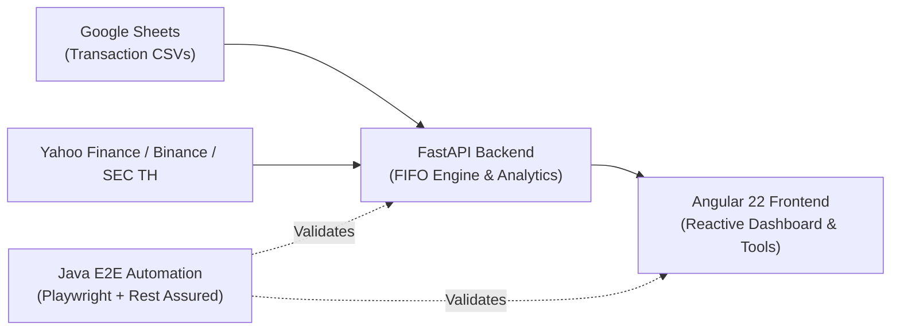

# SGSK-Wealth — Investment Portfolio Tracker & Wealth Analytics

<p align="center">
  
</p>

<p align="center">
  <strong>An enterprise-grade, multi-asset personal wealth tracking, First-In First-Out (FIFO) share lot accounting engine, unified portfolio analytics (allocation & performance), dividend cash flow tracker, and financial tools suite.</strong>
</p>

<p align="center">
  
  
  
  
  
  
  
  
  
  
  
  
  
  
</p>

---

## What This Repository Does

**SGSK-Wealth** is a production-grade wealth management monorepo designed to solve the complexity of multi-asset, multi-currency portfolio tracking and tax accounting. It automates **First-In, First-Out (FIFO)** transaction matching, reconciles cost bases, calculates unrealized and realized capital gains, and streams live market quotes and foreign exchange rates to deliver institutional-grade portfolio visibility.

The platform ingests trading transaction logs from Google Sheets, connects with external financial data providers (Yahoo Finance, Binance TH, SEC Thailand Mutual Fund APIs), and presents an intuitive, high-performance web interface for investors.



---

## Key Features & Functional Modules

### 📊 Executive Dashboard Landing Page
- **Root Landing View**: Direct landing at `/` with zero navigation friction.
- **Executive Net Worth Banner**: High-contrast headline portfolio valuation with dual-currency display (USD $\leftrightarrow$ THB), live FX badge, and a 4-card metric strip (*Invested Capital*, *Unrealized P&L*, *Realized Gains*, and *Projected Dividends*).
- **Asset Allocation Snapshot**: Interactive SVG Donut Chart with asset category legends and direct drill-down into detailed allocation analytics.
- **Top Movers Leaderboard**: Highlights top gainers and lagging positions with brand iconography and return indicators.
- **Forward Dividend Cashflow & Yield**: Trailing/forward annual dividend income, Yield on Cost (YOC %), and Market Yield %.
- **Provident Fund (PVD) / Portfolio Vitality**: Cumulative balance, employee vs. employer contribution split ratios, and one-click shortcut to the dedicated PVD screen on Holdings.
- **Recent Trade Activity**: Latest trade logs with badges (`BUY`, `SELL`, `EX-IN`, `EX-OUT`) and context-aware units.
- **Financial Tools Launchpad**: One-click shortcuts into the *Rebalance Planner*, *TVM Calculator*, and *Average Cost Simulator*.

### 🔒 Privacy Protection Mode
- **Instant Masking**: One-click toggle in the navigation header (state persisted in `localStorage`).
- **Selective Blurring**: Automatically blurs sensitive monetary figures (Net Worth, values, costs, proceeds, shares, dividends) using SVG/CSS filter backdrops.
- **Percentage Visibility**: Keeps performance percentages (`P/L %`, `Realized %`, `Yield on Cost %`, `Target %`, `Return %`) unblurred for safe public demonstrations or screen sharing.

### 💵 Dividend & Yield on Cost (YOC) Accounting
- **100% Automated Ingestion**: Fetches dividend distributions from Yahoo Finance (US/Thai equities, Bonds) and SEC Thailand (Mutual Funds).
- **Exact Ex-Date Share Accounting**: Evaluates historical transaction logs to reconstruct exact share balances held on ex-dividend dates ($T$):
  $$\text{Shares Held}(T) = \sum_{\text{Tx Date } < T} \text{Buy Quantity} - \sum_{\text{Tx Date } < T} \text{Sell Quantity}$$
- **Per-Asset Yield on Cost (YOC)**: Calculates true Yield on Cost without currency distortion across US Stocks, Thai Stocks, Mutual Funds, and Bonds.
- **Monthly Cashflow Timeline**: Stacked bar chart tracking monthly passive income segmented by asset category.
- **Distribution Ledger Modal**: Desktop table and mobile touch cards showing individual distributions, withholding taxes, and net payout amounts.

### 📈 Unified Portfolio Analytics (Overview, Allocation & Performance)
- **Unified Navigation Hub**: Consolidates Overview, Target Allocation, and Investment Performance into a single component (`app-analytics`).
- **Overview**: 5-card metric summary, asset distribution bars, top 5 holding concentrations, and top movers.
- **Target Asset Allocation**: Interactive Donut Chart, detailed category weighting table, click-to-filter class isolation with `← All Asset Classes` reset button, and USD/THB currency exposure analysis.
- **Investment Performance**: 5 summary KPI cards, timeframe presets (`YTD`, `1M`, `3M`, `6M`, `1Y`, `ALL`, custom date bounds), horizontal return bars by asset class, top 5 gainers/losers rankings, and keyboard-accessible symbol search autocomplete.

### 💼 Provident Fund (PVD) Management & Dedicated Holdings Screen
- **Holdings Mode Switcher**: Top-level segmented toggle on the Holdings view (`Market Holdings` $\leftrightarrow$ `Provident Fund (PVD)`) synchronized with the asset tab bar and direct Dashboard shortcut.
- **Executive PVD Hero**: Headline PVD balance, total return on cost, 4 KPI tiles (*Total Principal*, *Total Earnings*, *Employee Pool*, *Employer Pool*), and a 4-segment composition bar (*Employee Principal* `เงินสะสม`, *Employee Earnings* `ผลประโยชน์สะสม`, *Employer Matching* `เงินสมทบ`, and *Employer Earnings* `ผลประโยชน์สมทบ`).
- **Policy Weight Allocation & SEC Risk Spectrum**: Interactive SVG Donut Chart across sub-policies (`PVDSP500`, `PVDWEQ`, `PVDMPAEM`, `PVDMPINC`, `PVDMGLDH`, etc.) and an 8-level SEC Risk Spectrum (`RS1`–`RS8`) with value-weighted risk scoring and distribution buckets.
- **Sub-Policy Breakdown & SEC Factsheet Metadata**: Searchable and sortable sub-policy cards (`Value`, `Return`, `Principal`, `Units`, `Risk`) enriched via `/v1/pvd/factsheet/{proj_id}/policy` (`riskLevel`, `policyName`, `aimcType`, `aimcDescription`, `objective`, `pvdFundName`), unit counts, current NAV, and Employee vs. Employer pool tables.
- **Trading Feed Exemption**: Excluded from manual buy/sell feeds and transaction CSV exports since PVD represents balance snapshots rather than exchange trades.

### 📑 FIFO Share Lot Engine
- Matches buy and sell order queues strictly via First-In, First-Out principles.
- Computes open lots, acquisition dates, cost bases, and holding durations.
- **Mutual Fund Exchange Trades (`EX-OUT` & `EX-IN`)**: Supports connected fund switches (e.g. `From [K-CASH]` / `To [K-USA]`) and realized P/L tracking.

### 📜 Transaction History Ledger & CSV Exporter
- Consolidated unfiltered feed across all asset classes and trade types.
- **Context-Aware Asset Units**: Dynamically formats units:
  - **Cryptocurrency**: `coins` / `coin` (e.g. `+0.2500 coins`, `@ $98,400.00 / coin`).
  - **Mutual Funds & PVD**: `units` / `unit` (e.g. `10,335.6092 units`).
  - **Stocks**: `shares` / `share`.
- **Export to CSV**: Generates standard 5-column CSV (`Symbol,Date,Quantity,Price,Currency`) with signed quantities (`+` for BUY/EX-IN, `-` for SELL/EX-OUT), YYYY-MM-DD dates, and UTF-8 BOM encoding for seamless Excel compatibility.

### 🧮 Investor Tools & Simulators Hub
- **Portfolio Rebalance Planner**:
  - Grouped target allocation model across all asset classes.
  - **Standard Rebalance**: Computes exact buy/sell deltas and turnover to rebalance existing capital.
  - **No-Sell / Contribution Inflow Solver**: Solves the exact minimum cash inflow ($\Delta C_{\text{min}}$) needed based on the anchor overweight asset so zero assets are sold, with deficit waterfall allocation for custom deposit budgets.
  - Filter-aware dynamic KPI cards, checklist order summaries, and distribution presets (`Equal Weight`, `Set Current`, `Normalize`).
- **Time Value of Money (TVM) Calculator**:
  - **5 Flexible Solve Modes**: Future Value ($FV$), Periodic Payment ($PMT$), Starting Principal ($PV$), Number of Periods ($N$), and Annual Return ($Rate$).
  - **8 Compounding Frequencies**: Daily ($m=365$), Weekly ($m=52$), Biweekly ($m=26$), Semimonthly ($m=24$), Monthly ($m=12$), Quarterly ($m=4$), Semiannually ($m=2$), and Annually ($m=1$).
  - **Portfolio Value Sync**: Synchronize starting principal from live portfolio market values or cost basis with multi-asset category chips.
  - **Interactive Growth Chart**: Reactive SVG curve with crosshair guidelines, floating tooltips, and line/area fill toggles.
  - **Expandable Schedule**: Year-by-year financial table with deposits, annual interest, cumulative interest, and ending balances with privacy masking.
- **Average Cost Basis Calculator**:
  - Multi-order forward Buy / Sell simulation with brokerage commission fees.
  - Target Average Cost Solver calculating required shares and capital to achieve a desired cost basis.

### 📱 Responsive Touch UX & Tablet Optimization
- **Native Bottom Navigation Dock**: Docked bottom navigation on mobile/tablet devices with active indicator pills and instant switching across 6 primary views (`Dashboard`, `Holdings`, `Analytics`, `Dividends`, `Transactions`, `Tools`).
- **Desktop Floating Capsule Navigation**: Streamlined header navigation capsule for widescreen desktop layouts.

---

## Detailed Tech Stacks

### 1. Frontend Web Application (`frontend/`)

| Technology | Version / Spec | Purpose & Architectural Role |
|:---|:---|:---|
| **[Angular](https://angular.dev/)** | `22.2+` | Modern web framework utilizing standalone components, reactive Signals, and Computed Signals for performant, zoneless-ready reactivity. |
| **[Tailwind CSS](https://tailwindcss.com/)** | `v4.3+` | Next-generation CSS framework utilizing `@theme` tokens, modern design system, and custom utilities. |
| **[TypeScript](https://www.typescriptlang.org/)** | `~6.0.0` | Strict static typing, interfaces, and domain models across all components, services, and utilities. |
| **[Vitest](https://vitest.dev/)** | `4.1+` | Ultra-fast unit testing runner paired with `jsdom` executing **327 unit tests across 33 test suites** in under 7 seconds. |
| **[Node.js](https://nodejs.org/)** | `26 LTS` | Runtime environment and build toolchain. |
| **Design System** | Custom Tokens | High-contrast financial UI, SVG data visualizations, dark/light theme switching, and privacy blur filters. |

### 2. Backend API & Analytics Service (`backend/`)

| Technology | Version / Spec | Purpose & Architectural Role |
|:---|:---|:---|
| **[Python](https://www.python.org/)** | `3.10+` / `3.11` / `3.14` | High-level language powering mathematical algorithms, FIFO matching, and financial simulations. |
| **[FastAPI](https://fastapi.tiangolo.com/)** | `0.162+` | High-performance asynchronous REST API framework with automatic OpenAPI documentation. |
| **[Pydantic](https://docs.pydantic.dev/)** | `v2.14+` | Robust request/response validation, schema definitions, and serialization models. |
| **[HTTPX](https://www.python-httpx.org/)** | `0.28+` | Asynchronous HTTP client for querying external quote APIs (Yahoo Finance, Binance TH, SEC Thailand). |
| **In-Memory TTL Cache** | Custom | High-speed cache layer minimizing external network requests and respecting third-party rate limits. |
| **[Pytest](https://docs.pytest.org/)** | `9.2+` | Python test runner configured with `pytest-asyncio` and `pytest-cov`, enforcing **$\ge 80\%$ test coverage (currently 91%)**. |
| **[Ruff](https://astral.sh/ruff)** | `0.17+` | Blazing-fast Python linter enforcing strict PEP 8 and code hygiene standards. |
| **[Mypy](https://mypy-lang.org/)** | `2.4+` | Strict static type analysis ensuring zero type ambiguities across backend services. |

### 3. End-to-End Automation Suite (`e2e/`)

| Technology | Version / Spec | Purpose & Architectural Role |
|:---|:---|:---|
| **[Java](https://openjdk.org/)** | `JDK 25+` | Enterprise runtime powering the standalone end-to-end regression and verification suite. |
| **[Spring Boot](https://spring.io/projects/spring-boot)** | `4.1+` | IoC container (`@SpringBootTest`), externalized YAML configuration (`@ConfigurationProperties`), and `@ScenarioScope` dependency injection via `cucumber-spring`. |
| **[Playwright for Java](https://playwright.dev/java/)** | `1.64+` | Modern web automation engine driving Chromium headless browsers with native network route interception. |
| **[Rest Assured](https://rest-assured.io/)** | `6.3+` | Fluent REST API automation testing contract compliance, response codes, latencies, and payload schemas. |
| **[Cucumber-JVM](https://cucumber.io/)** | `8.0+` | Behavior-Driven Development (BDD) engine executing business-readable Gherkin feature specifications (`.feature`). |
| **[JUnit](https://junit.org/)** | `6.1+` | Modern JUnit Platform Suite engine running Cucumber scenarios seamlessly via Maven Surefire. |
| **[Allure Report](https://allurereport.org/)** | `3.1+` | Rich interactive HTML living documentation generating execution scorecards, step timelines, and failure screenshots. |
| **[Apache Maven](https://maven.apache.org/)** | `3.9+` | Robust build lifecycle management, dependency resolution, and test plugin execution (`pom.xml`). |
| **Mock Backend Server** | Built-in | Zero-dependency embedded `HttpServer` serving deterministic responses for standalone API testing. |

### 4. Multi-Agent Skills & Domain Knowledge (`.agent/skills/`)

`.agent/skills/` serves as the single source of truth shared across **Antigravity**, **OpenAI Codex** (`AGENTS.md`), and **Claude Code** (`CLAUDE.md` + `.claude/skills` adapter):

| Asset | Purpose |
|:---|:---|
| **`dividend-payments`** | Financial domain skill with codified rules for U.S. (SEC T+1) and Thai (SET T+2) equity settlement cutoffs, withholding tax rules (U.S. 15% DTA / 30%, Thai 10% / BOI 0%), stock dividends, and corporate disclosures. |
| **`cucumber-bdd-best-practices`** | Enterprise BDD & Gherkin authoring standards, Page Object Model architecture, multi-dimensional tagging taxonomy, and automated strict Gherkin linting (`validate_gherkin.py`). |
| **`fifo-cost-basis`** | First In, First Out (FIFO) inventory valuation and portfolio cost-basis accounting rules (lot matching, acquisition fees, FIFO vs. Average Cost, `share_lot_service.py`). |
| **`sec-open-apis`** | Thailand SEC Open Data API reference covering Mutual Funds (`/v2/fund/*`, 21 endpoints), Provident Funds (`/v1/pvd/factsheet/*`, 15 endpoints), cursor pagination, `204` handling, and `NavService` integration. |

### 5. Unified CI/CD Pipeline (`.github/workflows/ci.yml`)

A unified GitHub Actions workflow configured for `push`, `pull_request`, and `workflow_dispatch`:
1. **`backend-qa`**: Python 3.11 environment running Ruff linter, Mypy type checker, and Pytest with code coverage artifact upload.
2. **`frontend-qa`**: Node.js 26 LTS environment running Vitest unit tests (327 tests) and production Angular build.
3. **`e2e-automation`**: Runs after both QA jobs (`needs: [backend-qa, frontend-qa]`), sets up JDK 25 and Node.js 26, downloads Playwright Chromium, executes all 161 E2E scenarios (61 `@api` + 100 `@ui` across 16 feature files), generates the Allure HTML report, and stores `allure-e2e-report` build artifacts.

---

## Monorepo Project Structure

```
SGSK-Wealth/
├── backend/                    # Python FastAPI Backend
│   ├── main.py                 # FastAPI application entry point & CORS configuration
│   ├── config/                 # Settings, API keys, and Google Sheet GID mappings
│   ├── models/                 # Pydantic domain models (Transaction, Portfolio, Tools, Allocation)
│   ├── routers/                # API routers (share-lot, price, nav, portfolio, tools, icon)
│   ├── services/               # Core business logic (FIFO engine, valuation, dividend, tools)
│   ├── tests/                  # Pytest unit tests (110 tests, >=80% coverage enforced)
│   ├── pyproject.toml          # Ruff, Mypy, and Pytest coverage configuration
│   ├── pytest.ini              # Pytest runtime configuration
│   ├── requirements.txt        # Production dependencies
│   ├── requirements-dev.txt    # QA and development dependencies
│   └── vercel.json             # Vercel serverless function configuration (@vercel/python)
│
├── frontend/                   # Angular 22 Single Page Application
│   ├── src/
│   │   ├── app/
│   │   │   ├── components/     # UI feature components (dashboard, holdings, pvd-holdings, analytics, dividend, tools)
│   │   │   ├── config/         # Tab configurations and asset class constants
│   │   │   ├── interceptors/   # HTTP interceptors (API key injection, error handling)
│   │   │   ├── models/         # TypeScript interfaces and domain models
│   │   │   ├── services/       # Angular services (portfolio, share-lot, price, dividend, tools)
│   │   │   └── utils/          # Formatting, TVM compounding, and calculation helpers
│   │   ├── public/             # Static assets, SVG icons, and favicons
│   │   ├── styles.css          # Global Tailwind CSS tokens and theme styles
│   │   └── main.ts             # Application bootstrapping
│   ├── angular.json            # Angular CLI configuration
│   ├── proxy.conf.json         # Local dev proxy configuration (routes /api/backend -> :8000)
│   ├── vitest.config.ts        # Vitest unit testing configuration
│   ├── package.json            # Frontend dependencies & build scripts
│   └── vercel.json             # Vercel SPA routing and proxy rewrite rules
│
├── e2e/                        # Standalone Spring Boot E2E Test Suite
│   ├── pom.xml                 # Maven build file (Spring Boot, Playwright, Rest Assured, Cucumber, Allure)
│   └── src/test/
│       ├── java/com/sgsk/wealth/e2e/
│       │   ├── config/         # Spring Boot @SpringBootTest, @CucumberContextConfiguration & E2eProperties
│       │   ├── runner/         # JUnit 5 @Suite Cucumber test runner
│       │   ├── context/        # @ScenarioScope Spring dependency injection context
│       │   ├── hooks/          # Lifecycle hooks (Playwright setup, screenshot capture)
│       │   ├── support/        # Spring singleton beans (PlaywrightManager, ServerManager, MockBackendServer, ApiRouteMocker)
│       │   ├── pages/          # @ScenarioScope Playwright Page Object Model (POM) beans
│       │   └── steps/          # Rest Assured API and Playwright UI step definitions
│       └── resources/
│           ├── features/api/   # REST API Gherkin specifications (01..05 .feature files)
│           ├── features/ui/    # End-to-end UI Gherkin specifications (01..11 .feature files)
│           ├── fixtures/       # Deterministic JSON mock payloads
│           ├── application.yml # Spring Boot externalized E2E test configuration
│           ├── junit-platform.properties
│           └── allure.properties
│
├── .agent/skills/              # Single source of truth for AI agent skills (dividend-payments, cucumber-bdd-best-practices, fifo-cost-basis, sec-open-apis)
├── .claude/                    # Claude Code adapter (skills symlink -> ../.agent/skills)
├── .github/workflows/          # CI/CD Workflows
│   └── ci.yml                  # Unified monorepo pipeline (Backend QA, Frontend QA, Java E2E)
├── scripts/
│   ├── dev.mjs                 # Concurrent cross-platform runner for backend & frontend
│   └── setup-agents.mjs        # Cross-platform .claude/skills -> .agent/skills linker
├── package.json                # Root monorepo workspace configuration & unified scripts
├── AGENTS.md                   # Unified QA & engineering standards (Antigravity & Codex)
└── CLAUDE.md                   # Claude Code entrypoint (@AGENTS.md + Claude-specific rules)
```

---

## Getting Started

### Prerequisites

Ensure the following tools are installed on your workstation:
- **Node.js**: `v24+` or `v26 LTS` (Recommended: `v26.13+`)
- **npm**: `v10+` or `v11+`
- **Python**: `3.10+`, `3.11+` or `3.14`
- **Java**: `JDK 25+`
- **Apache Maven**: `3.9+`

### 1. Installation

Clone the repository and install root and frontend dependencies:

```bash
git clone https://github.com/vipatpolk/SGSK-Wealth.git
cd SGSK-Wealth
npm install
```

Set up the Python virtual environment for the backend:

```bash
cd backend
python -m venv .venv

# On Windows:
.venv\Scripts\activate
# On macOS / Linux:
source .venv/bin/activate

pip install -r requirements.txt
pip install -r requirements-dev.txt
cd ..
```

Install Playwright Chromium browser binaries for the E2E suite:

```bash
mvn -f e2e/pom.xml exec:java -Dexec.classpathScope=test -Dexec.mainClass=com.microsoft.playwright.CLI -Dexec.args="install chromium"
```

---

## Local Development Workflow

Start **both** the FastAPI backend and Angular frontend concurrently with a single command from the monorepo root:

```bash
npm start
# or
npm run dev
```

- **Frontend Application**: `http://localhost:4200` (automatically proxies `/api/backend/*` to `:8000`)
- **Backend API**: `http://127.0.0.1:8000` (interactive OpenAPI Swagger docs at `http://127.0.0.1:8000/docs`)

To start services individually:

```bash
npm run dev:backend    # Runs only FastAPI on http://127.0.0.1:8000
npm run dev:frontend   # Runs only Angular on http://localhost:4200
```

---

## Testing & Quality Assurance

SGSK-Wealth enforces strict quality standards before any code is committed. Unified scripts are provided at the root:

| Command | Description | Tech Stack |
|:---|:---|:---|
| **`npm run check`** | Run complete pre-commit QA suite (Gherkin lint, backend lint/test, frontend test/build) | Monorepo Orchestration |
| **`npm run lint:gherkin`** | Validate all `.feature` files with `validate_gherkin.py --strict` | Python Gherkin Linter |
| **`npm run lint:backend`** | Run Ruff linter and Mypy static type checker on `backend/` | Ruff & Mypy |
| **`npm run test:backend`** | Run Pytest unit test suite with coverage enforcement ($\ge 80\%$) | Pytest & Coverage |
| **`npm run test:frontend`** | Run Vitest unit test suite (327 unit tests across 33 suites) | Vitest & jsdom |
| **`npm run test:e2e`** | Run complete Java E2E test suite (**161 scenarios**: 61 API + 100 UI) | Playwright, Rest Assured & Cucumber |
| **`npm run test:e2e:ui`** | Run only Playwright web UI browser automation scenarios (**100 `@ui` scenarios**) | Playwright & Cucumber-JVM |
| **`npm run test:e2e:api`** | Run only Rest Assured API automation scenarios (**61 `@api` scenarios**) | Rest Assured & Cucumber-JVM |
| **`npm run test:e2e:smoke`** | Run critical path navigation and dashboard smoke scenarios (**79 `@smoke` scenarios**) | Playwright & Cucumber-JVM |
| **`npm run test:e2e:report`** | Generate and open the interactive Allure HTML report locally | Allure Maven Plugin |
| **`npm run build`** | Compile production-ready Angular bundle with budget validation | Angular CLI |

---

## Vercel Deployment

This monorepo supports independent or linked deployments on [Vercel](https://vercel.com/):

1. **Backend Deployment**:
   - Link project to the repository
   - Set **Root Directory** to `backend`
   - Configured via `backend/vercel.json` using the `@vercel/python` runtime
2. **Frontend Deployment**:
   - Link project to the repository
   - Set **Root Directory** to `frontend`
   - Configured via `frontend/vercel.json` with single-page app rewrite routing and backend proxy rules

---

## License

© 2026 SGSK Wealth — Investment Portfolio & Wealth Management System. Private and proprietary.
