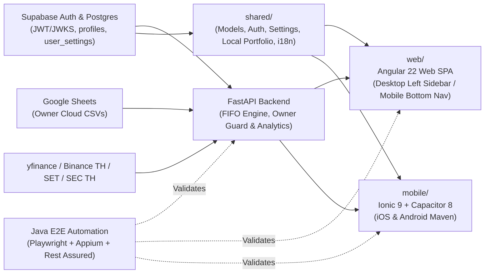

# SGSK-Wealth — Investment Portfolio Tracker & Wealth Analytics

<p align="center">
  
</p>

<p align="center">
  <strong>An enterprise-grade, multi-asset personal wealth tracking, First-In First-Out (FIFO) share lot accounting engine, unified portfolio analytics (allocation & performance), dividend cash flow tracker, financial tools suite, and native iOS/Android mobile app.</strong>
</p>

<p align="center">
  
  
  
  
  
  
  
  
  
  
  
  
  
  
  
  
  
  
  
  <a href="https://vipatpolk.github.io/SGSK-Wealth/"></a>
</p>

---

## What This Repository Does

**SGSK-Wealth** is a production-grade wealth management monorepo designed to solve the complexity of multi-asset, multi-currency portfolio tracking and tax accounting. It automates **First-In, First-Out (FIFO)** transaction matching, reconciles cost bases, calculates unrealized and realized capital gains, and streams live market quotes and foreign exchange rates across both a **Web SPA (`web/`)** and a **Native iOS & Android Mobile App (`mobile/`)** powered by a shared TypeScript core (`shared/`).

The platform supports **multi-tier authentication and portfolio data isolation** via **Supabase Auth** (Email/Password, Google OAuth 2.0 PKCE, and Account Linking): the authorized owner account syncs live trading transaction logs from **Cloud Google Sheets**, while Guest and standard signed-in users operate a full-featured **On-Device Local Portfolio Workspace** enriched with live market prices and dividends from external financial data providers (Yahoo Finance via `yfinance`, Binance TH, SET Thailand, SEC Thailand Mutual Fund & PVD APIs).



---

## Key Features & Functional Modules

### 🔐 Authentication, Account Linking & Cloud/Local Portfolio Isolation
- **Supabase Auth (Email/Password & Google OAuth 2.0 PKCE)**: Sign in or sign up with Email/Password or Google OAuth across Web (`/auth/callback`) and Native Mobile (`com.sgsk.wealth.mobile://auth/callback` via Chrome Custom Tabs / `SFSafariViewController`).
- **Sign-In Screen Language Toggle (`EN` / `ไทย`)**: Instant bilingual switcher directly on the Web Sign-In screen and Mobile Auth modal that translates all authentication forms immediately, persists in `localStorage` / Capacitor `Preferences`, carries into Guest mode, and seeds Supabase `user_settings` on first registration.
- **Bidirectional Account Linking**: Signed-in users can link or unlink their Google identity and set an email password directly from the **User Settings** modal, with PKCE callback recovery automatically reopening User Settings upon completion.
- **Strict Owner Cloud Guard & On-Device Local Portfolio Workspace**:
  - **Authorized Owner (`can_view_cloud_portfolio = true`)**: Verified server-side via Supabase JWT/JWKS (`require_owner_cloud_portfolio`) and Postgres RLS; automatically loads cloud Google Sheets portfolio data with local portfolio controls hidden.
  - **Guest & Standard Users (`Local Portfolio Workspace`)**: Zero cloud portfolio API calls; provides full on-device transaction CRUD, CSV import/export, one-click sample portfolio loader, client-side FIFO lot matching, and live market price & dividend enrichment.

### 🧭 Adaptive Navigation & Top-Right User Menu
- **Desktop Left Sidebar + Slim Top Utility Bar (`>= 1201px`)**:
  - Fixed left sidebar (`248px` expanded, collapsible to a `72px` icon-only rail via `#sidebar-collapse-btn` persisted in `localStorage`) housing the brand identity and 6 vertical workspace links (`Dashboard`, `Holdings`, `Analytics`, `Dividends`, `Transactions`, `Tools`).
  - Slim `56px` sticky top utility bar displaying the active workspace breadcrumb on the left and the `USD/THB` exchange rate pill, Privacy Mode toggle (`#privacy-toggle-btn`), and top-right User Menu (`#user-menu-btn`) on the right.
- **Mobile & Tablet Responsive Dock (`<= 1200px` Web & Native iOS/Android)**: Single-DOM responsive layout that transforms into a sticky top header and a fixed 6-tab bottom dock without duplicating DOM IDs.
- **Unified User Settings Modal**: Accessible from the top-right User Menu on both Web and Mobile, consolidating Display Currency (`THB` / `USD`), Language (`English` / `ไทย`), Appearance Theme (`Dark` / `Light`), Privacy Mode switch, real-time Supabase preference sync status, display name management, and connected sign-in methods.

### 📊 Executive Dashboard Landing Page
- **Root Landing View**: Direct landing at `/` with zero navigation friction.
- **Executive Net Worth Banner**: High-contrast headline portfolio valuation with dual-currency display (USD $\leftrightarrow$ THB), live FX badge, and a 4-card metric strip (*Invested Capital*, *Unrealized P&L*, *Realized Gains*, and *Projected Dividends*).
- **Asset Allocation Snapshot**: Interactive SVG Donut Chart with asset category legends and direct drill-down into detailed allocation analytics.
- **Top Movers Leaderboard**: Highlights top gainers and lagging positions with brand iconography and return indicators.
- **Forward Dividend Cashflow & Yield**: Trailing/forward annual dividend income, Yield on Cost (YOC %), and Market Yield %.
- **Provident Fund (PVD) / Portfolio Vitality**: Cumulative balance, employee vs. employer contribution split ratios, and one-click shortcut to the dedicated PVD screen on Holdings.
- **Recent Trade Activity**: Latest trade logs with badges (`BUY`, `SELL`, `EX-IN`, `EX-OUT`) and context-aware units.
- **Financial Tools Launchpad**: One-click shortcuts into the *Rebalance Planner*, *TVM Calculator*, and *Average Cost Simulator*.

### 🔒 Privacy Protection Mode
- **Instant Masking**: One-click toggle in the navigation header (persisted in `localStorage` on web and Capacitor `Preferences` on mobile).
- **Selective Blurring**: Automatically blurs sensitive monetary figures (Net Worth, values, costs, proceeds, shares, dividends) using SVG/CSS filter backdrops.
- **Percentage Visibility**: Keeps performance percentages (`P/L %`, `Realized %`, `Yield on Cost %`, `Target %`, `Return %`) unblurred for safe public demonstrations or screen sharing.

### 🌐 Bilingual Localization (`EN` / `TH`)
- **Sign-In & User Settings Language Toggle**: Instant switch (`EN` / `ไทย`) available directly on the Sign-In screen and inside the User Settings modal, persisted under `sgsk_wealth_lang` and synced to Supabase `user_settings` for authenticated users, with synchronized `<html lang>` and Gregorian CE date formatting (`th-TH-u-ca-gregory` / `en-US`).
- **Dynamic Upstream Security Names**: Resolves English (`name`) and Thai (`nameTh`) security names dynamically from SEC Open APIs and market data feeds (`NavService`, `PriceService`) with zero hardcoded symbol-to-name maps.
- **Market-Aware Display**: Thai equities (`.BK`), Mutual Funds (`.FUND`), and Provident Funds display in the active language (`TH` or `EN`), while non-Thai assets (`us-stock`, `crypto`, `bond`) remain in English across all views, dropdowns, and autocompletes.

### 📄 Fund Fact Sheet Viewer (Mutual Funds & PVD)
- **Universal In-App Modal**: Accessible via the Fact Sheet button beside fund names on Web Holdings/Dashboard cards and inside the Ionic `<ion-modal>` on Mobile.
- **Unified SEC Open API Aggregation**: Powered by `GET /api/backend/nav/factsheet`, aggregating SEC `/v2/fund/factsheet/*` (Mutual Funds) and `/v1/pvd/factsheet/{proj_id}/*` (Provident Funds) with client-side caching, multi-period deduplication, and strict sub-policy scoping.
- **Complete Fact Sheet Sections**: Displays Policy & Overview, SEC Risk Spectrum (`RS1`–`RS8`), Calendar/Trailing Performance & Benchmark, Key Risk Statistics, Fees & Dealing Conditions, Asset Allocation, Top 5 Holdings, and direct links to the official SEC Fact Sheet PDF and AMC fund page.

### 💵 Dividend & Yield on Cost (YOC) Accounting
- **100% Automated Ingestion**: Fetches complete historical dividend distributions via `yfinance` (`period="max"` for US/Thai equities & Bonds) and SEC Thailand Open APIs (Mutual Funds).
- **Exact Ex-Date Share Accounting**: Evaluates historical transaction logs to reconstruct exact share balances held on ex-dividend dates ($T$):
  $$\text{Shares Held}(T) = \sum_{\text{Tx Date } < T} \text{Buy Quantity} - \sum_{\text{Tx Date } < T} \text{Sell Quantity}$$
- **Per-Asset Yield on Cost (YOC)**: Calculates true Yield on Cost without currency distortion across US Stocks, Thai Stocks, Mutual Funds, and Bonds.
- **Monthly Cashflow Timeline & Distribution Ledger**: Visual monthly breakdown and filterable dividend payout ledger.

### 📈 Unified Portfolio Analytics (Overview, Allocation & Performance)
- **Unified Navigation Hub**: Consolidates Overview, Target Allocation, and Investment Performance across both Web (`app-analytics`) and Mobile (`MobileAnalyticsPage`).
- **Overview**: Summary metric cards, asset distribution bars, top holding concentrations, and top movers.
- **Target Asset Allocation**: Interactive Donut Chart, category weighting table, click-to-filter class isolation, and USD/THB currency exposure analysis.
- **Investment Performance**: Summary KPI cards, timeframe presets (`YTD`, `1M`, `3M`, `6M`, `1Y`, `ALL`, custom date bounds), asset class return breakdown, and top gainers/losers rankings.

### 💼 Provident Fund (PVD) Management & Dedicated Holdings Screen
- **Holdings Mode Switcher**: Segmented toggle on Holdings (`Market Holdings` $\leftrightarrow$ `Provident Fund (PVD)`) synchronized with asset tabs and Dashboard shortcuts.
- **Executive PVD Hero**: Headline PVD balance, total return on cost, pool composition (*Employee Principal*, *Employee Earnings*, *Employer Matching*, *Employer Earnings*), and SEC Risk Spectrum (`RS1`–`RS8`).
- **Sub-Policy Breakdown & SEC Factsheet Metadata**: Sub-policy cards enriched via `/v1/pvd/factsheet/{proj_id}/policy` with unit counts, current NAV, and factsheet modal links.

### 📑 FIFO Share Lot Engine & Transaction Ledger
- Matches buy and sell order queues strictly via First-In, First-Out principles, including Mutual Fund Exchange Trades (`EX-OUT` & `EX-IN`).
- Context-aware asset units (`coins` for Crypto, `units` for Mutual Funds/PVD, `shares` for Stocks) and UTF-8 BOM CSV export.

### 🧮 Investor Tools & Simulators Hub
- **Portfolio Rebalance Planner**: Standard Rebalance and No-Sell / Contribution Inflow Solver ($\Delta C_{\text{min}}$).
- **Time Value of Money (TVM) Calculator**: 5 solve modes ($FV$, $PMT$, $PV$, $N$, $Rate$), 8 compounding frequencies, portfolio value sync, interactive SVG growth curve, and expandable schedule.
- **Average Cost Basis Calculator**: Multi-order forward Buy / Sell simulation with commission fees and Target Average Cost Solver.

### 📱 Native iOS & Android Mobile App (`mobile/`)
- **Ionic 9 Standalone Shell**: 6-tab bottom navigation (`Dashboard`, `Holdings`, `Analytics`, `Dividends`, `Transactions`, `Tools`), platform-adaptive Ionic `mode` (`'md'` on Android, `'ios'` on iOS/Web), pull-to-refresh (`<ion-refresher>`), native-styled segment switches, searchable cards, Android hardware back-button handling, and `<ion-modal>` sheet drawers (SEC factsheet, dividend ledger, symbol selectors).
- **Web Responsive Feature Parity**: Shared `<app-symbol-icon>`, `<app-loading-screen>`, and `<app-date-range-picker>` components from `@shared/*`, Interactive SVG Allocation Donut, Executive PVD analytics, Forward/Reverse Average Cost simulator, No-Sell/Standard Rebalance planner, and TVM trajectory chart.
- **Capacitor 8 Native Bridge**: Integrated `@capacitor/haptics`, `@capacitor/status-bar`, `@capacitor/splash-screen`, `@capacitor/preferences`, and `@capacitor/app` with platform-aware API routing (`10.0.2.2:8000` on Android emulator, `127.0.0.1:8000` on iOS simulator, `/api/backend` on web dev proxy).
- **Maven Android Build (`mobile/android/pom.xml`)**: Packages the Capacitor Android `.apk` using Apache Maven + Android SDK (`aapt2`, `javac`, `d8`, `zipalign`, `apksigner`) without Gradle.

---

## Detailed Tech Stacks

### 1. Shared Core Library (`shared/`)

| Technology | Version / Spec | Purpose & Architectural Role |
|:---|:---|:---|
| **TypeScript** | `~6.0.0` | Platform-agnostic domain models, shared UI components (`SymbolIconComponent`, `LoadingScreenComponent`, `DateRangePickerComponent`), financial math (`calculator`, `rebalance`, `tvm`, `format`, `symbol-icon`, `csv-exporter`, client-side FIFO `local-portfolio`), bilingual i18n dictionaries, and reactive pipes (`| t`, `| ldate`). |
| **Supabase JS SDK** | `^2.103.3` | Shared `AuthService` (Email/Password, Google OAuth PKCE, manual identity linking/unlinking, cold-start deep-link callback capture) and `UserSettingsService` (real-time preference sync with `public.user_settings`). |
| **Angular DI Tokens** | `22.2+` | `API_BASE_URL`, `MAX_BATCH_SIZE`, and `SUPABASE_CONFIG` injection tokens decouple HTTP & Auth services (`PortfolioService`, `DividendService`, `PriceService`, `NavService`, `ShareLotService`, `ToolsService`, `AuthService`, `UserSettingsService`, `LocalPortfolioService`) from web vs. native mobile hosts. |

### 2. Web Single Page Application (`web/`)

| Technology | Version / Spec | Purpose & Architectural Role |
|:---|:---|:---|
| **[Angular](https://angular.dev/)** | `22.2+` | Modern web framework utilizing standalone components, reactive Signals, Computed Signals, collapsible desktop sidebar navigation (`>= 1201px`), and responsive bottom dock (`<= 1200px`). |
| **[Tailwind CSS](https://tailwindcss.com/)** | `v4.3+` | Next-generation CSS framework utilizing `@theme` tokens, dark/light themes, and privacy blur filters. |
| **[Vitest](https://vitest.dev/)** | `4.1+` | Fast unit testing runner paired with `jsdom` executing **381 unit tests across 40 test suites**. |

### 3. Native iOS & Android Mobile App (`mobile/`)

| Technology | Version / Spec | Purpose & Architectural Role |
|:---|:---|:---|
| **[Angular](https://angular.dev/)** | `22.2+` | Standalone component architecture sharing all domain logic from `@shared/*`. |
| **[Ionic Framework](https://ionicframework.com/)** | `9.0+` | Native-adaptive iOS & Android UI components (`@ionic/angular` standalone, `ionicons` `8.1+`). |
| **[Capacitor](https://capacitorjs.com/)** | `8.6+` | Native iOS (`mobile/ios/`) & Android (`mobile/android/`) container and plugins (`App`, `Browser`, `Haptics`, `Preferences`, `SplashScreen`, `StatusBar`). |
| **[Apache Maven](https://maven.apache.org/)** | `3.9+` | Android APK build lifecycle (`mobile/android/pom.xml`) resolving AndroidX & Cordova AARs via Google Maven and packaging `.apk` via `build-apk.mjs`. |
| **[Vitest](https://vitest.dev/)** | `4.1+` | Mobile component & Capacitor service unit tests (**23 unit tests across 10 test suites** in `mobile/src/app/**/*.spec.ts`). |

### 4. Backend API & Analytics Service (`backend/`)

| Technology | Version / Spec | Purpose & Architectural Role |
|:---|:---|:---|
| **[Python](https://www.python.org/)** | `3.10+` / `3.11` / `3.14` | High-level language powering mathematical algorithms, FIFO matching, and financial simulations. |
| **[FastAPI](https://fastapi.tiangolo.com/)** | `0.115+` | Asynchronous REST API framework with OpenAPI docs, Pydantic v2 validation, and Supabase JWT/JWKS owner authorization (`require_owner_cloud_portfolio`). |
| **[yfinance](https://ranaroussi.github.io/yfinance/)** | `1.8+` | Async-offloaded `YFinanceClient` adapter (`curl_cffi` TLS impersonation, `<tempdir>/py-yfinance` serverless cache config, bounded concurrency) for stock quotes, FX rates, crypto display names, and full (`max`) dividend history. |
| **[HTTPX](https://www.python-httpx.org/)** | `0.28+` | Asynchronous HTTP client for Google Sheets, Supabase Auth/REST verification, Binance TH, SET listed company metadata, and SEC Thailand Open APIs. |
| **[Pytest](https://docs.pytest.org/) / [Ruff](https://astral.sh/ruff) / [Mypy](https://mypy-lang.org/)** | `9.2+` / `0.17+` / `2.4+` | **154 unit tests** (`88.42%` coverage) with $\ge 80\%$ coverage enforcement, strict linting, and static typing. |

### 5. End-to-End Automation Suite (`e2e/`)

| Technology | Version / Spec | Purpose & Architectural Role |
|:---|:---|:---|
| **[Java](https://openjdk.org/)** | `JDK 25+` | Enterprise runtime powering the unified E2E regression suite. |
| **[Spring Boot](https://spring.io/projects/spring-boot)** | `4.1+` | IoC container (`@SpringBootTest`), externalized YAML configuration (`E2eProperties`), and `@ScenarioScope` DI via `cucumber-spring`. |
| **[Playwright for Java](https://playwright.dev/java/)** | `1.64+` | Web UI browser automation driving Chromium with network route interception (`@web`). |
| **[Appium Java Client](https://appium.io/)** | `11.0+` | Native iOS (`XCUITestOptions`) & Android (`UiAutomator2Options`) automation with Capacitor WebView switching and local platform-mode WebView fallback (`@mobile`, `@android`, `@ios`). |
| **[Rest Assured](https://rest-assured.io/)** | `6.3+` | Fluent REST API contract testing (`@api`). |
| **[Cucumber-JVM](https://cucumber.io/) & [Allure](https://allurereport.org/)** | `8.0+` / `3.1+` | BDD Gherkin execution across **25 feature files** organized by target and business function with `AllureStepEvidencePlugin` attaching step-level Web/Mobile screenshots (`image/png`) and API JSON payloads (`application/json`) directly inside every executed step. |

### 6. CI/CD Pipelines (`.github/workflows/`)

- **[`ci.yml`](.github/workflows/ci.yml)**: Automated push/PR/manual pipeline running `security-scan` (Gitleaks), `backend-qa` (Ruff, Mypy, Pytest), `frontend-qa` (Web Vitest + build), `mobile-qa` (Mobile Vitest + build), `e2e-automation` (Java Playwright + Rest Assured + Allure), and `publish-allure-report` to [GitHub Pages](https://vipatpolk.github.io/SGSK-Wealth/).
- **[`mobile-build.yml`](.github/workflows/mobile-build.yml)**: Dedicated manual `workflow_dispatch` workflow (`platform`: `all` | `android` | `ios`, `build_type`: `debug` | `release`) that builds and uploads the **Android `.apk`** (via Maven + Android SDK) and **iOS `.ipa`** (via Xcode `xcodebuild`).

---

## Monorepo Project Structure

```text
SGSK-Wealth/
├── backend/                    # Python FastAPI Backend
│   ├── main.py                 # FastAPI application entry point & CORS configuration
│   ├── config/                 # Settings, API keys, and Google Sheet GID mappings
│   ├── models/                 # Pydantic domain models
│   ├── routers/                # API routers (auth, share-lot, price, nav, portfolio, tools, icon)
│   ├── services/               # Core business logic (FIFO engine, valuation, dividend, nav/factsheet, tools)
│   ├── utils/                  # Shared HTTP client, Supabase JWT/JWKS verifier, yfinance adapter, TTL/singleflight cache, auth & format helpers
│   ├── tests/                  # Pytest unit tests (154 tests, >=80% coverage enforced)
│   ├── pyproject.toml          # Ruff, Mypy, and Pytest coverage configuration
│   └── vercel.json             # Vercel serverless function configuration (@vercel/python)
│
├── shared/                     # Shared Core Library (@shared/*)
│   ├── package.json            # @sgsk-wealth/shared workspace package
│   └── src/
│       ├── components/         # Shared UI components (SymbolIconComponent, LoadingScreenComponent, DateRangePickerComponent)
│       ├── config/             # asset.constants.ts, api-config.token.ts, supabase-config.token.ts
│       ├── i18n/               # Bilingual EN / TH dictionaries with full key parity
│       ├── models/             # TypeScript interfaces and domain models (portfolio, dividend, auth, user-settings)
│       ├── pipes/              # Reactive localization & Gregorian date pipes (| t, | ldate)
│       ├── services/           # Angular HTTP, Supabase Auth, UserSettings, LocalPortfolio & i18n services
│       ├── utils/              # Formatting, TVM, rebalance, and calculation helpers
│       └── index.ts            # Barrel exports
│
├── web/                        # Angular 22 Web Single Page Application (@sgsk-wealth/web)
│   ├── public/                 # Static assets, SVG icons, and favicons
│   ├── src/                    # Web components (desktop sidebar header, auth-screen, user-settings-modal, local-portfolio-modal, views), app shell & proxy
│   ├── angular.json
│   ├── tsconfig.json           # Maps @shared/* -> ../shared/src/*
│   ├── package.json
│   └── vercel.json             # Vercel SPA routing and backend proxy rewrite rules
│
├── mobile/                     # Angular 22 + Ionic 9 + Capacitor 8 Mobile App (@sgsk-wealth/mobile)
│   ├── android/                # Native Android Capacitor project built with Maven
│   │   ├── pom.xml             # Maven Android APK build configuration
│   │   ├── scripts/build-apk.mjs
│   │   └── app/src/main/       # AndroidManifest.xml, MainActivity.java, Capacitor assets
│   ├── ios/                    # Native iOS Xcode project (Swift + SPM Capacitor plugins)
│   ├── src/app/
│   │   ├── modals/             # Ionic modals (MobileAuthModal, MobileUserSettingsModal, MobileLocalPortfolioModal, FundFactsheetModal)
│   │   ├── pages/              # dashboard, holdings, analytics, dividends, tools, transactions
│   │   ├── services/           # NativePlatformService (Capacitor) & MobileStateService
│   │   ├── app.component.ts    # Ionic shell with <ion-header> & 6-tab <ion-tab-bar>
│   │   ├── app.config.ts       # Platform-adaptive Ionic mode ('md'/'ios') & API_BASE_URL
│   │   └── app.routes.ts
│   ├── capacitor.config.ts
│   ├── angular.json
│   └── package.json
│
├── e2e/                        # Unified Spring Boot E2E Test Suite
│   ├── pom.xml                 # Maven (Spring Boot, Playwright, Appium, Rest Assured, Cucumber, Allure)
│   └── src/test/
│       ├── java/com/sgsk/wealth/e2e/
│       │   ├── core/           # config, context (TestContext/Holder), runner, support & AllureStepEvidencePlugin
│       │   ├── web/            # Playwright Page Objects, Steps & Hooks grouped by function
│       │   ├── mobile/         # Ionic/Appium Screens, MobileDriverBridge, Steps & Hooks grouped by function
│       │   └── api/            # Rest Assured ApiClient, Steps & Hooks grouped by function
│       └── resources/
│           ├── features/web/   # Web Gherkin specs (navigation, dashboard, holdings, analytics, dividends, transactions, tools, resilience)
│           ├── features/mobile/# Mobile iOS/Android specs (navigation, holdings, analytics, dividends, transactions, tools, platform)
│           ├── features/api/   # REST API Gherkin specs (auth, price, portfolio, tools, sharelot)
│           └── fixtures/       # Deterministic JSON mock payloads
│
├── .agent/skills/              # Canonical AI agent skills (ai-native-sdlc, dividend-payments, cucumber-bdd-best-practices, fifo-cost-basis, sec-open-apis)
├── .claude/                    # Claude Code adapter (skills symlink -> ../.agent/skills)
├── .github/workflows/
│   ├── ci.yml                  # Automated Backend, Web, Mobile & E2E QA pipeline
│   └── mobile-build.yml        # Manual workflow_dispatch builder for Android .apk & iOS .ipa
├── scripts/
│   ├── dev.mjs                 # Concurrent runner ([BACKEND], [WEB], [MOBILE] & live [E2E] log tailer)
│   └── setup-agents.mjs        # Cross-platform .claude/skills -> .agent/skills linker
├── package.json                # Root npm workspaces & unified monorepo scripts
├── AGENTS.md                   # Unified QA & engineering standards (Antigravity & Codex)
└── CLAUDE.md                   # Claude Code entrypoint (@AGENTS.md + Claude-specific rules)
```

---

## Getting Started

### Prerequisites

Ensure the following tools are installed on your workstation:
- **Node.js**: `v24+` or `v26 LTS`
- **npm**: `v10+` or `v11+`
- **Python**: `3.10+`, `3.11+` or `3.14`
- **Java**: `JDK 25+`
- **Apache Maven**: `3.9+`
- **Mobile Native Tooling (optional, for native device/emulator builds & Appium)**: Android SDK (`ANDROID_HOME`) for `.apk` builds, Xcode (macOS) for `.ipa` builds, and Appium 2 (`http://127.0.0.1:4723`).

### 1. Installation

Clone the repository and install all npm workspace dependencies (`shared`, `web`, `mobile`):

```bash
git clone https://github.com/vipatpolk/SGSK-Wealth.git
cd SGSK-Wealth
npm install
```

Set up the Python virtual environment for the backend:

```bash
cd backend
python -m venv .venv

# On Windows:
.venv\Scripts\activate
# On macOS / Linux:
source .venv/bin/activate

pip install -r requirements.txt
pip install -r requirements-dev.txt
cd ..
```

Install Playwright Chromium browser binaries for the E2E suite:

```bash
mvn -f e2e/pom.xml exec:java -Dexec.classpathScope=test -Dexec.mainClass=com.microsoft.playwright.CLI -Dexec.args="install chromium"
```

---

## Local Development Workflow

Start **both** the FastAPI backend and Angular Web SPA concurrently from the monorepo root:

```bash
npm start
# or
npm run dev
```

- **Web Application**: `http://localhost:4200` (proxies `/api/backend/*` to `:8000`)
- **Backend API**: `http://127.0.0.1:8000` (interactive OpenAPI Swagger docs at `http://127.0.0.1:8000/docs`)
- **Live `[E2E]` Log Streaming**: `npm start` tails `e2e/target/e2e-live.log` automatically whenever `npm run test:e2e*` runs in another terminal (disable with `node scripts/dev.mjs --no-e2e-logs`).

To start services individually or include the Ionic mobile dev server:

```bash
npm run dev:backend            # Runs only FastAPI on http://127.0.0.1:8000
npm run dev:web                # Runs only Web Angular SPA on http://localhost:4200
npm run dev:mobile             # Runs Ionic Mobile App on http://localhost:4201
node scripts/dev.mjs --mobile  # Starts Backend + Web (:4200) + Mobile (:4201) together
```

To sync built Ionic web assets into native Capacitor iOS & Android projects:

```bash
npm run cap:sync               # Builds mobile/ and syncs mobile/android + mobile/ios
npm --prefix mobile run cap:open:android
npm --prefix mobile run cap:open:ios
```

---

## Testing & Quality Assurance

SGSK-Wealth enforces strict quality standards before any code is committed:

| Command | Description | Tech Stack |
|:---|:---|:---|
| **`npm run check`** | Run complete pre-commit QA suite (Gherkin lint, backend lint/test, web test/build, mobile test/build) | Monorepo Orchestration |
| **`npm run lint:gherkin`** | Validate all **25 `.feature` files** with `validate_gherkin.py --strict` | Python Gherkin Linter |
| **`npm run lint:backend`** | Run Ruff linter and Mypy static type checker on `backend/` | Ruff & Mypy |
| **`npm run test:backend`** | Run Pytest unit test suite (**154 tests**) with coverage enforcement ($\ge 80\%$) | Pytest & Coverage |
| **`npm run test:web`** | Run Web Vitest unit test suite (**381 tests across 40 suites**) | Vitest & jsdom |
| **`npm run test:mobile`** | Run Mobile Vitest unit test suite (**23 tests across 10 suites**) | Vitest & Ionic |
| **`npm run build:web`** | Compile production-ready Web Angular bundle | Angular CLI |
| **`npm run build:mobile`** | Compile production-ready Ionic mobile bundle | Angular CLI |
| **`npm run cap:sync`** | Build mobile bundle and sync assets/plugins to `mobile/android` & `mobile/ios` | Capacitor CLI |
| **`npm run test:e2e`** | Run default Java E2E suite (`not @mobile`: `@api` + `@web`) | Playwright, Rest Assured & Cucumber |
| **`npm run test:e2e:web`** | Run Playwright Web UI automation scenarios (`@web`) | Playwright & Cucumber-JVM |
| **`npm run test:e2e:api`** | Run Rest Assured API automation scenarios (`@api`) | Rest Assured & Cucumber-JVM |
| **`npm run test:e2e:mobile`** | Run Mobile Appium + Cucumber scenarios (`@mobile`, with local WebView fallback when Appium `:4723` is offline) | Appium & Cucumber-JVM |
| **`npm run test:e2e:android`** | Run Android-tagged mobile E2E scenarios (`@android`) | Appium UiAutomator2 |
| **`npm run test:e2e:ios`** | Run iOS-tagged mobile E2E scenarios (`@ios`) | Appium XCUITest |
| **`npm run test:e2e:smoke`** | Run critical path smoke scenarios across `@api`, `@web`, and `@mobile` | Cucumber-JVM |
| **`npm run test:e2e:report`** | Generate and open the interactive Allure HTML report locally | Allure Maven Plugin |
| **`npm run test:e2e:report:build`** | Generate the static Allure HTML report (`e2e/target/site/allure-maven-plugin/`) | Allure Maven Plugin |

---

## Deployment & Mobile Builds

### Vercel Deployment (Web & Backend)
This monorepo supports independent or linked deployments on [Vercel](https://vercel.com/):
1. **Backend Deployment**: Set **Root Directory** to `backend` (configured via `backend/vercel.json` using `@vercel/python`). On serverless hosts, `yfinance` automatically redirects its SQLite caches to `/tmp/py-yfinance` (overridable via optional `YFINANCE_CACHE_DIR`, `YFINANCE_TIMEOUT_SECONDS`, `YFINANCE_RETRIES`, `YFINANCE_MAX_CONCURRENCY`, and `YFINANCE_DIVIDEND_PERIOD` environment variables).
2. **Web Frontend Deployment**: Set **Root Directory** to `web` (configured via `web/vercel.json` with SPA rewrite routing and backend proxy rules).
3. Set the same strong `BACKEND_API_KEY` as a Sensitive/Secret variable in both projects for each deployed environment. The web proxy keeps this credential server-side; never put it in a mobile or browser bundle.
4. Native production builds use the HTTPS proxy URL configured as `nativeApiBaseUrl` in `mobile/src/environments/environment.prod.ts`. The deployed proxy domain must be reachable without interactive Vercel SSO from installed apps. If deployment protection is enabled, assign a public custom domain with an appropriate access policy before distributing native builds.

#### Rotating the backend API key
1. Generate a random key of at least 32 characters and update `BACKEND_API_KEY` in the backend and web Vercel projects for the same environment. Vercel does not reveal Sensitive values later, so preserve the old key from its approved secret source before replacing it.
2. To avoid downtime, set the old key as backend `BACKEND_API_KEY_PREVIOUS`, deploy the backend with the new key, then deploy the web proxy with the new key.
3. Verify web and native requests through the proxy, then remove `BACKEND_API_KEY_PREVIOUS` and redeploy the backend to retire the old key.
4. Keep secret values in Vercel's Sensitive/Secret variables. Do not add keys to `.env.example`, source control, build arguments, or native artifacts.

### Native `.apk` & `.ipa` Packaging
- **GitHub Actions Manual Build**: Trigger the **Mobile Native Build (.apk & .ipa)** workflow ([`.github/workflows/mobile-build.yml`](.github/workflows/mobile-build.yml)) from the Actions tab (`workflow_dispatch`) to build and download `sgsk-wealth-debug.apk` / `sgsk-wealth-release.apk` and `sgsk-wealth-debug.ipa` / `sgsk-wealth-release.ipa`.
- **Local Android Maven Build** (requires `ANDROID_HOME` with Platform 36 & Build Tools):
  ```bash
  npm run build:mobile
  npx --prefix mobile cap copy android
  mvn -f mobile/android/pom.xml clean package
  ```

---

## License

© 2026 SGSK Wealth — Investment Portfolio & Wealth Management System. Private and proprietary.
