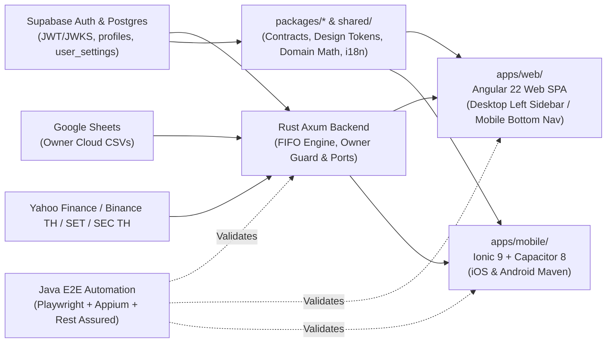

# SGSK-Wealth — Investment Portfolio Tracker & Wealth Analytics

<p align="center">
  
</p>

<p align="center">
  <strong>An enterprise-grade, multi-asset personal wealth tracking, First-In First-Out (FIFO) share lot accounting engine, unified portfolio analytics (allocation & performance), dividend cash flow tracker, financial tools suite, and native iOS/Android mobile app.</strong>
</p>

<p align="center">
  
  
  
  
  
  
  
  
  
  
  
  
  
  
  
  
  
  
  
  <a href="https://vipatpolk.github.io/SGSK-Wealth/"></a>
</p>

---

## What This Repository Does

**SGSK-Wealth** is a production-grade wealth management monorepo designed to solve the complexity of multi-asset, multi-currency portfolio tracking and tax accounting. It automates **First-In, First-Out (FIFO)** transaction matching, reconciles cost bases, calculates unrealized and realized capital gains, and streams live market quotes and foreign exchange rates across both a **Web SPA (`apps/web/`)** and a **Native iOS & Android Mobile App (`apps/mobile/`)** powered by framework-free workspace packages (`packages/contracts/`, `packages/design-tokens/`, `packages/domain/`) and shared Angular services/UI (`shared/`).

The platform supports **multi-tier authentication and portfolio data isolation** via **Supabase Auth** (Email/Password, Google OAuth 2.0 PKCE, and Account Linking): the authorized owner account syncs live trading transaction logs from **Cloud Google Sheets**, while Guest and standard signed-in users operate a full-featured **On-Device Local Portfolio Workspace** enriched with live market prices and dividends from Yahoo Finance, Binance TH, SET Thailand, and SEC Thailand Mutual Fund & PVD APIs.

> **Architecture, Decisions & Operations Docs:** See [Architecture Overview](docs/architecture/overview.md), [ADRs (`docs/decisions/`)](docs/decisions/ADR-001-local-cloud-portfolio-isolation.md), and the [Operations Runbook](docs/operations/runbook.md).



---

## Key Features & Functional Modules

### 🔐 Authentication, Account Linking & Cloud/Local Portfolio Isolation
- **Supabase Auth (Email/Password & Google OAuth 2.0 PKCE)**: Sign in or sign up with Email/Password or Google OAuth across Web (`/auth/callback`) and Native Mobile (`com.sgsk.wealth.mobile://auth/callback` via Chrome Custom Tabs / `SFSafariViewController`).
- **Sign-In Screen Language Toggle (`EN` / `ไทย`)**: Instant bilingual switcher directly on the Web Sign-In screen and Mobile Auth modal that translates all authentication forms immediately, persists in `localStorage` / Capacitor `Preferences`, carries into Guest mode, and seeds Supabase `user_settings` on first registration.
- **Bidirectional Account Linking**: Signed-in users can link or unlink their Google identity and set an email password directly from the **User Settings** modal, with PKCE callback recovery automatically reopening User Settings upon completion.
- **Strict Owner Cloud Guard & On-Device Local Portfolio Workspace**:
  - **Authorized Owner (`can_view_cloud_portfolio = true`)**: Verified server-side via Supabase JWT/JWKS (`require_owner_cloud_portfolio`) and Postgres RLS; automatically loads cloud Google Sheets portfolio data with local portfolio controls hidden.
  - **Guest & Standard Users (`Local Portfolio Workspace`)**: Zero cloud portfolio API calls; provides full on-device transaction CRUD, CSV import/export, one-click sample portfolio loader, client-side FIFO lot matching, and live market price & dividend enrichment.

### 🧭 Adaptive Navigation & Top-Right User Menu
- **Desktop Left Sidebar + Slim Top Utility Bar (`>= 1201px`)**:
  - Fixed left sidebar (`248px` expanded, collapsible to a `72px` icon-only rail via `#sidebar-collapse-btn` persisted in `localStorage`) housing the brand identity and 6 vertical workspace links (`Dashboard`, `Holdings`, `Analytics`, `Dividends`, `Transactions`, `Tools`).
  - Slim `56px` sticky top utility bar displaying the active workspace breadcrumb on the left and the `USD/THB` exchange rate pill, Privacy Mode toggle (`#privacy-toggle-btn`), and top-right User Menu (`#user-menu-btn`) on the right.
- **Mobile & Tablet Responsive Dock (`<= 1200px` Web & Native iOS/Android)**: Single-DOM responsive layout that transforms into a sticky top header and a fixed 6-tab bottom dock without duplicating DOM IDs.
- **Unified User Settings Modal**: Accessible from the top-right User Menu on both Web and Mobile, consolidating Display Currency (`THB` / `USD`), Language (`English` / `ไทย`), Appearance Theme (`Dark` / `Light` / `System` via `#settings-theme-dark`, `#settings-theme-light`, `#settings-theme-system` and mobile equivalents backed by the **Modern Wealth Terminal** tokens in `packages/design-tokens/`), Privacy Mode switch, real-time Supabase preference sync status, display name management, and connected sign-in methods.

### 📊 Executive Dashboard Landing Page
- **Root Landing View**: Direct landing at `/` with zero navigation friction.
- **Executive Net Worth Banner**: High-contrast headline portfolio valuation with dual-currency display (USD $\leftrightarrow$ THB), live FX badge, and a 4-card metric strip (*Invested Capital*, *Unrealized P&L*, *Realized Gains*, and *Projected Dividends*).
- **Asset Allocation Snapshot**: Interactive SVG Donut Chart with asset category legends and direct drill-down into detailed allocation analytics.
- **Top Movers Leaderboard**: Highlights top gainers and lagging positions with brand iconography and return indicators.
- **Forward Dividend Cashflow & Yield**: Trailing/forward annual dividend income, Yield on Cost (YOC %), and Market Yield %.
- **Provident Fund (PVD) / Portfolio Vitality**: Cumulative balance, employee vs. employer contribution split ratios, and one-click shortcut to the dedicated PVD screen on Holdings.
- **Recent Trade Activity**: Latest trade logs with badges (`BUY`, `SELL`, `EX-IN`, `EX-OUT`) and context-aware units.
- **Financial Tools Launchpad**: One-click shortcuts into the *Rebalance Planner*, *TVM Calculator*, and *Average Cost Simulator*.

### 🔒 Privacy Protection Mode
- **Instant Masking**: One-click toggle in the navigation header (persisted in `localStorage` on web and Capacitor `Preferences` on mobile).
- **Selective Blurring**: Automatically blurs sensitive monetary figures (Net Worth, values, costs, proceeds, shares, dividends) using SVG/CSS filter backdrops.
- **Percentage Visibility**: Keeps performance percentages (`P/L %`, `Realized %`, `Yield on Cost %`, `Target %`, `Return %`) unblurred for safe public demonstrations or screen sharing.

### 🌐 Bilingual Localization (`EN` / `TH`)
- **Sign-In & User Settings Language Toggle**: Instant switch (`EN` / `ไทย`) available directly on the Sign-In screen and inside the User Settings modal, persisted under `sgsk_wealth_lang` and synced to Supabase `user_settings` for authenticated users, with synchronized `<html lang>` and Gregorian CE date formatting (`th-TH-u-ca-gregory` / `en-US`).
- **Dynamic Upstream Security Names**: Resolves English (`name`) and Thai (`nameTh`) security names dynamically from SEC Open APIs and market data feeds (`NavService`, `PriceService`) with zero hardcoded symbol-to-name maps.
- **Market-Aware Display**: Thai equities (`.BK`), Mutual Funds (`.FUND`), and Provident Funds display in the active language (`TH` or `EN`), while non-Thai assets (`us-stock`, `crypto`, `bond`) remain in English across all views, dropdowns, and autocompletes.

### 📄 Fund Fact Sheet Viewer (Mutual Funds & PVD)
- **Universal In-App Modal**: Accessible via the Fact Sheet button beside fund names on Web Holdings/Dashboard cards and inside the Ionic `<ion-modal>` on Mobile.
- **Unified SEC Open API Aggregation**: Powered by `GET /api/backend/nav/factsheet`, aggregating SEC `/v2/fund/factsheet/*` (Mutual Funds) and `/v1/pvd/factsheet/{proj_id}/*` (Provident Funds) with client-side caching, multi-period deduplication, and strict sub-policy scoping.
- **Complete Fact Sheet Sections**: Displays Policy & Overview, SEC Risk Spectrum (`RS1`–`RS8`), Calendar/Trailing Performance & Benchmark, Key Risk Statistics, Fees & Dealing Conditions, Asset Allocation, Top 5 Holdings, and direct links to the official SEC Fact Sheet PDF and AMC fund page.

### 💵 Dividend & Yield on Cost (YOC) Accounting
- **Automated Ingestion**: Fetches historical dividend distributions from Yahoo Finance for US/Thai equities and bonds, and SEC Thailand Open APIs for mutual funds.
- **Exact Ex-Date Share Accounting**: Evaluates historical transaction logs to reconstruct exact share balances held on ex-dividend dates ($T$):
  $$\text{Shares Held}(T) = \sum_{\text{Tx Date } < T} \text{Buy Quantity} - \sum_{\text{Tx Date } < T} \text{Sell Quantity}$$
- **Per-Asset Yield on Cost (YOC)**: Calculates true Yield on Cost without currency distortion across US Stocks, Thai Stocks, Mutual Funds, and Bonds.
- **Monthly Cashflow Timeline & Distribution Ledger**: Visual monthly breakdown and filterable dividend payout ledger.

### 📈 Unified Portfolio Analytics (Overview, Allocation & Performance)
- **Unified Navigation Hub**: Consolidates Overview, Target Allocation, and Investment Performance across both Web (`app-analytics`) and Mobile (`MobileAnalyticsPage`).
- **Overview**: Summary metric cards, asset distribution bars, top holding concentrations, and top movers.
- **Target Asset Allocation**: Interactive Donut Chart, category weighting table, click-to-filter class isolation, and USD/THB currency exposure analysis.
- **Investment Performance**: Summary KPI cards, timeframe presets (`YTD`, `1M`, `3M`, `6M`, `1Y`, `ALL`, custom date bounds), asset class return breakdown, and top gainers/losers rankings.

### 💼 Provident Fund (PVD) Management & Dedicated Holdings Screen
- **Holdings Mode Switcher**: Segmented toggle on Holdings (`Market Holdings` $\leftrightarrow$ `Provident Fund (PVD)`) synchronized with asset tabs and Dashboard shortcuts.
- **Executive PVD Hero**: Headline PVD balance, total return on cost, pool composition (*Employee Principal*, *Employee Earnings*, *Employer Matching*, *Employer Earnings*), and SEC Risk Spectrum (`RS1`–`RS8`).
- **Sub-Policy Breakdown & SEC Factsheet Metadata**: Sub-policy cards enriched via `/v1/pvd/factsheet/{proj_id}/policy` with unit counts, current NAV, and factsheet modal links.

### 📑 FIFO Share Lot Engine & Transaction Ledger
- Matches buy and sell order queues strictly via First-In, First-Out principles, including Mutual Fund Exchange Trades (`EX-OUT` & `EX-IN`).
- Context-aware asset units (`coins` for Crypto, `units` for Mutual Funds/PVD, `shares` for Stocks) and UTF-8 BOM CSV export.

### 🧮 Investor Tools & Simulators Hub
- **Portfolio Rebalance Planner**: Standard Rebalance and No-Sell / Contribution Inflow Solver ($\Delta C_{\text{min}}$).
- **Time Value of Money (TVM) Calculator**: 5 solve modes ($FV$, $PMT$, $PV$, $N$, $Rate$), 8 compounding frequencies, portfolio value sync, interactive SVG growth curve, and expandable schedule.
- **Average Cost Basis Calculator**: Multi-order forward Buy / Sell simulation with commission fees and Target Average Cost Solver.

### 📱 Native iOS & Android Mobile App (`apps/mobile/`)
- **Ionic 9 Standalone Shell**: 6-tab bottom navigation (`Dashboard`, `Holdings`, `Analytics`, `Dividends`, `Transactions`, `Tools`), platform-adaptive Ionic `mode` (`'md'` on Android, `'ios'` on iOS/Web), pull-to-refresh (`<ion-refresher>`), native-styled segment switches, searchable cards, Android hardware back-button handling, and `<ion-modal>` sheet drawers (SEC factsheet, dividend ledger, symbol selectors).
- **Web Responsive Feature Parity**: Shared `<app-symbol-icon>`, `<app-loading-screen>`, and `<app-date-range-picker>` components from `@shared/*`, Interactive SVG Allocation Donut, Executive PVD analytics, Forward/Reverse Average Cost simulator, No-Sell/Standard Rebalance planner, and TVM trajectory chart.
- **Capacitor 8 Native Bridge**: Integrated `@capacitor/haptics`, `@capacitor/status-bar`, `@capacitor/splash-screen`, `@capacitor/preferences`, and `@capacitor/app` with platform-aware API routing (`10.0.2.2:8000` on Android emulator, `127.0.0.1:8000` on iOS simulator, `/api/backend` on web dev proxy).
- **Maven Android Build (`apps/mobile/android/pom.xml`)**: Packages the Capacitor Android `.apk` using Apache Maven + Android SDK (`aapt2`, `javac`, `d8`, `zipalign`, `apksigner`) without Gradle.

---

## Detailed Tech Stacks

### 1. Framework-Free Packages (`packages/`) & Shared Angular Library (`shared/`)

| Technology | Version / Spec | Purpose & Architectural Role |
|:---|:---|:---|
| **`@sgsk-wealth/contracts`** | `TypeScript ~6.0` | Framework-free DTO contracts, `ApiResult<T>` helpers (`apiOk`, `apiErr`, `mapHttpErrorToApiFailure`), `AppLang`, `AppTheme`, and Rust/TS JSON contract tests (`packages/contracts/`). |
| **`@sgsk-wealth/design-tokens`** | `CSS Custom Properties` | Layered **Modern Wealth Terminal** token system (`primitives`, `semantic`, `financial`, `assets`, `components`) driving `Dark`, `Light`, and `System` themes across Web (Tailwind CSS v4) and Mobile (Ionic 9) (`packages/design-tokens/`). |
| **`@sgsk-wealth/domain`** | `TypeScript ~6.0` | Framework-free financial math, FIFO lot matching, TVM/rebalance/avg-cost calculators, pure CSV export, holdings/ledger filters & formatters, and shared Rust parity fixtures (`packages/domain/`). |
| **Shared Core (`shared/`)** | `Angular 22.2+` | Platform-agnostic UI components (`SymbolIconComponent`, `LoadingScreenComponent`, `DateRangePickerComponent`), `PortfolioDataProvider` / `PortfolioSourceCoordinator`, `KeyValueStorageAdapter`, API services, Supabase Auth/Settings, bilingual i18n dictionaries, and DI tokens. |

### 2. Web Single Page Application (`apps/web/`)

| Technology | Version / Spec | Purpose & Architectural Role |
|:---|:---|:---|
| **[Angular](https://angular.dev/)** | `22.2+` | Modern web framework utilizing standalone components, reactive Signals, Computed Signals, collapsible desktop sidebar navigation (`>= 1201px`), and responsive bottom dock (`<= 1200px`). |
| **[Tailwind CSS](https://tailwindcss.com/)** | `v4.3+` | Next-generation CSS framework utilizing `@theme` tokens, dark/light themes, and privacy blur filters. |
| **[Vitest](https://vitest.dev/)** | `4.1+` | Fast unit testing runner paired with `jsdom` executing Web component & integration specs (`npm run test:web`). |

### 3. Native iOS & Android Mobile App (`apps/mobile/`)

| Technology | Version / Spec | Purpose & Architectural Role |
|:---|:---|:---|
| **[Angular](https://angular.dev/)** | `22.2+` | Standalone component architecture sharing domain logic from `@sgsk-wealth/domain`, `@sgsk-wealth/contracts`, and `@shared/*`. |
| **[Ionic Framework](https://ionicframework.com/)** | `9.0+` | Native-adaptive iOS & Android UI components (`@ionic/angular` standalone, `ionicons` `8.1+`). |
| **[Capacitor](https://capacitorjs.com/)** | `8.6+` | Native iOS (`apps/mobile/ios/`) & Android (`apps/mobile/android/`) container and plugins (`App`, `Browser`, `Haptics`, `Preferences`, `SplashScreen`, `StatusBar`). |
| **[Apache Maven](https://maven.apache.org/)** | `3.9+` | Android APK build lifecycle (`apps/mobile/android/pom.xml`) resolving AndroidX & Cordova AARs via Google Maven and packaging `.apk` via `build-apk.mjs`. |
| **[Vitest](https://vitest.dev/)** | `4.1+` | Mobile component & Capacitor service unit tests (`npm run test:mobile`). |

### 4. Backend API & Analytics Service (`backend/`)

| Technology | Version / Spec | Purpose & Architectural Role |
|:---|:---|:---|
| **[Rust](https://www.rust-lang.org/) / [Axum](https://github.com/tokio-rs/axum)** | Stable / `0.8` | Async REST API, typed request handling, port traits (`ports.rs`), grouped `AppState`, financial analytics, and Supabase JWT/JWKS owner authorization. |
| **[Tokio](https://tokio.rs/) / [Reqwest](https://docs.rs/reqwest/)** | `1.x` / `0.12` | Async runtime and HTTP clients for Google Sheets, Supabase, Binance TH, SET, Yahoo Finance, and SEC Thailand APIs. |
| **[Cargo](https://doc.rust-lang.org/cargo/) / rustfmt / Clippy** | Stable | Dependency management, formatting, linting (`-D warnings`), offline port tests, and backend test execution. |

### 5. End-to-End Automation Suite (`e2e/`)

| Technology | Version / Spec | Purpose & Architectural Role |
|:---|:---|:---|
| **[Java](https://openjdk.org/)** | `JDK 25` | Enterprise runtime powering the unified E2E regression suite (`e2e/pom.xml`). |
| **[Spring Boot](https://spring.io/projects/spring-boot)** | `4.1+` | IoC container (`@SpringBootTest`), externalized YAML configuration (`E2eProperties`), and `@ScenarioScope` DI via `cucumber-spring`. |
| **[Playwright for Java](https://playwright.dev/java/)** | `1.64+` | Web UI browser automation driving Chromium with network route interception (`@web`). |
| **[Appium Java Client](https://appium.io/)** | `11.0+` | Native iOS (`XCUITestOptions`) & Android (`UiAutomator2Options`) automation with Capacitor WebView switching and local platform-mode WebView fallback (`@mobile`, `@android`, `@ios`). |
| **[Rest Assured](https://rest-assured.io/)** | `6.3+` | Fluent REST API contract testing (`@api`). |
| **[Cucumber-JVM](https://cucumber.io/) & [Allure](https://allurereport.org/)** | `8.0+` / `3.1+` | BDD Gherkin execution across **25 feature files** organized by target and business function with `AllureStepEvidencePlugin` attaching step-level screenshots and API JSON payloads directly inside every executed step. |

### 6. CI/CD Pipelines (`.github/workflows/`)

- **[`ci.yml`](.github/workflows/ci.yml)**: Automated push/PR/manual pipeline running `security-scan` (Gitleaks), `gherkin-qa` (Python 3.11), `backend-qa` (Rust Stable fmt, Clippy, Cargo test, release build), `domain-qa` (boundary lint, contracts & domain typecheck + Vitest), `frontend-qa` (Web Vitest, build & secret scan), `mobile-qa` (Mobile Vitest, build & secret scan), `e2e-api` (Playwright-free `@api` Rest Assured scenarios), `e2e-automation` (Playwright + Rest Assured + Allure), and `publish-allure-report` to [GitHub Pages](https://vipatpolk.github.io/SGSK-Wealth/).
- **[`mobile-build.yml`](.github/workflows/mobile-build.yml)**: Dedicated manual `workflow_dispatch` workflow (`platform`: `all` | `android` | `ios`, `build_type`: `debug` | `release`) that builds and uploads the **Android `.apk`** (JDK 21 + Android SDK Platform 36 + Build-Tools 36.0.0 via Maven) and **iOS `.ipa`** (macOS runner + Xcode `xcodebuild`).

---

## Monorepo Project Structure

```text
SGSK-Wealth/
├── backend/                    # Rust Axum API and analytics service
│   ├── src/main.rs             # Local & Vercel standalone server entry point
│   ├── src/{ports,state,error,middleware,lib}.rs
│   ├── src/features/           # Feature modules: portfolio, dividends, market_data, tools, identity
│   ├── src/{config,utils}/     # Runtime settings, cache, singleflight, auth & upstream clients
│   ├── tests/                  # Rust integration & offline port tests
│   └── Cargo.toml              # Rust package, binaries, and dependencies
│
├── packages/                   # Framework-free pure workspace packages
│   ├── contracts/              # @sgsk-wealth/contracts DTOs, ApiResult<T>, AppLang & contract tests
│   ├── design-tokens/          # @sgsk-wealth/design-tokens Modern Wealth Terminal CSS token layers
│   └── domain/                 # @sgsk-wealth/domain pure FIFO/TVM/rebalance/filter logic & unit specs
│
├── shared/                     # Shared Angular core library (@shared/*)
│   ├── src/config/             # API tokens, Supabase tokens, KeyValueStorageAdapter
│   ├── src/providers/          # PortfolioDataProvider, CloudPortfolioProvider, LocalPortfolioProvider, Coordinator
│   ├── src/{components,i18n,pipes,services}/
│   └── package.json
│
├── apps/
│   ├── web/                    # Angular 22 Web Single Page Application (@sgsk-wealth/web)
│   │   ├── public/             # Static assets, SVG icons, and favicons
│   │   ├── src/app/{core,features,ui,interceptors,shared-tests}/
│   │   └── angular.json, tsconfig.json, package.json
│   └── mobile/                 # Angular 22 + Ionic 9 + Capacitor 8 Mobile App (@sgsk-wealth/mobile)
│       ├── android/            # Native Android Capacitor project built with Maven (pom.xml)
│       ├── ios/                # Native iOS Xcode project (Swift + SPM Capacitor plugins)
│       ├── src/app/{modals,pages,services}/
│       └── capacitor.config.ts, angular.json, package.json
│
├── e2e/                        # Unified Spring Boot E2E Test Suite
│   ├── pom.xml                 # Maven (Spring Boot, Playwright, Appium, Rest Assured, Cucumber, Allure)
│   └── src/test/               # Java step definitions, page/screen objects & 25 .feature files
│
├── docs/
│   ├── architecture/overview.md
│   ├── decisions/              # ADR-001 through ADR-004
│   ├── operations/runbook.md
│   └── specs/sgsk-wealth-improvement-spec.md
│
├── fixtures/accounting/        # Shared language-neutral FIFO & CSV parity fixtures
├── .agent/skills/              # Canonical AI agent skills (synced to .claude/skills/)
├── .github/workflows/          # ci.yml & mobile-build.yml
├── scripts/                    # check-boundaries.mjs, check-bundle-secrets.mjs, lint-gherkin.mjs, dev.mjs, setup-agents.mjs
├── package.json                # Root npm workspaces & unified monorepo scripts
├── vercel.json                 # Unified Vercel Services config (apps/web + backend)
├── AGENTS.md                   # Unified QA & engineering standards (Antigravity & Codex)
└── CLAUDE.md                   # Claude Code entrypoint (@AGENTS.md + Claude-specific rules)
```

---

## Getting Started

### Runtime Matrix (Aligned with CI)

| Runtime / SDK | Version | Used By |
|---|---|---|
| **Node.js / npm** | `26 LTS` / `npm@11.10.1` | Root workspaces (`packages/*`, `shared`, `apps/*`), Vitest, Angular CLI |
| **Rust** | `Stable` (`rustfmt`, `clippy`) | `backend/` Axum server & integration tests |
| **Python** | `3.11` | Gherkin strict validation (`npm run lint:gherkin`) |
| **Java (E2E Suite)** | `JDK 25` (`maven.compiler.release=25`) | `e2e/` Playwright, Appium & Rest Assured suite |
| **Java & Android SDK (APK)** | `JDK 21` + `Android SDK Platform 36` + `Build-Tools 36.0.0` | `apps/mobile/android/pom.xml` APK packaging |
| **Xcode (IPA)** | `macOS` runner | `apps/mobile/ios/App/` IPA packaging via Capacitor |

### 1. Installation

Clone the repository and install all npm workspace dependencies (`packages/*`, `shared`, `apps/*`):

```bash
git clone https://github.com/vipatpolk/SGSK-Wealth.git
cd SGSK-Wealth
npm install
```

Install the Rust toolchain with `rustup`; Cargo downloads backend dependencies when its commands run.

Install Playwright Chromium browser binaries for the Web E2E suite:

```bash
mvn -f e2e/pom.xml exec:java -Dexec.classpathScope=test -Dexec.mainClass=com.microsoft.playwright.CLI -Dexec.args="install chromium"
```

---

## Local Development Workflow

Start **both** the Rust backend and Angular Web SPA concurrently from the monorepo root:

```bash
npm start
# or
npm run dev
```

- **Web Application**: `http://localhost:4200` (proxies `/api/backend/*` to `:8000`)
- **Backend API**: `http://127.0.0.1:8000`
- **Live `[E2E]` Log Streaming**: `npm start` tails `e2e/target/e2e-live.log` automatically whenever `npm run test:e2e*` runs in another terminal (disable with `node scripts/dev.mjs --no-e2e-logs`).

To start services individually or include the Ionic mobile dev server:

```bash
npm run dev:backend            # Runs only the Rust backend on http://127.0.0.1:8000
npm run dev:web                # Runs only Web Angular SPA on http://localhost:4200
npm run dev:mobile             # Runs Ionic Mobile App on http://localhost:4201
node scripts/dev.mjs --mobile  # Starts Backend + Web (:4200) + Mobile (:4201) together
```

To sync built Ionic web assets into native Capacitor iOS & Android projects:

```bash
npm run cap:sync               # Builds apps/mobile and syncs apps/mobile/android + apps/mobile/ios
npm --prefix apps/mobile run cap:open:android
npm --prefix apps/mobile run cap:open:ios
```

---

## Testing & Quality Assurance

SGSK-Wealth enforces strict quality standards before any code is committed:

| Command | Description | Tech Stack |
|:---|:---|:---|
| **`npm run check`** | Run complete pre-commit QA suite (boundaries, Gherkin, contracts, domain, backend, web, mobile & secret scan) | Monorepo Orchestration |
| **`npm run lint:boundaries`** | Verify framework-free domain/contracts & workspace boundaries (`check-boundaries.mjs`) | Node AST/Import Check |
| **`npm run lint:gherkin`** | Validate all **25 `.feature` files** with `validate_gherkin.py --strict` | Python 3.11 Linter |
| **`npm run test:contracts`** | Run DTO & API result envelope contract tests (`packages/contracts`) | Vitest & TypeScript |
| **`npm run test:domain`** | Run pure domain financial, parity & filter unit tests (`packages/domain`) | Vitest & TypeScript |
| **`npm run lint:backend`** | Check Rust formatting and run Clippy with warnings denied | rustfmt & Clippy |
| **`npm run test:backend`** | Run backend unit, integration & offline port tests (`backend/tests`) | Cargo test |
| **`npm run test:web`** | Run Web Vitest unit test suite (`apps/web`) | Vitest & jsdom |
| **`npm run test:mobile`** | Run Mobile Vitest unit test suite (`apps/mobile`) | Vitest & Ionic |
| **`npm run build:web`** | Compile production-ready Web Angular bundle (`apps/web/dist/sgsk-wealth`) | Angular CLI |
| **`npm run build:mobile`** | Compile production-ready Ionic mobile bundle (`apps/mobile/dist/sgsk-wealth-mobile`) | Angular CLI |
| **`npm run check:secrets`** | Scan built Web/Mobile JS bundles for accidental secret leaks | Node Bundle Scanner |
| **`npm run cap:sync`** | Build mobile bundle and sync assets/plugins to `apps/mobile/android` & `apps/mobile/ios` | Capacitor CLI |
| **`npm run test:e2e`** | Run default Java E2E suite (`not @mobile`: `@api` + `@web`) | Playwright, Rest Assured & Cucumber |
| **`npm run test:e2e:web`** | Run Playwright Web UI automation scenarios (`@web`) | Playwright & Cucumber-JVM |
| **`npm run test:e2e:api`** | Run Rest Assured API automation scenarios (`@api`, no browser required) | Rest Assured & Cucumber-JVM |
| **`npm run test:e2e:mobile`** | Run Mobile Appium + Cucumber scenarios (`@mobile`, with local WebView fallback when Appium `:4723` is offline) | Appium & Cucumber-JVM |
| **`npm run test:e2e:android`** | Run Android-tagged mobile E2E scenarios (`@android`) | Appium UiAutomator2 |
| **`npm run test:e2e:ios`** | Run iOS-tagged mobile E2E scenarios (`@ios`) | Appium XCUITest |
| **`npm run test:e2e:smoke`** | Run critical path smoke scenarios across `@api`, `@web`, and `@mobile` | Cucumber-JVM |
| **`npm run test:e2e:report`** | Generate and open the interactive Allure HTML report locally | Allure Maven Plugin |
| **`npm run test:e2e:report:build`** | Generate the static Allure HTML report (`e2e/target/site/allure-maven-plugin/`) | Allure Maven Plugin |

---

## Deployment & Mobile Builds

### Vercel Deployment (Unified Vercel Services)
This monorepo deploys **both** the Angular Web SPA (`apps/web/`) and Rust Axum backend (`backend/`) in a **single Vercel project** (`sgsk-wealth`) using **Vercel Services** configured in root [`vercel.json`](vercel.json):
1. **Project Settings**: Keep **Root Directory** at repository root (`.`), set **Framework Preset** to **Services**, use **Node.js 26**, and keep **Fluid Compute** enabled under **Settings → Functions**. Connect the `sgsk-supabase` integration to `sgsk-wealth` for both Preview and Production.
2. **Web Service (`apps/web/`)**: Builds the Angular 22 workspace (`installCommand: "cd ../.. && npm ci"`, `buildCommand: "npm run build"`, `outputDirectory: "dist/sgsk-wealth"`) with SPA fallback rewrites to `/index.html`.
3. **Backend Service (`backend/`)**: Builds the standalone Rust Axum server in `src/main.rs` via `@vercel/rust`. Service-scoped routes inject `X-API-Key` from the Secret `$BACKEND_API_KEY` environment variable. Local development runs `cargo run --bin sgsk-backend` on port `8000`.
4. **Local Services Emulation & Native Mobile**: Run `vercel dev --local` from the repository root to test unified Services routing locally. Native mobile production builds call `https://sgsk-wealth.vercel.app/api/backend` (`nativeApiBaseUrl` in `apps/mobile/src/environments/environment.prod.ts`) without bundling `BACKEND_API_KEY`; the Rust backend allows configured web and Capacitor origins through CORS.

#### Rotating the backend API key
See the detailed procedure in [docs/operations/runbook.md](docs/operations/runbook.md#2-zero-downtime-backend_api_key-rotation). Summary:
1. Generate a random key of at least 32 characters and set the previous key in `BACKEND_API_KEY_PREVIOUS` while updating `BACKEND_API_KEY` as a Sensitive/Secret variable in the single `sgsk-wealth` Vercel project.
2. Redeploy so Web and Mobile traffic continue smoothly, then remove `BACKEND_API_KEY_PREVIOUS` and redeploy.
3. Keep secret values in Vercel's Sensitive/Secret variables. Do not add keys to `.env.example`, source control, build arguments, or native artifacts.

### Native `.apk` & `.ipa` Packaging
- **GitHub Actions Manual Build**: Trigger the **Mobile Native Build (.apk & .ipa)** workflow ([`.github/workflows/mobile-build.yml`](.github/workflows/mobile-build.yml)) from the Actions tab (`workflow_dispatch`) to build and download `sgsk-wealth-debug.apk` / `sgsk-wealth-release.apk` and `sgsk-wealth-debug.ipa` / `sgsk-wealth-release.ipa`.
- **Local Android Maven Build** (requires `ANDROID_HOME` with Platform 36 & Build-Tools `36.0.0`, JDK 21):
  ```bash
  npm run build:mobile
  npx --prefix apps/mobile cap copy android
  mvn -f apps/mobile/android/pom.xml clean package
  ```

---

## Documentation

- **[Architecture Overview](docs/architecture/overview.md)** — Monorepo layout, trust-boundary diagram, Backend Ports & `AppState`, 19-route auth matrix & cache TTL inventory
- **[Architecture Decision Records](docs/decisions/)** — [ADR-001](docs/decisions/ADR-001-local-cloud-portfolio-isolation.md), [ADR-002](docs/decisions/ADR-002-financial-calculation-parity.md), [ADR-003](docs/decisions/ADR-003-typed-api-result-contract.md), [ADR-004](docs/decisions/ADR-004-fail-closed-production-owner-auth.md)
- **[Operations Runbook](docs/operations/runbook.md)** — Environment variables, zero-downtime key rotation, Vercel edge transforms, Supabase fail-closed triage & `502`/`503` recovery

---

## License

© 2026 SGSK Wealth — Investment Portfolio & Wealth Management System. Private and proprietary.
