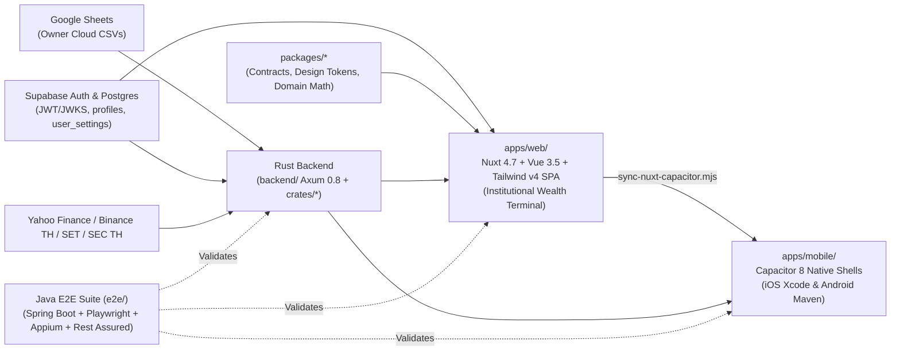

# SGSK-Wealth — Investment Portfolio Tracker & Wealth Analytics

<p align="center">
  
</p>

<p align="center">
  <strong>An institutional-grade, multi-asset personal wealth tracking platform featuring a First-In, First-Out (FIFO) share lot accounting engine, unified portfolio analytics (overview, allocation & performance), dividend cashflow & YOC tracking, financial tools suite, and Capacitor iOS/Android mobile packaging.</strong>
</p>

<p align="center">
  
  
  
  
  
  
  
  
  
  
  
  
  
  
  
  
  
  
  
  <a href="https://vipatpolk.github.io/SGSK-Wealth/"></a>
</p>

---

## What This Repository Does

**SGSK-Wealth** is a production-grade wealth management monorepo designed to handle multi-asset, multi-currency portfolio tracking and tax-lot accounting. It automates **First-In, First-Out (FIFO)** transaction matching, reconciles cost bases, tracks unrealized and realized capital gains, and streams live market quotes and foreign exchange rates across a **Nuxt 4 + Vue 3 SPA (`apps/web/`)** and **Capacitor 8 iOS & Android mobile shells (`apps/mobile/`)**, backed by framework-free TypeScript workspace packages (`packages/contracts/`, `packages/design-tokens/`, `packages/domain/`) and a **Rust (Axum + Tokio)** backend (`backend/` and modular `crates/*`).

The platform enforces **multi-tier authentication and portfolio data isolation** via **Supabase Auth** (Email/Password, Google OAuth 2.0 PKCE, and bidirectional Account Linking): the authorized owner account syncs live trading transaction logs and Provident Fund snapshots from **Cloud Google Sheets**, while Guest and standard signed-in users operate a full-featured **On-Device Local Portfolio Workspace** enriched with live market prices and dividends from Yahoo Finance, Binance TH, SET Thailand, and SEC Thailand Mutual Fund & PVD Open APIs.

> **Architecture, Decisions & Operations Docs:** See [Architecture Overview](docs/architecture/overview.md), [ADRs (`docs/decisions/`)](docs/decisions/ADR-001-local-cloud-portfolio-isolation.md), and the [Operations Runbook](docs/operations/runbook.md).



---

## Key Features & Functional Modules

### 🔐 Authentication, Account Linking & Cloud/Local Portfolio Isolation
- **Supabase Auth (Email/Password & Google OAuth 2.0 PKCE)**: Sign in or sign up with Email/Password or Google OAuth across Web (`/auth/callback`) and Native Mobile (`com.sgsk.wealth.mobile://auth/callback`).
- **Sign-In Screen Language Toggle (`EN` / `ไทย`)**: Instant bilingual switcher directly on the sign-in screen that translates authentication forms immediately, persists locally (`localStorage` / Capacitor `Preferences`), carries into Guest mode, and seeds Supabase `user_settings` on first registration.
- **Bidirectional Account Linking**: Signed-in users can link or unlink their Google identity and set an email password from **User Settings**, with PKCE callback recovery automatically reopening settings upon completion.
- **Strict Owner Cloud Guard & On-Device Local Portfolio Workspace**:
  - **Authorized Owner (`can_view_cloud_portfolio = true`)**: Verified server-side via Supabase JWT/JWKS (`require_owner_cloud_portfolio`) and Postgres RLS; automatically loads cloud Google Sheets portfolio data with local portfolio controls hidden.
  - **Guest & Standard Users (`Local Portfolio Workspace`)**: Zero cloud portfolio API calls; provides full on-device transaction CRUD, CSV import/export, one-click sample portfolio loader, client-side FIFO lot matching, and live market price & dividend enrichment.

### 🧭 Institutional Wealth Terminal UI & Adaptive Navigation
- **Desktop Left Sidebar + Slim Top Utility Bar (`>= 1201px`)**:
  - Collapsible left sidebar (`#sidebar-collapse-btn` persisted in `localStorage`) housing the brand identity and 6 workspace links (`Dashboard`, `Holdings`, `Analytics`, `Dividends`, `Transactions`, `Tools`).
  - Slim sticky top utility bar displaying the active workspace breadcrumb, live `USD/THB` exchange rate pill, Privacy Mode toggle (`#privacy-toggle-btn`), and top-right User Menu (`#user-menu-btn`).
- **Mobile & Tablet Responsive Dock (`<= 1200px` Web & Capacitor)**: Single-DOM responsive layout that adapts into a compact top header and fixed bottom navigation dock without duplicating DOM IDs.
- **Unified User Settings Modal**: Consolidates Display Currency (`THB` / `USD`), Language (`English` / `ไทย`), Appearance Theme (`Dark` / `Light` / `System` driven by `@sgsk-wealth/design-tokens`), Privacy Mode switch, Supabase preference sync status, display name, and connected sign-in methods.

### 📊 Executive Dashboard
- **Root Landing View (`/`)**: High-contrast headline portfolio valuation with live FX badge and 4-card KPI strip (*Invested Capital*, *Unrealized P&L*, *Realized Gains*, and *Projected Dividends*).
- **Universal Dual-Currency Display (`THB` $\leftrightarrow$ `USD`)**: Renders converted secondary currency equivalents (`≈ USD` / `≈ THB`) across hero banners, KPI cards, and data rows via `<SecondaryCurrency>` and `@sgsk-wealth/domain` conversion helpers.
- **Executive Widgets**: Interactive Asset Allocation SVG Donut, Top Movers leaderboard, Forward Dividend Cashflow & Yield, Provident Fund (PVD) vitality card, Recent Trade Activity, and Financial Tools launchpad.

### 🔒 Privacy Protection Mode & 🌐 Bilingual Localization (`EN` / `TH`)
- **Privacy Mode**: One-click toggle in the top bar (persisted in `localStorage` and Capacitor `Preferences`) that masks monetary amounts, share counts, and secondary currency equivalents (`.privacy-mask`) while keeping performance percentages visible.
- **Bilingual (`EN` / `TH`)**: Synchronized `<html lang>`, Gregorian CE date formatting (`th-TH-u-ca-gregory` / `en-US`), and dynamic upstream security names (`name` / `nameTh`) resolved from SEC Open APIs and market data feeds—Thai equities (`.BK`), Mutual Funds (`.FUND`), and Provident Funds localize to the active language while non-Thai assets remain in English.

### 💼 Holdings, FIFO Share Lots & Provident Fund (PVD) Management
- **Market Holdings & FIFO Lot Drawer**: Asset-class tabs (`All`, `U.S. Stock`, `Thai Stock`, `Cryptocurrency`, `Mutual Fund`, `Bond`, `Closed Position`), search autocomplete, multi-metric sorting, and expandable per-symbol **FIFO Share Lots** drawers.
- **Snapshot-Based PVD Cards in Market Holdings**: Provident Fund policies display master fund badges, `units` labels, `NAV`, and an inline **Employee / Employer Split Bar** (`Emp XX% / Co YY%`), omitting FIFO lot counts and `View Trades` links. Expanding a PVD card reveals the **Contribution Breakdown (`Official Snapshot`)** panel instead of a FIFO lots table.
- **Dedicated `Provident Fund (PVD)` Dashboard (`PvdHoldings.vue`)**: Top-level `Market Holdings` $\leftrightarrow$ `Provident Fund (PVD)` switcher featuring a headline PVD hero card, 4 KPI sub-cards, **4-Part Proportional Fund Split Bar** (*Employee Contribution*, *Employee Earnings*, *Employer Matching*, *Employer Earnings*), **Policy Weight Allocation** donut + legend, **SEC Risk Spectrum (`RS1`–`RS8`)** with tier breakdown, and searchable/sortable sub-policy cards with SEC metadata.
- **Fund Fact Sheet Viewer**: Universal modal (`GET /api/backend/nav/factsheet`) aggregating SEC `/v2/fund/factsheet/*` (Mutual Funds) and `/v1/pvd/factsheet/{proj_id}/*` (PVD), including Risk Spectrum, trailing performance, fees, asset allocation, top 5 holdings, and official SEC PDF links.

### 📈 Unified Portfolio Analytics (`/analytics`)
- **Overview**: Portfolio KPIs, Asset Class Distribution bars, Top Holding Concentrations, and Top Movers.
- **Target Asset Allocation**: Interactive SVG Donut Chart, target-vs-actual weighting table with drift badges, click-to-filter class isolation, and USD/THB currency exposure analysis.
- **Investment Performance**: Summary KPI cards, timeframe presets (`1M`, `3M`, `6M`, `YTD`, `1Y`, `ALL`, custom date range), asset-class return breakdown, and top gainers/losers rankings.

### 💵 Dividend & Yield on Cost (YOC) Analytics (`/dividends`)
- **Automated Ingestion & Ex-Date Accounting**: Fetches historical payouts from Yahoo Finance and SEC Thailand Mutual Fund APIs, reconstructing exact shares held on ex-dividend dates ($T$):
  $$\text{Shares Held}(T) = \sum_{\text{Tx Date } < T} \text{Buy Quantity} - \sum_{\text{Tx Date } < T} \text{Sell Quantity}$$
- **Stacked Monthly Dividend Cashflow**: Color-coded stacked monthly bars segmented by asset class (`U.S. Stocks`, `Thai Stocks`, `Mutual Funds`, `Bonds`, etc.) matching the chart legend and active asset/year filters.
- **Per-Asset YOC & Payout Ledger**: Asset-class YOC summary cards, sortable holding breakdown table, and per-symbol payout ledger modal.

### 📑 Transaction Ledger & CSV Exporter (`/transactions`)
- Chronological FIFO-reconciled market trade stream (`BUY`, `SELL`, `EX-IN`, `EX-OUT`) with symbol selector modal, asset-class & date filters, pagination, and UTF-8 BOM CSV export.
- **Clean Snapshot Isolation**: Provident Fund snapshots are excluded from `transaction_summaries` (Backend), `transactionSummaries` (`@sgsk-wealth/domain`), the Transactions asset filter bar, symbol selector, ledger rows, and open-position status count.

### 🧮 Investor Tools Hub (`/tools`)
- **Average Cost Basis Calculator**: Asset-class filter pills, open-position prefill or custom initial state, multi-order Buy/Sell simulation with broker fees, Before/After comparison table, and Target Average Cost Reverse Solver.
- **Time Value of Money (TVM) Calculator**: 5 solve modes ($FV$, $PMT$, $PV$, $N$, $Rate$), 8 compounding frequencies with live EAR preview, portfolio value sync, interactive SVG growth curve (Area/Lines), and period-by-period schedule.
- **Portfolio Rebalance Planner**: Standard Rebalance and No-Sell Contribution Solver ($\Delta C_{\text{min}}$), class-level filtering, Anchor/Balanced status badges, and copyable Trade Execution Plan checklist.

### 📱 Native iOS & Android Capacitor Shells (`apps/mobile/`)
- **Synced Nuxt SPA Bundle**: `npm run cap:sync` generates the static Nuxt SPA (`apps/web/.output/public`) and copies it cleanly into `apps/mobile/android/app/src/main/assets/public` and `apps/mobile/ios/App/App/public`.
- **Capacitor 8 Plugins**: Integrates `@capacitor/app`, `@capacitor/browser`, `@capacitor/haptics`, `@capacitor/preferences`, `@capacitor/splash-screen`, and `@capacitor/status-bar`.
- **Maven Android Build (`apps/mobile/android/pom.xml`)**: Packages the Android `.apk` using Apache Maven + Android SDK without Gradle.

---

## Detailed Tech Stacks

### 1. Framework-Free Workspace Packages (`packages/`)

| Package | Technology | Purpose & Architectural Role |
|:---|:---|:---|
| **`@sgsk-wealth/contracts`** | `TypeScript` | Framework-free DTO contracts, `ApiResult<T>` helpers, `AppLang`, `AppTheme`, and JSON contract tests (`packages/contracts/`). |
| **`@sgsk-wealth/design-tokens`** | `CSS Custom Properties` | Layered Institutional Wealth Terminal token system (`primitives`, `semantic`, `financial`, `assets`, `components`) driving `Dark`, `Light`, and `System` themes (`packages/design-tokens/`). |
| **`@sgsk-wealth/domain`** | `TypeScript` | Pure financial math, local FIFO lot matching, TVM/rebalance/avg-cost calculators, CSV export, formatters, and Rust accounting parity tests (`packages/domain/`). |

### 2. Web & Mobile Frontend (`apps/web/` & `apps/mobile/`)

| Technology | Version / Spec | Purpose & Architectural Role |
|:---|:---|:---|
| **[Nuxt](https://nuxt.com/) / [Vue](https://vuejs.org/)** | `4.7+` / `3.5+` | Static SPA (`ssr: false`) powering all pages (`index`, `holdings`, `analytics`, `dividends`, `transactions`, `tools`, `auth/callback`), composables, and bilingual i18n (`apps/web/app/`). |
| **[Tailwind CSS](https://tailwindcss.com/)** | `v4.3+` | Utility-first styling integrated with `@sgsk-wealth/design-tokens` CSS variables (`apps/web/`). |
| **[Capacitor](https://capacitorjs.com/)** | `8.6+` | Native iOS (`apps/mobile/ios/`) & Android (`apps/mobile/android/`) containers synced from the built Nuxt SPA via `scripts/sync-nuxt-capacitor.mjs`. |
| **[Apache Maven](https://maven.apache.org/)** | `3.9+` | Android `.apk` build lifecycle (`apps/mobile/android/pom.xml`). |
| **[Vitest](https://vitest.dev/)** | `4.1+` | Fast unit testing for contracts, domain math, design tokens, and Nuxt web composables/i18n (`apps/web/tests/`). |

### 3. Rust Backend & Modular Crates (`backend/` & `crates/`)

| Technology | Version / Spec | Purpose & Architectural Role |
|:---|:---|:---|
| **[Rust](https://www.rust-lang.org/) / [Axum](https://github.com/tokio-rs/axum)** | Stable / `0.8` | Async REST API (`backend/`), typed request handling, port traits (`ports.rs`), grouped `AppState`, financial analytics, and Supabase JWT/JWKS owner authorization. |
| **Modular Workspace Crates** | `crates/*` | `sgsk-common`, `sgsk-domain`, `sgsk-financial-engine`, `sgsk-application`, `sgsk-database`, `sgsk-integrations`, and `crates/api` (`Cargo.toml`). |
| **[Tokio](https://tokio.rs/) / [Reqwest](https://docs.rs/reqwest/)** | `1.x` / `0.12` | Async runtime and HTTP clients for Google Sheets, Supabase, Binance TH, SET, Yahoo Finance, and SEC Thailand APIs. |

### 4. End-to-End Automation Suite (`e2e/`)

| Technology | Version / Spec | Purpose & Architectural Role |
|:---|:---|:---|
| **[Java](https://openjdk.org/)** | `JDK 25` | Runtime powering the unified E2E regression suite (`e2e/pom.xml`). |
| **[Spring Boot](https://spring.io/projects/spring-boot)** | `4.1+` | IoC container (`@SpringBootTest`), externalized YAML config (`E2eProperties`), and `@ScenarioScope` DI via `cucumber-spring`. |
| **[Playwright for Java](https://playwright.dev/java/)** | `1.64+` | Web UI browser automation driving Chromium with network route interception (`@web`). |
| **[Appium Java Client](https://appium.io/)** | `11.0+` | Native iOS (`XCUITestOptions`) & Android (`UiAutomator2Options`) automation (`@mobile`, `@android`, `@ios`). |
| **[Rest Assured](https://rest-assured.io/)** | `6.3+` | Fluent REST API contract testing (`@api`). |
| **[Cucumber-JVM](https://cucumber.io/) & [Allure](https://allurereport.org/)** | `8.0+` / `3.1+` | BDD execution across **26 feature files** with step-level screenshot and API JSON payload attachments. |

### 5. CI/CD Pipelines (`.github/workflows/`)

- **[`ci.yml`](.github/workflows/ci.yml)**: Push/PR/manual pipeline running security scanning, Gherkin linting, Rust formatting/Clippy/tests, contracts & domain QA, Nuxt web Vitest/build/secret scan, Rest Assured `@api` tests, Playwright `@web` E2E tests, and publishing the live Allure report to [GitHub Pages](https://vipatpolk.github.io/SGSK-Wealth/).
- **[`mobile-build.yml`](.github/workflows/mobile-build.yml)**: Manual `workflow_dispatch` workflow (`platform`: `all` | `android` | `ios`, `build_type`: `debug` | `release`) building and uploading **Android `.apk`** and **iOS `.ipa`** artifacts.

---

## Monorepo Project Structure

```text
SGSK-Wealth/
├── backend/                    # Rust Axum API service (main.rs, features/, ports, tests/)
├── crates/                     # Modular Rust workspace crates
│   ├── common/                 # Shared Rust types, config, errors
│   ├── domain/                 # Rust domain models & validation
│   ├── financial-engine/       # FIFO, TVM, rebalance & valuation engines
│   ├── application/            # Application use cases & orchestration
│   ├── database/               # Persistence & repository implementations
│   ├── integrations/           # External market data & Google Sheets/SEC adapters
│   └── api/                    # HTTP router crate
│
├── packages/                   # Framework-free pure TypeScript/CSS workspace packages
│   ├── contracts/              # @sgsk-wealth/contracts DTOs, ApiResult<T> & contract tests
│   ├── design-tokens/          # @sgsk-wealth/design-tokens CSS token layers & contrast checks
│   └── domain/                 # @sgsk-wealth/domain pure FIFO/TVM/rebalance/filter logic
│
├── apps/
│   ├── web/                    # Nuxt 4.7 + Vue 3.5 Web SPA (@sgsk-wealth/web)
│   │   ├── app/                # pages/, components/, composables/, i18n/, assets/, utils/
│   │   ├── public/             # Static assets & favicons (favicon.svg, brand-logo.png)
│   │   ├── tests/              # Vitest unit & i18n completeness specs
│   │   └── nuxt.config.ts, package.json
│   └── mobile/                 # Capacitor 8 Native Mobile Shells (@sgsk-wealth/mobile)
│       ├── android/            # Native Android Capacitor project built with Maven (pom.xml)
│       ├── ios/                # Native iOS Xcode project (Swift + SPM Capacitor plugins)
│       └── capacitor.config.ts, package.json
│
├── e2e/                        # Unified Spring Boot E2E Test Suite
│   ├── pom.xml                 # Maven (Spring Boot, Playwright, Appium, Rest Assured, Cucumber, Allure)
│   └── src/test/               # Java step definitions, page/screen objects & 26 .feature files
│
├── docs/
│   ├── architecture/overview.md
│   ├── decisions/              # ADR-001 through ADR-004
│   └── operations/runbook.md
│
├── fixtures/accounting/        # Shared language-neutral FIFO & CSV parity fixtures
├── .agent/skills/              # Canonical AI agent skills (synced to .claude/skills/)
├── .github/workflows/          # ci.yml & mobile-build.yml
├── scripts/                    # dev.mjs, sync-nuxt-capacitor.mjs, check-boundaries.mjs, check-bundle-secrets.mjs, lint-gherkin.mjs, lint-openapi.mjs, reconcile-api.mjs
├── Cargo.toml                  # Rust workspace manifest (crates/*)
├── package.json                # Root npm workspaces & unified monorepo scripts
├── vercel.json                 # Unified Vercel Services config (apps/web + backend)
├── AGENTS.md                   # Unified QA & engineering standards
└── CLAUDE.md                   # Claude Code entrypoint (@AGENTS.md + Claude-specific rules)
```

---

## Getting Started

### Runtime Matrix (Aligned with CI)

| Runtime / SDK | Version | Used By |
|---|---|---|
| **Node.js / npm** | `26 LTS` / `npm@11.10.1` | Root workspaces (`packages/*`, `apps/*`), Nuxt 4, Vitest |
| **Rust** | `Stable` (`rustfmt`, `clippy`) | `backend/` Axum server & `crates/*` workspace |
| **Python** | `3.11` | Gherkin strict validation (`npm run lint:gherkin`) |
| **Java (E2E Suite)** | `JDK 25` | `e2e/` Playwright, Appium & Rest Assured suite |
| **Java & Android SDK (APK)** | `JDK 21` + `Android SDK Platform 36` + `Build-Tools 36.0.0` | `apps/mobile/android/pom.xml` APK packaging |
| **Xcode (IPA)** | `macOS` runner | `apps/mobile/ios/App/` IPA packaging via Capacitor |

### 1. Installation

Clone the repository and install all npm workspace dependencies:

```bash
git clone https://github.com/vipatpolk/SGSK-Wealth.git
cd SGSK-Wealth
npm install
```

Install the Rust toolchain via `rustup` (Cargo downloads crate dependencies automatically on build/test), and install Playwright Chromium binaries for the Web E2E suite:

```bash
mvn -f e2e/pom.xml exec:java -Dexec.classpathScope=test -Dexec.mainClass=com.microsoft.playwright.CLI -Dexec.args="install chromium"
```

---

## Local Development Workflow

Start **both** the Rust backend and Nuxt Web SPA concurrently from the monorepo root:

```bash
npm start
# or
npm run dev
```

- **Web Application**: `http://localhost:4200` (proxies `/api/backend/*` to `:8000`)
- **Backend API**: `http://127.0.0.1:8000`
- **Live `[E2E]` Log Streaming**: `npm start` tails `e2e/target/e2e-live.log` automatically whenever `npm run test:e2e*` runs in another terminal (disable with `node scripts/dev.mjs --no-e2e-logs`).

To run services individually or sync Capacitor mobile assets:

```bash
npm run dev:backend            # Rust backend on http://127.0.0.1:8000
npm run dev:web                # Nuxt 4 Web SPA on http://localhost:4200
npm run cap:sync               # Generates apps/web static SPA and syncs apps/mobile/android + apps/mobile/ios
npm --prefix apps/mobile run cap:open:android
npm --prefix apps/mobile run cap:open:ios
```

---

## Testing & Quality Assurance

SGSK-Wealth enforces strict pre-commit quality gates across every layer:

| Command | Description | Tech Stack |
|:---|:---|:---|
| **`npm run check`** | Run complete pre-commit QA suite (boundaries, Gherkin, OpenAPI, contracts, domain, tokens, backend, crates, web tests, Nuxt generate & secret scan) | Monorepo Orchestration |
| **`npm run lint:boundaries`** | Verify framework-free domain/contracts & workspace boundaries (`check-boundaries.mjs`) | Node AST/Import Check |
| **`npm run lint:gherkin`** | Validate all **26 `.feature` files** with `validate_gherkin.py --strict` | Python 3.11 Linter |
| **`npm run lint:openapi`** | Validate OpenAPI specifications (`lint-openapi.mjs`) | Node Linter |
| **`npm run test:contracts`** | Run DTO & `ApiResult<T>` contract tests (`packages/contracts`) | Vitest & TypeScript |
| **`npm run test:domain`** | Run pure financial, FIFO parity & filter unit tests (`packages/domain`) | Vitest & TypeScript |
| **`npm run test:tokens`** | Verify design token contrast & integrity (`packages/design-tokens`) | Node / Vitest |
| **`npm run lint:backend`** | Check Rust formatting and Clippy (`-D warnings`) on `backend/` | rustfmt & Clippy |
| **`npm run test:backend`** | Run backend unit, integration & offline port tests (`backend/tests`) | Cargo test |
| **`npm run lint:crates`** | Check `rustfmt` & Clippy across `crates/*` workspace | rustfmt & Clippy |
| **`npm run test:crates`** | Run workspace crate tests (`cargo test --workspace`) | Cargo test |
| **`npm run test:web`** | Run Nuxt Web Vitest unit & i18n completeness tests (`apps/web`) | Vitest |
| **`npm run generate:web`** | Generate production static Nuxt SPA (`apps/web/.output/public`) | Nuxt 4 CLI |
| **`npm run cap:sync`** | Generate Web SPA and sync to `apps/mobile/android` & `apps/mobile/ios` | Nuxt + `sync-nuxt-capacitor.mjs` |
| **`npm run check:secrets`** | Scan built Web JS bundles for accidental secret leaks | Node Bundle Scanner |
| **`npm run reconcile:api`** | Reconcile API contracts (`reconcile:offline` for offline check) | Node |
| **`npm run test:e2e`** | Run default Java E2E suite (`not @mobile`: `@api` + `@web`) | Playwright, Rest Assured & Cucumber |
| **`npm run test:e2e:web`** | Run Playwright Web UI automation scenarios (`@web`) | Playwright & Cucumber-JVM |
| **`npm run test:e2e:api`** | Run Rest Assured API automation scenarios (`@api`, no browser required) | Rest Assured & Cucumber-JVM |
| **`npm run test:e2e:mobile`** | Run Mobile Appium + Cucumber scenarios (`@mobile`) | Appium & Cucumber-JVM |
| **`npm run test:e2e:android`** | Run Android-tagged mobile E2E scenarios (`@android`) | Appium UiAutomator2 |
| **`npm run test:e2e:ios`** | Run iOS-tagged mobile E2E scenarios (`@ios`) | Appium XCUITest |
| **`npm run test:e2e:smoke`** | Run critical path smoke scenarios (`@smoke and not @mobile`) | Cucumber-JVM |
| **`npm run test:e2e:report`** | Generate and open the interactive Allure HTML report locally | Allure Maven Plugin |
| **`npm run test:e2e:report:build`** | Generate the static Allure HTML report (`e2e/target/site/allure-maven-plugin/`) | Allure Maven Plugin |

---

## Deployment & Mobile Builds

### Vercel Deployment (Unified Vercel Services)
This monorepo deploys **both** the Nuxt 4 Web SPA (`apps/web/`) and Rust Axum backend (`backend/`) in a **single Vercel project** (`sgsk-wealth`) using **Vercel Services** configured in root [`vercel.json`](vercel.json):
1. **Project Settings**: Keep **Root Directory** at repository root (`.`), set **Framework Preset** to **Services**, use **Node.js 26**, and keep **Fluid Compute** enabled under **Settings → Functions**. Connect the `sgsk-supabase` integration to `sgsk-wealth` for both Preview and Production.
2. **Web Service (`apps/web/`)**: Generates the static Nuxt 4 SPA (`apps/web/.output/public`) with SPA fallback routing.
3. **Backend Service (`backend/`)**: Builds the standalone Rust Axum server in `src/main.rs` via `@vercel/rust`. Service-scoped routes inject `X-API-Key` from the Secret `$BACKEND_API_KEY` environment variable.
4. **Local Services Emulation**: Run `vercel dev --local` from the repository root to test unified Services routing locally.

#### Rotating the Backend API Key
See [docs/operations/runbook.md](docs/operations/runbook.md#2-zero-downtime-backend_api_key-rotation) for zero-downtime `BACKEND_API_KEY` rotation using `BACKEND_API_KEY_PREVIOUS`. Never commit secrets to source control or native bundles.

### Native `.apk` & `.ipa` Packaging
- **GitHub Actions Manual Build**: Trigger **Mobile Native Build (.apk & .ipa)** ([`.github/workflows/mobile-build.yml`](.github/workflows/mobile-build.yml)) via `workflow_dispatch`.
- **Local Android Maven Build** (requires `ANDROID_HOME` with Platform 36 & Build-Tools `36.0.0`, JDK 21):
  ```bash
  npm run cap:sync
  mvn -f apps/mobile/android/pom.xml clean package
  ```

---

## Documentation

- **[Architecture Overview](docs/architecture/overview.md)** — Monorepo layout, trust-boundary diagram, Backend Ports & `AppState`, route auth matrix & cache TTL inventory
- **[Architecture Decision Records](docs/decisions/)** — [ADR-001](docs/decisions/ADR-001-local-cloud-portfolio-isolation.md), [ADR-002](docs/decisions/ADR-002-financial-calculation-parity.md), [ADR-003](docs/decisions/ADR-003-typed-api-result-contract.md), [ADR-004](docs/decisions/ADR-004-fail-closed-production-owner-auth.md)
- **[Operations Runbook](docs/operations/runbook.md)** — Environment variables, zero-downtime key rotation, Vercel edge transforms, Supabase fail-closed triage & `502`/`503` recovery

---

## License

© 2026 SGSK Wealth — Investment Portfolio & Wealth Management System. Private and proprietary.
