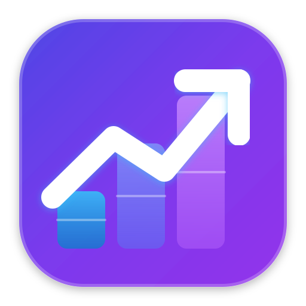

# ShareLot — FIFO Share Lot & Portfolio Tracker

<p align="center">
  
</p>

<p align="center">
  <strong>A modern, real-time investment portfolio tracker, FIFO share lot accounting dashboard, asset allocation rebalancer, dividend cash flow tracker, and performance analytics engine.</strong>
</p>

<p align="center">
  
  
  
  
  
  
  
</p>

---

## Overview

**ShareLot** is an investment portfolio analytics web application designed to automate **First-In, First-Out (FIFO)** share lot accounting across multiple asset classes. It connects to **SGSKBackend** to ingest transaction logs from Google Sheets and streams real-time market data to compute cost basis, open lots, realized gains, holding values, total profit/loss (P/L), asset rebalancing, dividend income ledgers, privacy masking, and comprehensive investment performance analytics.

---

## Key Features

### 🔒 Privacy Protection Mode
- **Instant Masking**: One-click toggle in the header to activate Privacy Mode (state preserved in `localStorage`).
- **Targeted Masking**: Automatically blurs sensitive monetary amounts, portfolio values, total cost, proceeds, shares, net received, and dividend payments.
- **Percentage Visibility**: Crucial performance percentages (`P/L %`, `Realized %`, `Yield on Cost %`, `Target %`, `Return %`, `Allocation %`) remain clearly readable and unblurred for safe public demonstrations or casual tracking.

### 💵 Dividend & Income Yield Tracking
- **100% API-Driven Dividend Engine**: Fetches complete dividend distributions automatically from Yahoo Finance (US & Thai stocks, Bonds) and the SEC Thailand Fund API (Mutual Funds).
- **Exact Ex-Date Share Accounting**: Evaluates historical trade logs to calculate exact shares held on each dividend ex-date ($T$):
  $$\text{Shares Held}(T) = \sum_{\text{Tx Date } \le T} \text{Buy Quantity} - \sum_{\text{Tx Date } \le T} \text{Sell Quantity}$$
- **Forward Income & Yield on Cost (YOC)**: Displays trailing 12-month DPS, current market yield %, Yield on Cost %, and forward projected annual income.
- **Interactive Monthly Cashflow Timeline**: Visual stacked bar chart tracking monthly dividend income split across Thai Stocks, US Stocks, Mutual Funds, and Bonds.
- **Holdings Distribution Ledger Popup Modal**: Responsive popup modal with a desktop table ($\ge 640\text{px}$) and touch-friendly mobile cards ($< 640\text{px}$) showing individual dividend payouts, withholding tax, and net amounts.
- **Global Asset Type & Year Filtering**: Filter summary metrics, monthly timeline chart, holdings breakdown, and transaction ledger across `All Assets`, `U.S. Stocks`, `Thai Stocks`, `Mutual Funds`, and `Bonds` or specific calendar years.
- **Fuzzy Autocomplete & Ledger Pagination**: Real-time autocomplete suggestions with keyboard navigation (`↑`, `↓`, `Enter`, `Escape`) and paginated historical payout ledger.

### 📈 Investment Performance & Returns Analytics
- **Portfolio Summary Grid**: Five high-level KPI cards displaying *Total Invested*, *Total Value*, *P/L (Unrealized)*, *Realized P/L*, and *Total Return* with color-coded profit/loss amounts and relative return percentages.
- **Asset Type Performance Breakdown**: Grouped returns analysis by asset class (`U.S. Stock`, `Thai Stock`, `Cryptocurrency`, `Mutual Fund`, `Bond`), featuring proportional horizontal return bar charts and open/closed symbol counts.
- **Top Movers Ranking**: Dynamic top 5 **Gainers** and top 5 **Losers** leaderboards with badge styling, progress bars, and percentage return indicators.
- **Time Frame Selection & Date Filtering**: Integrated [`DateRangePickerComponent`](src/app/components/date-range-picker/date-range-picker.component.ts) with presets (`YTD`, `1M`, `3M`, `6M`, `1Y`, `All Time`, or custom bounds) to dynamically filter closed-lot realized gains over specific timeframes.
- **Interactive Symbol Search & Autocomplete**: Fast search toolbar with keyboard-accessible autocomplete suggestions (`↑`, `↓`, `Enter`, `Escape`), active index highlighting, asset badges, status pills, and clickable filter actions.
- **Multi-Currency Valuation**: Automatic conversion across `USD` $\leftrightarrow$ `USDT` $\leftrightarrow$ `THB` based on exchange rates and price quote currencies.
- **Flexible Sorting & Status Filters**: Sort performance table by Symbol, Total Return %, Total Return $, Invested Cost, Current Value, Realized P/L, or Unrealized P/L with Open/Closed/All status filters.

### ⚖️ Target Asset Allocation & Breakdown
- **Auto-Aggregated Portfolio Overview**: Navigating to the Allocation page automatically aggregates positions across all asset categories (`U.S. Stock`, `Thai Stock`, `Cryptocurrency`, `Mutual Fund`, `Bond`).
- **Asset Class Breakdown Table**: Clean breakdown of Asset Class, Value, and Allocation % with intuitive visual indicators.
- **Interactive Asset Class Filtering**: Clicking any Asset Class row, Donut Chart segment, or Legend item filters the Allocation view directly to that specific asset class.
- **"Symbol at Class" Detailed Breakdown View**: When filtered, dynamically reveals individual holdings within that asset class with a prominent **`← All Asset Classes`** reset button.
- **Concentration & Currency Exposure**: Top Holdings Concentration chart with **Show All / Show Top 5** toggle controls, alongside USD/THB currency exposure visualizer.

### 💼 Provident Fund (PVD) Tracking & Contribution Breakdown
- **Dedicated Asset Tab**: Seamlessly navigates to the Provident Fund portfolio view via the tab bar (`briefcase` icon, `#6366f1` brand indigo).
- **Contribution Split Bar**: Visual header progress bar detailing Employee vs. Company contribution shares and percentages (e.g. `Emp 58% Co 42%`).
- **Laser-Aligned Layout**: Header cards maintain unified horizontal columns across desktop, tablet, and mobile, with the contribution split bar occupying the exact same slot as the Transactions button on trading asset types.
- **Dedicated Expanded Contribution Breakdown**:
  - **Employee Contribution Card**: Displays Employee Total Contribution ($), Cumulative Earnings ($), and percentage of total plan.
  - **Employer Matching Card**: Displays Employer Matching Contribution ($), Cumulative Company Earnings ($), and percentage of total plan.
  - **Official Snapshot Footer Banner**: Shows plan policy name, sub-policy ID, SEC Thailand AIMC classification, risk level, and aggregate portfolio valuation.
- **Transaction History Exemption**: Provident Fund positions reflect official balance snapshots without manual buy/sell trade logs, cleanly excluding PVD from the trading feed and transaction CSV export.

### 📊 FIFO Share Lot Engine
- Automatically matches buy and sell transaction queues according to First-In, First-Out (FIFO) principles.
- Computes remaining open lots, weighted average cost basis, and acquisition dates.
- **Mutual Fund Exchange Trades (`EX-OUT` & `EX-IN`)**: Renders purple exchange badges (`.tag-exchange`), connected fund pills (`From [K-CASH]` / `To [K-USA]`), and realized P/L tracking.
- Analyzes closed positions with realized gains/losses, hold durations, and sell execution prices.

### 📜 Full Transaction History Ledger
- **Initial Unfiltered Feed**: Opening the Transactions view automatically consolidates all asset classes and trade types (`BUY`, `SELL`, `EX-IN`, `EX-OUT`) across all symbols.
- **Normalized Table Layout**: Standardized column widths across all type filters with multi-line symbol name display.
- **Context-Aware Asset Units**: Dynamically formats unit labels:
  - **Cryptocurrency**: Displays unit as `coins` / `coin` (e.g., `+0.2500 coins`, `@ $98,400.00 / coin`).
  - **Mutual Funds & Provident Funds**: Displays unit as `units` / `unit` (e.g., `10,335.6092 units`, `32,772.99 units`).
  - **Stocks**: Displays unit as `shares` / `share`.
- **Export to CSV**: Download transactions in standard 5-column CSV format (`Symbol,Date,Quantity,Price,Currency`) with YYYY-MM-DD dates, signed quantities (`+` for BUY/EX-IN, `-` for SELL/EX-OUT), UTF-8 BOM encoding (`\uFEFF`), and filter options (Asset Type and Open/Closed scope).
- **Pagination & Sorting**: Configurable page size options (10, 50, 100) with responsive pagination navigation.

### 🧮 Investor Tools & Financial Simulators Hub
- **Portfolio Rebalance Planner**:
  - Symbol-level target allocation model grouped by asset classes (`U.S. Stocks`, `Thai Stocks`, `Crypto`, `Mutual Funds`, `Bonds`, `Provident Funds`).
  - **Standard Two-Way Rebalance**: Computes exact buy/sell orders, turnover, and delta shares to rebalance existing capital.
  - **No-Sell / Contribution Inflow Solver**: Solves the exact minimum cash inflow ($\Delta C_{\text{min}}$) needed based on the anchor overweight asset so zero assets are sold, plus smart deficit waterfall allocation for custom deposit budgets.
  - **Responsive Hybrid Interface**: 6-column widescreen data table on desktop (`≥ 1024px`), two-tier split header on tablet (`768px – 1023px`), and card grid on mobile (`< 1024px`).
  - **Filter-Aware Dynamic KPIs & Orders**: Asset class filter chips dynamically refresh portfolio/class values, buy/sell totals, required cash contribution, and copyable trade execution checklists.
  - Interactive Target % steppers (`[-]` / `[+]`) and distribution presets (`Equal Weight`, `Set Current`, `Normalize`).
- **Time Value of Money (TVM) Calculator**:
  - **5-Way Flexible Solve Modes**: Calculate Future Value ($FV$), Periodic Payment ($PMT$), Starting Principal ($PV$), Investment Horizon ($N$), and Required Annual Return Rate ($Rate$).
  - **8 Compounding Frequencies**: Daily ($m=365$), Weekly ($m=52$), Biweekly ($m=26$), Semimonthly ($m=24$), Monthly ($m=12$), Quarterly ($m=4$), Semiannually ($m=2$), and Annually ($m=1$).
  - **Multi-Asset Class Present Value ($PV$) Sync**: Directly sync starting principal from live portfolio market values or cost basis with multi-asset selection chips (U.S. Stocks, Thai Stocks, Crypto, Mutual Funds, Bonds).
  - **Interactive Year-by-Year Wealth Trajectory Line Graph**: Reactive SVG line & area curves, crosshair vertical guidelines, animated indicator dots, and floating tooltips displaying balance, invested capital, interest earned, and return multiples.
  - **Expandable Accumulation Schedule**: Complete year-by-year financial table with annual deposits, yearly interest, cumulative interest, and ending balances with Privacy Mode blurring.
- **Average Cost Basis Calculator**:
  - Multi-step forward Buy / Sell order simulation with custom brokerage fees.
  - Target Average Cost Solver calculating exact required shares and capital to achieve a desired cost basis.

### 📱 Responsive Experience & Tablet Optimization
- **Segmented Capsule Header Stats**: Redesigned floating header statistics capsule with monospace typography and distinct meta stats pill badge.
- **Tablet & iPad Breakpoints**: Optimized layout scaling for iPad Air, iPad Pro 11", and iPad Pro 12.9" preventing header stat overflow.
- **Fluid Touch Navigation**: Responsive view selector dropdown and touch-friendly controls across all mobile form factors.

---

## Tech Stack

| Layer | Technology |
| :--- | :--- |
| **Framework** | [Angular 22](https://angular.dev/) (Standalone Components, Signals, Computed Signals) |
| **Styling** | Custom Design System with Modern CSS & [Tailwind CSS v4.3](https://tailwindcss.com/) |
| **Language** | [TypeScript 6.0](https://www.typescriptlang.org/) |
| **Runtime** | [Node.js 24 LTS](https://nodejs.org/) (v24.19.0) |
| **Backend Integration** | [FastAPI Backend (SGSKBackend)](https://github.com/vipatpolk/SGSKBackend) for data processing and API proxying |
| **Data Source** | Google Sheets CSV Export (via Backend) |
| **Unit Testing** | [Vitest](https://vitest.dev/) & jsdom (**29 test files, 280 unit tests**) |
| **E2E Testing** | [Playwright](https://playwright.dev/) & Page Object Models (**150 automated tests** across 5 browser targets) |
| **Deployment** | [Vercel](https://vercel.com/) (with API proxy rewrites) |


---

## Project Structure

```
ShareLot/
├── e2e/                        # Playwright End-to-End (E2E) Test Suite
│   ├── fixtures/               # Deterministic mock JSON payloads (sheets, prices, rates)
│   ├── pages/                  # Page Object Model (POM) classes
│   ├── specs/                  # E2E test spec suites across core functional areas
│   └── utils/                  # Network interception utilities (page.route)
├── public/                     # Static assets & favicons
├── src/
│   ├── app/
│   │   ├── components/         # Reusable UI feature components & co-located unit tests
│   │   │   ├── asset-allocation/     # Asset allocation & target rebalancing
│   │   │   ├── date-range-picker/    # Preset & custom date range picker
│   │   │   ├── dividend/             # Dividend cash flows, YOC, timeline & ledger modal
│   │   │   ├── filters/              # Filter pill buttons & dropdowns
│   │   │   ├── header/               # Header, navigation, theme, currency & privacy toggle
│   │   │   ├── performance/          # Performance analytics, charts, movers & symbol table
│   │   │   ├── search-bar/           # Autocomplete symbol search input
│   │   │   ├── summary-card/         # Metric cards & statistics displays
│   │   │   ├── tab-bar/              # Asset category tab navigation
│   │   │   ├── tools/                # Tools Hub, Avg Cost Simulator & TVM Calculator
│   │   │   │   ├── avg-cost-calculator/
│   │   │   │   └── tvm-calculator/
│   │   │   └── transaction-history/  # Transaction ledger, CSV export & pagination
│   │   ├── config/             # UI tab constants & asset metadata
│   │   │   └── asset.constants.ts
│   │   ├── models/             # Domain models (Transaction, ShareLot, Portfolio, Tools)
│   │   │   ├── portfolio.model.ts
│   │   │   ├── tools.model.ts
│   │   │   └── transaction.model.ts
│   │   ├── services/           # Data fetching & portfolio services with spec tests
│   │   └── utils/              # Formatting & TVM math calculation utilities
│   │   │   ├── dividend.service.ts
│   │   │   ├── portfolio.service.ts
│   │   │   ├── share-lot.service.ts
│   │   │   ├── price.service.ts
│   │   │   └── nav.service.ts
│   │   ├── utils/              # Dynamic formatting helpers & unit tests
│   │   │   ├── csv-exporter.utils.ts
│   │   │   └── format.utils.ts
│   │   ├── app.ts              # Root component logic, signal state & privacy management
│   │   ├── app.html            # Dashboard layout & view switching
│   │   └── app.css             # Root component styling, animations & privacy filters
│   ├── index.html              # HTML entry point with favicon metadata
│   ├── main.ts                 # Application bootstrapping
│   └── styles.css              # Global styles, theme tokens & privacy masking rules
├── angular.json                # Angular CLI configuration
├── playwright.config.ts        # Playwright E2E configuration & browser targets
├── proxy.conf.json             # Dev server reverse proxies (CORS bypass)
├── vitest.config.ts            # Vitest unit testing configuration
├── vercel.json                 # Production API rewrites for Vercel
└── package.json                # Project dependencies & scripts
```

---

## Getting Started

### Prerequisites

- [Node.js](https://nodejs.org/) (version 22.x or 24.x LTS recommended)
- [npm](https://www.npmjs.com/) (version 10.x or later)
- Python 3.9+ with virtualenv (for running `SGSKBackend`)

### Installation

Clone the repository and install dependencies:

```bash
git clone https://github.com/vipatpolk/ShareLot.git
cd ShareLot
npm install
npx playwright install --with-deps
```

### Development Server

Start the local Angular development server with proxy support:

```bash
npm start
```

Navigate to `http://localhost:4200/` in your browser. The application will automatically reload if you modify any source files.

> [!NOTE]
> The dev server uses `proxy.conf.json` to proxy requests to the local `SGSKBackend` running on `http://127.0.0.1:8000`. Make sure the backend is running locally.

### Running Unit Tests

Execute unit tests using Vitest (29 test files, 286 unit tests):

```bash
npm test
```

### Running End-to-End (E2E) Tests

ShareLot includes a comprehensive Playwright E2E suite covering **150 automated tests** across 5 browser target environments (Chromium, Firefox, WebKit, Mobile Safari, Mobile Chrome):

```bash
# Run all E2E tests in headless mode across all 5 browser targets
npm run test:e2e

# Launch the interactive Playwright UI runner
npm run test:e2e:ui

# Debug E2E tests step-by-step with browser inspector
npm run test:e2e:debug

# View HTML test execution report
npm run test:e2e:report

# Clear test results and report output folders
npm run clean:e2e
```

### Production Build

To build the production bundle:

```bash
npm run build
```

The compiled output will be generated inside the `dist/` directory, ready for deployment.

---

## Configuration

### Views and Navigation

The top header enables instant switching across the 5 primary views:
- **Holdings**: Real-time open positions, FIFO lots, cost basis, and unrealized gains.
- **Dividends**: FIFO cashflow accounting, Yield on Cost (YOC), monthly timeline charts, and distribution ledgers.
- **Allocation**: Target asset allocation, rebalancing recommendations, and concentration breakdown.
- **Performance**: Return percentages, asset type breakdown charts, top movers, and symbol metrics with date filtering.
- **Transactions**: Complete transaction history ledger, trade type filters, and CSV export.

### Asset Category Configuration

Asset categories (`All`, `U.S. Stock`, `Thai Stock`, `Cryptocurrency`, `Mutual Fund`, `Bond`, `Provident Fund`, `Closed Position`) and brand colors are configured in [src/app/config/asset.constants.ts](src/app/config/asset.constants.ts) and [src/app/utils/format.utils.ts](src/app/utils/format.utils.ts).

### Backend Data Source

All Google Spreadsheet IDs, tab GID mappings, and data processing are configured centrally inside **[SGSKBackend](https://github.com/vipatpolk/SGSKBackend)** (`config/sheet_config.py`).

---

## License

© 2026 SGSK ShareLot — Investment Portfolio Tracker & FIFO Engine. Private and proprietary.
