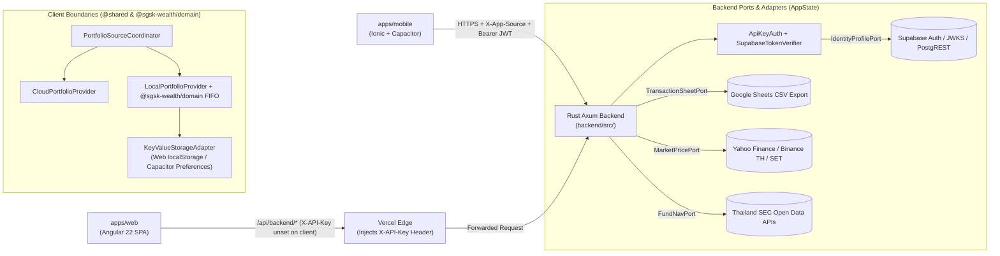

# SGSK-Wealth Architecture Overview

## 1. Monorepo Package & App Map

```text
SGSK-Wealth/
├── packages/
│   ├── contracts/          # @sgsk-wealth/contracts: Framework-free DTOs, ApiResult<T>, AppLang
│   └── domain/             # @sgsk-wealth/domain: FIFO calculator, TVM, rebalance, CSV, filters & pure formatters
├── shared/                 # @shared/*: Angular services, PortfolioDataProvider / PortfolioSourceCoordinator, KeyValueStorageAdapter, i18n, UI components & pipes
├── apps/
│   ├── web/                # @sgsk-wealth/web: Angular 22 Web SPA (Tailwind v4, desktop sidebar + mobile dock)
│   └── mobile/             # @sgsk-wealth/mobile: Angular 22 + Ionic 9 + Capacitor 8 (iOS Xcode + Android Maven)
├── backend/                # sgsk-backend: Rust Axum 0.8 REST API, FIFO engine, market data & Supabase JWT/JWKS guard
├── e2e/                    # sgsk-wealth-e2e: Spring Boot 4.1, Cucumber-JVM, Playwright, Appium, Rest Assured & Allure
├── fixtures/accounting/    # Language-neutral FIFO & CSV parity fixtures shared across Rust and TypeScript
└── docs/                   # architecture/, decisions/, operations/, specs/
```

Architectural boundaries are enforced automatically by `npm run lint:boundaries` ([scripts/check-boundaries.mjs](../../scripts/check-boundaries.mjs)):
- `packages/contracts/src` and `packages/domain/src` cannot import Angular, Ionic, Capacitor, Supabase, RxJS, `shared/`, `apps/`, or `backend/`, nor reference DOM globals (`window.`, `document.`, `localStorage.`, `sessionStorage.`).
- `packages/contracts/src` cannot depend on `packages/domain`.
- Neither `apps/`, `packages/`, nor `shared/` can import from `backend/`.

---

## 2. Trust Boundaries & Request Flow



---

## 3. Backend Grouped State & Ports (`backend/src/state.rs` & `backend/src/ports.rs`)

`AppState` groups dependencies cleanly into four domain structs:
- `infra: InfrastructureDeps` — `settings`, `http` (`HttpResources` with per-upstream semaphores), `cache` (`TTLCache`), `singleflight` (`AsyncSingleflight`)
- `identity: IdentityDeps` — `token_verifier` (`SupabaseTokenVerifier` using `IdentityProfilePort`)
- `market_data: MarketDataDeps` — `nav_service`, `price_service`, `icon_service`
- `portfolio: PortfolioDeps` — `share_lot_service`, `valuation_service`, `performance_service`, `allocation_service`, `dividend_service`, `tools_service`

| Port Trait (`ports.rs`) | Production Adapter | Injected Services |
|---|---|---|
| `TransactionSheetPort` | `GoogleSheetsAdapter` | `ShareLotService` |
| `MarketPricePort` | `PriceServicePortAdapter` | `ValuationService`, `DividendService` |
| `FundNavPort` | `NavServicePortAdapter` | `ValuationService`, `DividendService` |
| `IdentityProfilePort` | `SupabaseProfileAdapter` | `SupabaseTokenVerifier` |

`AppState::with_ports(...)` allows deterministic offline integration tests ([test_offline_ports_and_use_cases.rs](../../backend/tests/test_offline_ports_and_use_cases.rs)) without live external HTTP traffic.

---

## 4. 19-Route Authorization Matrix

Note: Every router is mounted at root (`/`) and nested under `/api/backend/*`.

| # | Method & Path | API Key (`ApiKeyAuth`) | User / Owner Guard | Notes |
|---|---|---|---|---|
| 1 | `GET /` | Required | — | Health check (`Welcome to SGSKBackend!`) |
| 2 | `GET /auth/me` | Required | `OptionalCurrentUser` | Returns `authenticated`, `role`, `canViewCloudPortfolio`, `portfolioSource` |
| 3 | `GET /share-lot/sheet/{tab_id}` | Required | `RequirePortfolioAuthorizedUser` | `200` on valid tab or `Invalid tab id`; `502`/`503` on upstream failure |
| 4 | `GET /share-lot/sheets` | Required | `RequirePortfolioAuthorizedUser` | Aggregates all non-empty `ASSET_TABS`; `502`/`503` if all upstream tabs fail |
| 5 | `GET /portfolio/holdings` | Required | `RequirePortfolioAuthorizedUser` | Valued holdings & lots; `502`/`503` on upstream error (`200` for `Invalid tab id`) |
| 6 | `GET /portfolio/performance` | Required | `RequirePortfolioAuthorizedUser` | Multi-timeframe performance; `502`/`503` on upstream error |
| 7 | `POST /portfolio/allocation` | Required | `RequirePortfolioAuthorizedUser` | Allocation & rebalance targets; `422` invalid JSON; `502`/`503` upstream |
| 8 | `GET /portfolio/dividend` | Required | `RequirePortfolioAuthorizedUser` | Dividend & YOC analytics; `502`/`503` on upstream error |
| 9 | `POST /portfolio/tools/simulate` | Required | Conditional (`OptionalCurrentUser`) | Open when `initialPosition` is supplied; requires owner if looking up by `symbol` |
| 10 | `POST /portfolio/tools/solve-target` | Required | Conditional (`OptionalCurrentUser`) | Open when `initialPosition` is supplied; requires owner if looking up by `symbol` |
| 11 | `POST /portfolio/tools/tvm` | Required | — | Pure TVM solver (guest-accessible) |
| 12 | `POST /portfolio/tools/rebalance` | Required | `RequirePortfolioAuthorizedUser` | Uses portfolio holdings for rebalancing |
| 13 | `POST /price/fetch-prices` | Required | — | Batch quotes & USD/THB FX (`<= 50` summaries, else `422`) |
| 14 | `GET /price/exchange-rate` | Required | — | Spot FX rate lookup |
| 15 | `POST /nav/fetch` | Required | — | Batch mutual fund NAV lookup (`<= 50` symbols, else `422`) |
| 16 | `GET /nav/factsheet` | Required | — | SEC Mutual Fund / PVD factsheet aggregation |
| 17 | `GET /icon/meta/{*symbol}` | Public | — | Exempt from direct-access block on backend hosts |
| 18 | `GET /icon` | Public | — | Query-param icon image (`Cache-Control: public, max-age=86400`) |
| 19 | `GET /icon/{*symbol}` | Public | — | Path-param icon image (`Cache-Control: public, max-age=86400`) |

---

## 5. Backend Cache TTL Inventory (`TTLCache`)

Default capacity is `2000` entries per `TTLCache` instance (`state.rs`: general `cache` defaults to `60s`; `icon_cache` defaults to `86400s`). All cache keys use `AsyncSingleflight` on cache miss to coalesce concurrent upstream fetches.

| Cache Key / Domain | TTL (Seconds) | Source Location |
|---|---|---|
| `sheet_{tab_id}`, `sheet_all` | `120s` | `backend/src/features/portfolio/services/share_lot_service.rs` |
| `dividend_{tab_id}_{currency}` | `120s` | `backend/src/features/dividends/services/dividend_service.rs` |
| `valuation_{tab_id}_{currency}`, `valuation_base_{tab_id}` | `60s` | `backend/src/features/portfolio/services/valuation_service.rs` |
| `perf_*` (performance analytics) | `60s` | `backend/src/features/portfolio/services/performance_service.rs` |
| `supabase_jwks::{url}` | `600s` | `backend/src/utils/supabase_auth.rs` |
| `supabase_user_token::*`, `supabase_profile_flags::{user_id}` | `60s` | `backend/src/utils/supabase_auth.rs` |
| Stock / crypto quote lookups | `60s` | `backend/src/features/market_data/services/price_service.rs` |
| Binance TH ticker array | `30s` | `backend/src/features/market_data/services/price_service.rs` |
| USD/THB FX rate | `300s` | `backend/src/features/market_data/services/price_service.rs` |
| Yahoo historical dividends | `3600s` | `backend/src/features/market_data/services/price_service.rs` |
| SET listed companies catalog | `86400s` | `backend/src/features/market_data/services/price_service.rs` |
| SEC mutual fund NAV | `1800s` | `backend/src/features/market_data/services/nav_service.rs` |
| SEC factsheet / fund dividends / error negative cache | `3600s` | `backend/src/features/market_data/services/nav_service.rs` |
| SEC PVD policy map / AMC & fund metadata | `86400s` | `backend/src/features/market_data/services/nav_service.rs` |
| SEC factsheet hash index | `604800s` | `backend/src/features/market_data/services/nav_service.rs` |
| Resolved symbol icon image & metadata (`icon_cache`) | `86400s` (`3600s` negative) | `backend/src/features/market_data/services/icon_service.rs` |
