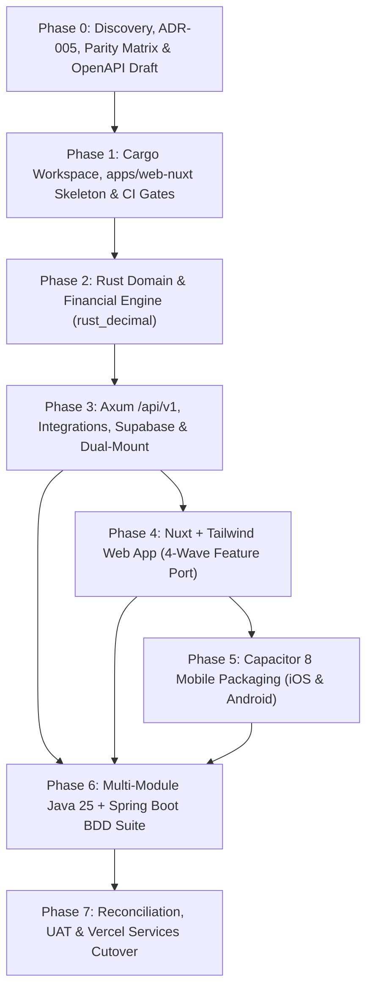

# SGSK-Wealth Architecture Modernization & Rewrite Roadmap

> **Status:** Cutover Applied & Legacy Angular/Ionic/`shared/` Retired (`backend/` + `crates/*` Active)
> **Architecture Baseline:** [ADR-005](../decisions/ADR-005-target-architecture-and-strangler-roadmap.md)
> **Strategy:** Incremental Strangler Migration in `main` with Controlled Cutover

## Phase Execution Status

| Phase | Deliverable | Status |
| :--- | :--- | :--- |
| **Phase 0** | `ADR-005`, `ROADMAP.md`, `FEATURE_PARITY_MATRIX.md`, `DATABASE_ARCHITECTURE.md`, `contracts/openapi/openapi.yaml` | Complete |
| **Phase 1** | Root Cargo workspace (`crates/*`), `apps/web-nuxt` skeleton, `lint:openapi`, parallel CI jobs | Complete |
| **Phase 2** | `crates/domain`, `crates/financial-engine` (`rust_decimal`), `crates/application`, golden parity tests | Complete |
| **Phase 3** | `crates/database`, `crates/integrations`, `crates/api` (`/api/v1/*` + `/api/backend/*` dual-mount) | Complete |
| **Phase 4** | `apps/web-nuxt` shell, composables, modals, Waves 1–4 feature pages, Vitest unit tests | Complete |
| **Phase 5** | Capacitor 8 native bridge (`useNativePlatform.ts`), `cap:sync:nuxt`, `mobile-build.yml` toggle | Complete |
| **Phase 6** | `e2e/` `TestAdapter` + `TestAdapterRegistry` + `@cross-platform` Gherkin specs (Java 25 + Spring Boot 4.1) | Complete |
| **Phase 7** | `scripts/reconcile-api.mjs`, `MIGRATION_ROADMAP.md`, Vercel & Capacitor cutover applied | Cutover Applied |

---

## Target Architecture Summary

| Layer | Current State | Target State |
| :--- | :--- | :--- |
| **Web Frontend** | Angular 22 + Tailwind v4 (`apps/web`) | Nuxt + Tailwind CSS v4 (`apps/web-nuxt` → `apps/web` at cutover) |
| **Mobile Shell** | Angular 22 + Ionic 9 + Capacitor 8 (`apps/mobile`) | Capacitor 8 wrapping shared Nuxt SPA (no Ionic) |
| **Backend** | Single crate `sgsk-backend` (`backend/`) | Cargo Workspace Modular Monolith (`crates/*`) + Axum + `rust_decimal` |
| **API Contract** | 19 routes at `/` & `/api/backend/*` (`f64` JSON) | OpenAPI 3.1 (`/api/v1/*` with decimal strings) + dual-mounted `/api/backend/*` |
| **Database & Cloud Sync** | Supabase (profiles, settings, logo cache) + Google Sheets CSV | Preserved: Supabase + `sqlx` (for Supabase tables) + Google Sheets CSV |
| **Guest / Local Mode** | On-device `KeyValueStorageAdapter` + `@sgsk-wealth/domain` | Preserved on-device local portfolio; Price/NAV/FX/Cloud compute in Rust |
| **BDD Automation** | Single-module Maven (`e2e/`, Java 25 + Spring Boot 4.1) | Multi-module Maven (`bdd-core`, `web-adapter`, `mobile-adapter`, `api-adapter`, `test-runner`) |
| **Hosting** | Vercel Services (`vercel.json`) | Vercel Services (`vercel.json`) |

---

## Phased Roadmap

---

### Phase 0: Discovery, Feature Inventory & Golden Baseline
**Deliverables:**
- `docs/decisions/ADR-005-target-architecture-and-strangler-roadmap.md`
- `docs/implementation/ROADMAP.md` (this document)
- `docs/implementation/FEATURE_PARITY_MATRIX.md`
- `docs/database/DATABASE_ARCHITECTURE.md`
- `contracts/openapi/openapi.yaml` (OpenAPI 3.1 draft for all 19 endpoints)

**Exit Gate:** Governance docs and OpenAPI 3.1 draft pass `lint:boundaries` and `lint:gherkin` with zero regressions.

---

### Phase 1: Monorepo Foundation, Cargo Workspace & CI Skeleton
**Scope:** Establish the target directory layout and CI gates in `main` alongside the existing application.
- **Root Cargo Workspace (`Cargo.toml`):** Define workspace members `crates/common`, `crates/domain`, `crates/financial-engine`, `crates/application`, `crates/database`, `crates/integrations`, and `crates/api` while keeping `backend/` untouched and compilable.
- **OpenAPI Tooling (`contracts/`):** Wire OpenAPI 3.1 validation and TypeScript client type generation into root `package.json`.
- **Nuxt Skeleton (`apps/web-nuxt/`):** Bootstrap Nuxt + Tailwind CSS v4 importing `@sgsk-wealth/design-tokens` CSS layers and `shared/src/i18n/{en,th}.ts`.
- **CI/CD (`.github/workflows/ci.yml`):** Add parallel jobs for Cargo workspace (`fmt`, `clippy -D warnings`, `test`), OpenAPI validation, and `apps/web-nuxt` typecheck/build while keeping `npm run check` green.

**Exit Gate:** Cargo workspace compiles, `apps/web-nuxt` builds, OpenAPI lints, and existing CI remains green.

---

### Phase 2: Rust Domain & Financial Engine (`crates/domain`, `crates/financial-engine`, `crates/application`)
**Scope:** Extract core domain logic and migrate authoritative accounting math to `rust_decimal`.
- **`crates/domain`:** Pure entities, value objects (`Currency`, `AssetTab`, `Transaction`, `ShareLot`, `DividendEvent`, `UserPreferences`), and domain errors with zero `axum`/`sqlx`/`reqwest` dependencies.
- **`crates/financial-engine`:** Port FIFO lot matching, valuation, realized/unrealized P&L, dividend/withholding tax (U.S. 15%/30%, Thai 10%/0%), FX conversion, allocation/rebalance, TVM solver, and performance returns to `rust_decimal` with explicit rounding rules.
- **`crates/application`:** Define use cases and port traits (`TransactionSheetPort`, `MarketPricePort`, `FundNavPort`, `IdentityProfilePort`, `UserSettingsRepository`).
- **Golden Parity:** Validate against `fixtures/accounting/fifo_scenarios.json` and expanded `contracts/fixtures/` golden datasets.

**Exit Gate:** `cargo test --workspace` passes all unit tests and golden financial fixtures offline.

---

### Phase 3: Axum `/api/v1`, Integrations, Supabase & Dual-Mount (`crates/api`, `crates/database`, `crates/integrations`)
**Scope:** Implement the production REST API boundary, external provider adapters, and Supabase database integration.
- **`crates/integrations`:** Migrate `PriceService` (Yahoo Finance, Binance TH, SET), `NavService` (Thailand SEC Mutual Fund & PVD APIs), `IconService` (Supabase Storage `symbol-logos`), and `GoogleSheetsAdapter` behind application ports with bounded timeouts, retries, `TTLCache`, and `AsyncSingleflight`.
- **`crates/database`:** Implement `sqlx` / PostgREST access for `user_profiles`, `user_settings`, and `symbol_logo_cache`, preserving existing Supabase Auth JWKS/JWT verification, fail-closed owner authorization ([ADR-004](../decisions/ADR-004-fail-closed-production-owner-auth.md)), and RLS isolation tests.
- **`crates/api`:** Implement `/api/v1/*` handlers with OpenAPI 3.1 schemas, decimal strings, standardized error envelope, and dual-mount legacy `/api/backend/*` routes for strangler compatibility.

**Exit Gate:** Rust API integration tests (`wiremock` + test Supabase) and Rest Assured `@api` contract tests pass, including cross-user authorization negative tests.

---

### Phase 4: Nuxt + Tailwind Web Application (`apps/web-nuxt`)
**Scope:** Deliver 1-to-1 Web UI feature parity on Nuxt + Tailwind CSS.
- **Foundation:** App shell (desktop sidebar + responsive mobile bottom dock), Supabase Auth (`/auth/callback`), `Dark`/`Light`/`System` theme sync, `en`/`th` i18n, privacy mask toggle, dual-currency (`THB` ↔ `USD`) display, and generated OpenAPI TS client.
- **4-Wave Feature Port:**
  1. **Wave 1 (Core Read):** Auth screen, Dashboard Overview, Holdings + FIFO Lots + PVD Holdings, Fund Factsheet Modal.
  2. **Wave 2 (Ledger & Income):** Transaction History (filters, search, CSV export), Dividend & YOC Analytics.
  3. **Wave 3 (Analytics & Tools):** Asset Allocation & Rebalance, Performance Analytics, Financial Tools (Avg Cost Simulator, Target Cost Solver, TVM Calculator, Rebalance Calculator).
  4. **Wave 4 (Preferences, Local Mode & Resilience):** User Settings Modal, Local Guest Portfolio (`KeyValueStorageAdapter` + `@sgsk-wealth/domain` + Rust Price/NAV/FX), error/offline states.

**Exit Gate:** Full Web feature parity verified against `FEATURE_PARITY_MATRIX.md`, `npm run check:secrets` passes, and Playwright Web E2E scenarios pass against `apps/web-nuxt`.

---

### Phase 5: Capacitor 8 Mobile Packaging (`apps/mobile`)
**Scope:** Package the shared Nuxt SPA in Capacitor 8 for iOS and Android without Ionic 9.
- **Native Shell:** Point `apps/mobile/capacitor.config.ts` `webDir` to the built Nuxt SPA output while preserving `apps/mobile/ios/` (Xcode) and `apps/mobile/android/` (Maven `pom.xml`).
- **Native Plugins & UX:** Wire `@capacitor/status-bar` (`#0B1220` dark / `#FFFFFF` light), `@capacitor/haptics`, `@capacitor/preferences`, `@capacitor/splash-screen`, `@capacitor/app` (deep links + Android hardware `backButton`), safe-area insets (`env(safe-area-inset-*)`), and stable E2E selectors (`#mobile-*`, `[data-symbol-lots]`).

**Exit Gate:** `npm run cap:sync`, `mvn -f apps/mobile/android/pom.xml package`, iOS Simulator build, and Appium `@mobile` smoke tests pass.

---

### Phase 6: Multi-Module Java 25 + Spring Boot 4.1 BDD Suite (`e2e/`)
**Scope:** Refactor `e2e/` into a shared-specification, adapter-driven multi-module Maven project while preserving Java 25 + Spring Boot 4.1.
- **Modules:**
  - `bdd-core`: Canonical `.feature` files, shared `TestAdapter` interface, Spring scenario context, AssertJ assertions, isolated test data builders.
  - `web-adapter`: Playwright Java browser/context lifecycle and Page Objects targeting Nuxt UI.
  - `mobile-adapter`: Appium Java iOS/Android driver lifecycle and Screen Objects targeting Capacitor.
  - `api-adapter`: Rest Assured clients and OpenAPI schema validation.
  - `test-runner`: JUnit Platform + Cucumber-JVM runner supporting `-Dtest.target=web|mobile|api` and tag filters (`@smoke`, `@regression`, `@cross-platform`, `@web`, `@mobile`, `@api`).
- **Consolidation:** Promote equivalent user journeys across the 25 `.feature` files to `@cross-platform` while keeping platform-specific tests cleanly tagged and `npm run lint:gherkin` green.

**Exit Gate:** Shared `@cross-platform` scenarios pass identically on `web`, `mobile`, and `api` targets with Allure 3 reports published.

---

### Phase 7: Reconciliation, UAT & Controlled Strangler Cutover
**Scope:** Verify numerical/behavioral parity and cut over production traffic via Vercel Services.
- **Reconciliation:** Run automated diff checks comparing `/api/backend/*` (`f64`) vs `/api/v1/*` (`rust_decimal`) across all 8 asset tabs and representative portfolios.
- **Cutover:** Update `vercel.json` to route production traffic to Nuxt Web and `crates/api`. Keep legacy fallback and documented rollback runbook during the stabilization window.
- **Cleanup:** Retire legacy Angular `apps/web`, Ionic `apps/mobile` Angular code, `shared/` Angular layer, legacy `backend/` crate, and `/api/backend/*` shim after stabilization sign-off.

**Exit Gate:** All production acceptance criteria, security scans, and rollback rehearsals pass.
