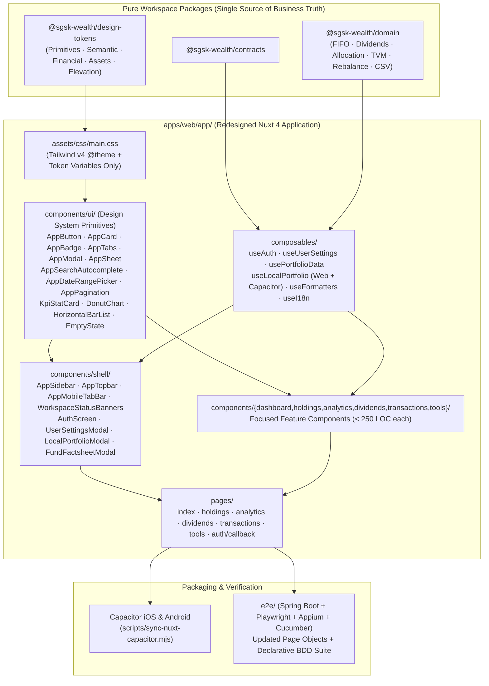

# SGSK-Wealth Nuxt 4 Full Site Redesign & Functional Parity Plan

## Goal Description

During the migration from Angular 22 (`fe983e5`) to Nuxt 4 ([apps/web/](file:///c:/dev/SGSK-Wealth/apps/web)), two systemic regressions degraded the user experience and broke parity:

1. **Systemic CSS Collisions & Broken Tailwind Cascade**:
   - [main.css](file:///c:/dev/SGSK-Wealth/apps/web/app/assets/css/main.css) globally imports **22 legacy Angular component stylesheets** ([shell.css](file:///c:/dev/SGSK-Wealth/apps/web/app/assets/css/shell.css) at 4,185 lines plus 21 feature CSS files) **without Angular's `_ngcontent` view-encapsulation**, causing generic class names (`.card-header`, `.metric-card`, `.toolbar`, `.dropdown-item`, `.type-pill`, `.hero-card`, `.empty-state`) to bleed and overwrite each other across routes.
   - An **unlayered** `*, *::before, *::after { margin: 0; padding: 0; }` reset in [main.css](file:///c:/dev/SGSK-Wealth/apps/web/app/assets/css/main.css#L54-L61) has higher CSS cascade priority than Tailwind CSS v4's `@layer utilities`, wiping out utility spacing classes (`p-*`, `px-*`, `py-*`, `m-*`, `mt-*`) across Nuxt templates.
   - Ad-hoc `z-index` values caused sticky headers (`.header { z-index: 850 }`) and sibling inputs to intercept dropdowns, popovers, and modals.
2. **Lost or Degraded Legacy Angular Functionalities**:
   - Pages were condensed into monolithic `.vue` files ([tools.vue](file:///c:/dev/SGSK-Wealth/apps/web/app/pages/tools.vue) 1,129 lines, [analytics.vue](file:///c:/dev/SGSK-Wealth/apps/web/app/pages/analytics.vue) 785 lines, [holdings.vue](file:///c:/dev/SGSK-Wealth/apps/web/app/pages/holdings.vue) 618 lines, [transactions.vue](file:///c:/dev/SGSK-Wealth/apps/web/app/pages/transactions.vue) 616 lines, [dividends.vue](file:///c:/dev/SGSK-Wealth/apps/web/app/pages/dividends.vue) 521 lines) that dropped or simplified key workflows from legacy Angular (`fe983e5`), including:
     - Interactive custom calendar `DateRangePicker` (8 presets + dual-click start/end calendar with hover range preview)
     - Transaction ledger pagination (`10 / 50 / 100` rows + ellipsis page numbers) and Status (`all`/`open`/`closed`) × Asset-Type CSV export scopes + mobile ledger cards
     - Multi-column sorting (`asc`/`desc`) in Performance and Dividends tables + Top Gainers / Top Losers split rankings
     - Dedicated Holding Dividend Payout Ledger modal/drawer and SEC Mutual Fund Distribution History modal (`recentDistributions`)
     - Holdings `"View Trades"` pre-filtering (`/transactions?symbol=AAPL`) and Dashboard mover/slice click-through deep-links
     - Rebalance Planner quick-weight presets (**Equal Weight**, **Current Weight**, **Normalize to 100%**, **Reset**), `+/-` steppers, and **Copy Trade Orders to Clipboard**
     - Average Cost Calculator quick price-adjustment pills (`-10%`, `-5%`, `Market`, `+5%`, `+10%`) and custom currency/asset-type controls
     - TVM Calculator live Portfolio / Asset-Class Present Value linking, Begin/End timing, and interactive SVG Line/Stacked Area chart with hover tooltips
     - Local Portfolio JSON export (`sgsk-local-portfolio.json`), Capacitor `@capacitor/preferences` persistence parity, `#local-quotes-warning` partial quote banner, and `#reauth-btn` on `401` errors

This plan **redesigns and rewrites every Nuxt 4 layout, UI primitive, modal, and feature page from the ground up**, restores **100% of legacy Angular business capabilities** on top of `@sgsk-wealth/domain` and `@sgsk-wealth/contracts`, maintains Capacitor iOS/Android parity, and updates the **Spring Boot + Playwright/Appium + Cucumber E2E suite ([e2e/](file:///c:/dev/SGSK-Wealth/e2e))** to match the new design and verify all restored workflows.

---

## User Review Required

> [!IMPORTANT]
> **100% Preservation of Business Logic, Contracts & Backend**
> Pure financial logic in [@sgsk-wealth/domain](file:///c:/dev/SGSK-Wealth/packages/domain/src/index.ts), DTO schemas in [@sgsk-wealth/contracts](file:///c:/dev/SGSK-Wealth/packages/contracts/src/index.ts), Supabase Auth/Settings sync (`user_profiles`, `user_settings`), Google Sheets cloud portfolio sync, and Rust Axum endpoints (`/api/v1/*` & `/api/backend/*`) remain **unchanged in business rules**.

> [!WARNING]
> **Full Retirement of Legacy Unscoped Angular CSS (`~9,500` LOC)**
> All 22 legacy global CSS files under `apps/web/app/assets/css/` (`shell.css`, `header.css`, `auth.css`, `polish.css`, and `features/*.css`) will be deleted and replaced by `@sgsk-wealth/design-tokens` + Tailwind CSS v4 `@theme` utilities + modular UI primitives (`components/ui/*`).

---

## Confirmed Design Decisions

1. **Visual Aesthetic Direction (Confirmed)**: **Institutional Wealth Terminal** (crisp `1px` hairlines `--color-border`, layered slate-navy dark surfaces `#0B1220 -> #111C2E` and clean alabaster light surfaces `#F8FAFC -> #FFFFFF`, strict `tabular-nums` monospace numerals, high signal-to-noise hierarchy, and WCAG AA contrast across Dark & Light themes).
2. **Workspace Navigation Layout (Confirmed)**: **Collapsible Left Sidebar + Contextual Top Command Bar on Desktop (`>= 1024px`)**, paired with an **Adaptive Bottom Tab Bar + Sheet Modals on Mobile & Capacitor (`< 1024px`)**.
3. **E2E Selector & Feature Scope (Recommended Default)**: Deterministic `data-testid` + semantic ARIA role contract in `e2e/` Page Objects with added declarative Gherkin scenarios for restored legacy Angular features (calendar range picker, pagination, dividend modals, rebalance presets/clipboard).

---

## Target Architecture & Component Hierarchy



### Design System Standards

| Dimension | Standard |
| :--- | :--- |
| **Typography & Financial Alignment** | `Inter` + `Noto Sans Thai` for prose; mandatory `font-variant-numeric: tabular-nums` (`tnum`, `zero`) on all monetary amounts, share quantities, percentages, dates, and table cells. |
| **Tokenized Elevation (`z-index`)** | `--z-sticky: 100`, `--z-sidebar: 200`, `--z-topbar: 300`, `--z-backdrop: 400`, `--z-popover: 450`, `--z-modal: 500`, `--z-toast: 600` — preventing header/input pointer interception across all popovers and dialogs. |
| **Theme & Privacy Sync** | Reactive `<html lang data-theme data-theme-mode data-privacy>` via `useHead()`; Dark (`#0B1220`), Light (`#F8FAFC`), and System modes; `[data-privacy="true"]` blurs currency/share totals while preserving return `%` and badge counts. |
| **Bilingual EN / TH Parity** | Zero hardcoded UI strings in Vue templates; complete `en.ts` / `th.ts` key parity; cross-language symbol/name search (`"PTT"` and `"ปตท"` match in both EN and TH); `Intl.DateTimeFormat` localized dates. |
| **Responsive & Native Ergonomics** | Desktop (`>= 1024px`) multi-column analytical grids; Tablet (`640–1023px`) 2-column adaptive grids; Mobile (`< 640px`) touch-friendly cards (`min-height: 44px` tap targets), bottom-sheet modals, `env(safe-area-inset-*)`, status-bar color sync, haptics, and Android hardware back-button handling. |

---

## Functional Parity Matrix (Legacy Angular vs. Current Nuxt vs. Redesigned Nuxt)

| Capability | Legacy Angular (`fe983e5`) | Current Nuxt | Redesigned Nuxt |
| :--- | :---: | :---: | :---: |
| **CSS Architecture** | Scoped per component | ❌ 22 unscoped global CSS files + broken Tailwind reset | ✅ Pure Tailwind v4 `@theme` + `@sgsk-wealth/design-tokens` + `components/ui/*` |
| **Shell: Partial Quotes Warning & `401` Re-Auth** | ✅ `#local-quotes-warning` & `#reauth-btn` | ❌ Missing | ✅ Restored in `WorkspaceStatusBanners.vue` |
| **Local Portfolio: Capacitor Sync & JSON Export** | ✅ Native storage + CSV & JSON export | ⚠️ `localStorage` only, CSV only | ✅ Dual `useNativePlatform()` + `localStorage`, CSV/JSON import & export, sample & 2-step clear |
| **Dashboard: Interactive Donut & Symbol Deep-Links** | ✅ Hover slice callout + click mover/holding | ⚠️ Static links | ✅ Interactive `DonutChart.vue`, mover/class deep-links, normalized recent trades, PVD card |
| **Holdings: `"View Trades"` Pre-Filter & Keyboard Search** | ✅ Links to symbol trades; arrow-key autocomplete | ❌ Unfiltered `/transactions` link; mouse-only | ✅ `/transactions?symbol=<sym>`, keyboard-navigable ranked search, FIFO lot accordion |
| **PVD Holdings: Localized `RS1–RS8` & Policy Donut** | ✅ `pvd.rs.1..8` i18n + interactive slice callout | ⚠️ Hardcoded mixed TH/EN risk labels | ✅ Full i18n `RS1–RS8` risk meter, interactive policy donut, Employee/Employer split bars |
| **Analytics: Custom Calendar `DateRangePicker`** | ✅ 8 presets + interactive month/year range calendar | ❌ 6 preset buttons only | ✅ `AppDateRangePicker.vue` with 8 presets + start/end calendar & hover range preview |
| **Performance: Multi-Column Sort & Split Movers** | ✅ Sortable columns + Gainers/Losers + Show All | ❌ Unsortable table | ✅ Sortable columns (`asc`/`desc`), Top Gainers & Top Losers cards, keyboard search |
| **Allocation: Live Drift, USD/THB Split & Drill-Down** | ✅ Donut/row toggle, USD/THB bar, concentration | ⚠️ Basic table | ✅ Interactive donut + class symbol drill-down, live target inputs, USD/THB & concentration |
| **Dividends: Sortable Table, Ledger & SEC Fund Modal** | ✅ Sortable + Holding Ledger modal + SEC Fund modal | ❌ Unsortable, no SEC modal | ✅ Sortable breakdown table, `DividendLedgerModal.vue`, and `FundDistributionsModal.vue` |
| **Transactions: Pagination (`10/50/100`) & Scoped CSV** | ✅ Paginated + Status × Asset CSV + mobile cards | ❌ Unpaginated, basic CSV | ✅ `AppPagination.vue` (`10/50/100`), Status (`all/open/closed`) × Asset CSV, mobile cards |
| **Tools — Avg Cost: Quick Price Pills & Step Chain** | ✅ `±5%/±10%/Mkt` pills, custom asset/currency, chain | ⚠️ Partial custom mode | ✅ `AvgCostCalculator.vue` with quick price pills, custom asset/currency, multi-step chain & Solver |
| **Tools — TVM: Live Portfolio PV & SVG Hover Chart** | ✅ Portfolio/Class PV import, Begin/End, Line/Area SVG | ⚠️ Simplified chart | ✅ `TvmCalculator.vue` with live portfolio/class PV sync, 5 solve modes, Line/Area SVG + schedule |
| **Tools — Rebalance: Presets & Copy to Clipboard** | ✅ Equal/Current/100% presets, steppers, Copy Orders | ❌ Equal weight only | ✅ `RebalancePlanner.vue` with Equal/Current/Normalize presets, No-Sell modes, Copy Clipboard |

---

## Proposed Changes

### Phase 1: Design Tokens, CSS Architecture Cleanup & UI Primitives

#### [MODIFY] [index.css](file:///c:/dev/SGSK-Wealth/packages/design-tokens/src/index.css) & [components.css](file:///c:/dev/SGSK-Wealth/packages/design-tokens/src/components.css)
- Add elevation (`--z-sticky` through `--z-toast`), border-radius (`--radius-sm` through `--radius-xl`), and shell layout dimension tokens (`--sidebar-width`, `--sidebar-collapsed-width`, `--topbar-height`, `--mobile-nav-height`).

#### [MODIFY] [main.css](file:///c:/dev/SGSK-Wealth/apps/web/app/assets/css/main.css)
- Remove all 22 legacy global CSS imports (`shell.css`, `header.css`, `auth.css`, `polish.css`, `features/*.css`).
- Remove the unlayered `* { margin: 0; padding: 0; }` override so Tailwind v4 `@layer utilities` spacing classes work natively.
- Map `@sgsk-wealth/design-tokens` into Tailwind v4 `@theme` and keep clean base rules for `tabular-nums` and `[data-privacy="true"]` masking.

#### [DELETE] Legacy Angular CSS Files in `apps/web/app/assets/css/`
- Delete `shell.css`, `header.css`, `auth.css`, `polish.css`, and `apps/web/app/assets/css/features/*.css`.

#### [NEW] Core Design System Primitives in `apps/web/app/components/ui/`
- `AppButton.vue`, `AppCard.vue`, `AppBadge.vue`, `AppTabs.vue`, `AppModal.vue`, `AppSheet.vue`, `AppSearchAutocomplete.vue`, `AppDateRangePicker.vue` (8 presets + interactive month/year calendar grid), `AppPagination.vue` (`10 / 50 / 100` + `buildDisplayedPageNumbers`), `KpiStatCard.vue`, `DonutChart.vue`, `EmptyState.vue`, and `ToastBanner.vue`.

---

### Phase 2: Composables, i18n Dictionary Completion & Workspace Shell Rewrite

#### [MODIFY] [useLocalPortfolio.ts](file:///c:/dev/SGSK-Wealth/apps/web/app/composables/useLocalPortfolio.ts) & [usePortfolioData.ts](file:///c:/dev/SGSK-Wealth/apps/web/app/composables/usePortfolioData.ts)
- Persist local transactions to both `useNativePlatform()` (`@capacitor/preferences`) and `localStorage`; add `exportJson()` alongside `exportCsv()`.
- Expose `pricesError` (partial quote warning) and `isUnauthorizedError` (`401`) in `usePortfolioData.ts`; wire `startDate` and `endDate` into `getPerformance(timeframe, startDate, endDate)` and `refreshPerformance(timeframe, startDate, endDate)`.

#### [MODIFY] [en.ts](file:///c:/dev/SGSK-Wealth/apps/web/app/i18n/en.ts) & [th.ts](file:///c:/dev/SGSK-Wealth/apps/web/app/i18n/th.ts)
- Add complete EN/TH translations for calendar weekdays/months/presets, pagination controls, `pvd.rs.1..8` risk tiers, rebalance clipboard/preset actions, and dividend ledger/distribution modals.

#### [MODIFY] [default.vue](file:///c:/dev/SGSK-Wealth/apps/web/app/layouts/default.vue) & Shell/Modal Components (`apps/web/app/components/shell/`)
- Decompose the workspace shell into `AppSidebar.vue`, `AppTopbar.vue`, `AppMobileTabBar.vue`, and `WorkspaceStatusBanners.vue` (`#local-workspace-bar`, `#local-quotes-warning`, `#error-state` with `#retry-btn` & `#reauth-btn`).
- Rewrite [AuthScreen.vue](file:///c:/dev/SGSK-Wealth/apps/web/app/components/AuthScreen.vue), [UserSettingsModal.vue](file:///c:/dev/SGSK-Wealth/apps/web/app/components/UserSettingsModal.vue), [LocalPortfolioModal.vue](file:///c:/dev/SGSK-Wealth/apps/web/app/components/LocalPortfolioModal.vue), and [FundFactsheetModal.vue](file:///c:/dev/SGSK-Wealth/apps/web/app/components/FundFactsheetModal.vue) using unified design system primitives.

---

### Phase 3: Full Rewrite of All 6 Feature Pages & Domain Components

#### [MODIFY] [index.vue](file:///c:/dev/SGSK-Wealth/apps/web/app/pages/index.vue) + `[NEW] apps/web/app/components/dashboard/*`
- Rewrite Dashboard into `DashboardHero.vue`, `DashboardAllocationCard.vue` (interactive `DonutChart` + slice hover/click), `DashboardMoversCard.vue` (with symbol deep-link to Holdings), `DashboardPvdSnapshot.vue` (with PVD Factsheet trigger), `DashboardRecentTrades.vue` (normalized `transactionSummaries` + `rawTransactions` fallback), and `DashboardQuickTools.vue`.

#### [MODIFY] [holdings.vue](file:///c:/dev/SGSK-Wealth/apps/web/app/pages/holdings.vue) & [PvdHoldings.vue](file:///c:/dev/SGSK-Wealth/apps/web/app/components/PvdHoldings.vue) + `[NEW] apps/web/app/components/holdings/*`
- Rewrite Holdings into `MarketHoldingsToolbar.vue` (8-tab `AppTabs`, keyboard `AppSearchAutocomplete`, 5 sort pills with direction), `HoldingPositionCard.vue` (with `/transactions?symbol=<sym>` pre-filter link, Mutual Fund Factsheet icon, and smooth FIFO lot table/mobile cards), `ClosedPositionsSection.vue`, and fully localized `PvdHoldings.vue`.

#### [MODIFY] [analytics.vue](file:///c:/dev/SGSK-Wealth/apps/web/app/pages/analytics.vue) + `[NEW] apps/web/app/components/analytics/*`
- Rewrite Analytics into 3 sub-panes (`AnalyticsOverviewPane.vue`, `AssetAllocationPane.vue`, `PerformancePane.vue`):
  - `AssetAllocationPane.vue`: Interactive donut + class drill-down symbol list, live target % inputs with drift/rebalance badges, Currency Exposure (`USD`/`THB`), and Holdings Concentration.
  - `PerformancePane.vue`: `AppDateRangePicker.vue` (8 presets + custom calendar), Asset/Status filters, keyboard `AppSearchAutocomplete.vue`, 5 KPI cards, Asset Type Return bars, Top Gainers & Top Losers cards, and multi-column sortable Symbol Performance table with `Show All` toggle.

#### [MODIFY] [dividends.vue](file:///c:/dev/SGSK-Wealth/apps/web/app/pages/dividends.vue) + `[NEW] apps/web/app/components/dividends/*`
- Rewrite Dividends into `DividendsHeroGrid.vue`, `DividendsCashflowChart.vue` (year/asset filters + stacked monthly bars), `DividendsAssetCards.vue`, `DividendsSymbolTable.vue` (searchable & multi-column sortable), `DividendLedgerModal.vue` (holding payout records), and `FundDistributionsModal.vue` (SEC mutual fund distributions).

#### [MODIFY] [transactions.vue](file:///c:/dev/SGSK-Wealth/apps/web/app/pages/transactions.vue) + `[NEW] apps/web/app/components/transactions/*`
- Rewrite Transactions with `?symbol=` route query sync, `TransactionSymbolSelector.vue`, `TransactionHeroCard.vue`, `TransactionExportMenu.vue` (`all`/`open`/`closed` × asset-type CSV export via `generateTransactionsCsv` & `generateExportFilename`), desktop 10-column ledger + mobile transaction cards, and `AppPagination.vue` (`10 / 50 / 100`).

#### [MODIFY] [tools.vue](file:///c:/dev/SGSK-Wealth/apps/web/app/pages/tools.vue) + `[NEW] apps/web/app/components/tools/*`
- Replace the 1,129-line monolith with `ToolsWorkspaceHeader.vue` + 3 modular calculators:
  - `AvgCostCalculator.vue` (Forward DCA/Sell + quick price pills `±5%/±10%/Mkt` + custom symbol currency/asset-type + multi-step simulation queue + Reverse Goal Solver)
  - `TvmCalculator.vue` (5 solve modes + Manual/Portfolio PV source with asset-class chips + Begin/End payment timing + interactive SVG Line/Area chart + schedule table)
  - `RebalancePlanner.vue` (Standard vs. No-Sell cash modes + `Equal` / `Current` / `Normalize 100%` / `Reset` presets + `+/-` target steppers + Copy Trade Orders to Clipboard)

---

### Phase 4: Capacitor Sync, Unit Tests & E2E Suite Redesign (`e2e/`)

#### [MODIFY] Vitest Unit & Component Suite (`apps/web/tests/*.spec.ts`)
- Expand Vitest coverage for `AppDateRangePicker`, `AppPagination`, `useLocalPortfolio` (CSV/JSON + Capacitor storage sync), and calculator/filter composables.

#### [MODIFY] Web E2E Page Objects & Steps (`e2e/src/test/java/com/sgsk/wealth/e2e/web/**`)
- Update `HeaderPage`, `ResponsiveLayoutPage`, `DashboardPage`, `HoldingsPage`, `PvdHoldingsPage`, `FactsheetModalPage`, `AllocationPage`, `PerformancePage`, `DividendPage`, `TransactionsPage`, `ToolsPage`, and step definitions to bind against clean semantic/`data-testid` selectors in the redesigned Nuxt UI.

#### [MODIFY] Web E2E Feature Specifications (`e2e/src/test/resources/features/web/**`)
- Keep all existing `@smoke`, `@web`, and `@cross-platform` scenarios passing and add declarative Gherkin scenarios covering restored Angular capabilities (calendar custom date range, performance/dividend column sorting, dividend ledger modal, transaction pagination & `closed` CSV export, Holdings -> Transactions symbol deep-link, rebalance presets & clipboard copy, local JSON export).

---

## Verification Plan

### Automated Quality Gates
```bash
# Architecture boundaries & strict Gherkin BDD lint
npm run lint:boundaries
npm run lint:gherkin

# Contracts, Domain & Nuxt Web unit tests
npm run test:contracts
npm run test:domain
npm run test:web

# Production static build, Capacitor native asset sync & secret scan
npm run generate:web
node scripts/sync-nuxt-capacitor.mjs
npm run check:secrets

# Rust backend lint & test parity
npm run lint:backend
npm run test:backend

# Full Spring Boot + Playwright + Cucumber E2E Suite
npm run test:e2e:smoke
npm run test:e2e
```

### Manual / Visual Review
1. Start the workspace (`npm run dev`) and inspect Desktop (`1440×900`) and Mobile (`390×844`) layouts across **Dark**, **Light**, and **System** themes, and in both **EN** and **TH** languages.
2. Verify **Privacy Mode** blurs currency/share amounts while keeping percentages readable.
3. Test **Guest/Local Mode** (sample data, Add/Edit/Delete trade, CSV/JSON import & export) and **Authenticated Owner Cloud Mode** across all 6 workspace modules and 4 modals.
4. Review before/after screenshots captured in `walkthrough.md` upon completion.
