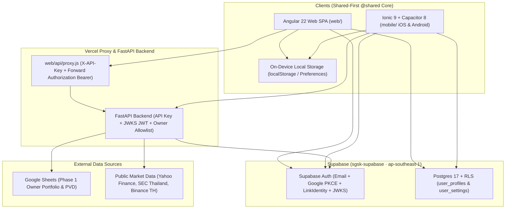
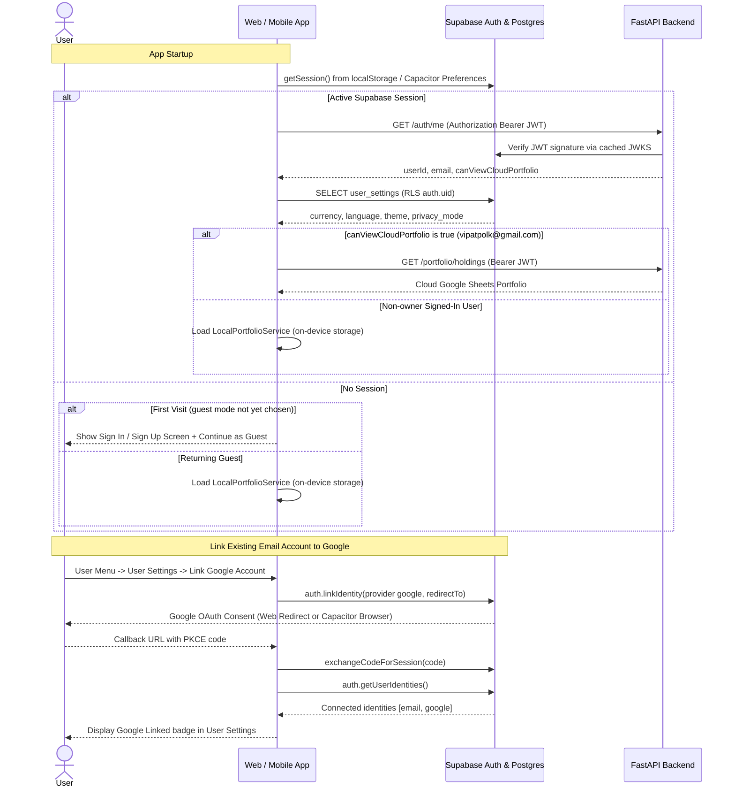
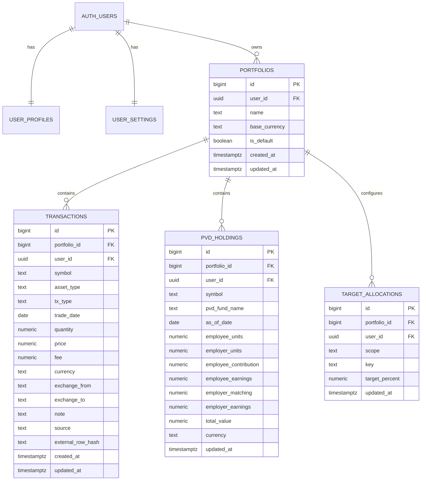

# SGSK-Wealth User System — Architecture & Implementation Plan

## Goal Description

Design and implement a full cross-platform user system (**Web**, **iOS**, **Android**, and **FastAPI Backend**) backed by the provisioned **Supabase** project (`sgsk-supabase`, project ref `jjdnxifgpbdvntfwhyzz`, Postgres 17 in `ap-southeast-1`), while providing a complete local-only portfolio experience for unregistered users and establishing a clean architectural runway to migrate portfolio storage from Google Sheets to Supabase in Phase 2.

### Core Requirements & Product Decisions

| Requirement | Architectural Decision |
| :--- | :--- |
| **Only authorized user can view portfolio** | In Phase 1 (while cloud portfolio data reads from owner Google Sheets), **only `vipatpolk@gmail.com`** (verified email + server-side allowlist + DB authorization flag) is permitted to access cloud portfolio endpoints (`/portfolio/*`, `/share-lot/*`, and portfolio-backed tools). When signed in as `vipatpolk@gmail.com`, the app **always displays the Cloud (Google Sheets) portfolio** (no local sandbox toggle). All other callers receive `401 Unauthorized` (unauthenticated) or `403 Forbidden` (authenticated non-owner). Per-user cloud portfolios arrive in Phase 2. |
| **Sign In / Sign Up screen** | Dedicated Auth screen (Web & Ionic Mobile) that **first-time unregistered visitors land on by default**, supporting Email/Password Sign In, Sign Up, Forgot Password, **Continue with Google**, and **Continue as Guest (Local Data Only)** (remembered across subsequent visits). |
| **Google or Email auth** | Powered by **Supabase Auth** (`flowType: 'pkce'` on Web; `@capacitor/browser` system browser + custom URL scheme `com.sgsk.wealth.mobile://auth/callback` deep linking on iOS & Android). |
| **Link existing account to Google** | Powered by Supabase **Manual Identity Linking** (`supabase.auth.linkIdentity({ provider: 'google' })`) inside **User Settings → Connected Accounts**, supporting linking even when the Google email differs, plus safe unlinking when $\ge 2$ identities exist. |
| **Unregistered users → Local data only** | Full **Local-Only Portfolio Workspace** stored strictly on-device (`localStorage` on Web, `@capacitor/preferences` on iOS/Android). Guests (and Phase 1 non-owner signed-in users) can add/edit/delete transactions, import/export CSV, or load sample data, and use Dashboard, Holdings, Analytics, Dividends, Transactions, and Tools with **zero** calls to cloud Google Sheets endpoints. |
| **User data stored on Supabase** | `public.user_profiles` (identity + immutable authorization flags) and `public.user_settings` (synced currency, language, theme, privacy, target allocations) on `sgsk-supabase`, protected by strict Postgres Row-Level Security (RLS) and column-level SQL privileges. |
| **Top-right User Menu & Settings** | Keep **Privacy Mode** (eye icon) and **USD/THB exchange rate badge** in the top header. Move **Currency (`THB`/`USD`)**, **Language (`EN`/`TH`)**, and **Theme (`Dark`/`Light`)** into **User Settings**, opened from a new **top-right User Menu** (Web dropdown + Mobile Ionic sheet modal). |
| **Future Google Sheets → Supabase plan** | Documented in **Future Phase 2 Plan** below (not implemented in Phase 1): multi-tenant Postgres schema, repository abstraction, per-user cache isolation, idempotent migration script, parity validation, and cutover plan. |

---

## User Review Required

> [!IMPORTANT]
> **External Configuration Prerequisites (Before Live OAuth & Production Verification)**
> 1. **Google Cloud Console**: Create an OAuth 2.0 Web Client with Authorized Redirect URI `https://jjdnxifgpbdvntfwhyzz.supabase.co/auth/v1/callback` and configure the Client ID & Secret under **Supabase Dashboard → Authentication → Providers → Google**.
> 2. **Supabase Auth Settings (`sgsk-supabase` / `jjdnxifgpbdvntfwhyzz`)**:
>    - Keep **Confirm email** enabled (prevents unverified sign-ups from claiming `vipatpolk@gmail.com`).
>    - Enable **Manual Linking** (`Authentication → Settings → Enable Manual Linking`) so existing Email accounts can link Google from User Settings.
>    - Set **Site URL** to `https://sgsk-wealth.vercel.app`.
>    - Add **Additional Redirect URLs**:
>      - `http://localhost:4200/auth/callback`
>      - `http://localhost:4201/auth/callback`
>      - `https://sgsk-wealth.vercel.app/auth/callback`
>      - `com.sgsk.wealth.mobile://auth/callback`
> 3. **Environment Variables (`.env` & Vercel Dashboard)**:
>    - Backend: `SUPABASE_URL=https://jjdnxifgpbdvntfwhyzz.supabase.co` and `AUTHORIZED_PORTFOLIO_EMAILS=["vipatpolk@gmail.com"]`.
>    - Frontend (`web/` & `mobile/`): `supabaseUrl` and `supabasePublishableKey` (modern `sb_publishable_...` key — **never** expose `service_role` or `sb_secret_...` to clients).

> [!WARNING]
> **Security Catch: Portfolio Side-Channel in `/portfolio/tools/*`**
> Code inspection of [tools_service.py](file:///c:/dev/SGSK-Wealth/backend/services/tools_service.py) revealed that:
> - `POST /portfolio/tools/rebalance` always calls `valuation_service.get_portfolio_holdings()` (reads owner Google Sheets).
> - `POST /portfolio/tools/simulate` and `POST /portfolio/tools/solve-target` also call `valuation_service.get_portfolio_holdings()` whenever `req.initialPosition` is omitted and `req.symbol` is provided.
>
> To prevent broken access control (IDOR), this plan enforces `require_portfolio_authorized_user` on `/portfolio/tools/rebalance` and on symbol-lookup calls in `/simulate` & `/solve-target`, while keeping `/portfolio/tools/tvm` and explicit-snapshot simulations open to guest local users.

> [!NOTE]
> **E2E Test & Header Selector Migration**
> Removing Currency, Language, and Theme buttons from the top header directly affects existing Playwright and Appium E2E tests (`navigation_header.feature`, `navigation_and_shell.feature`, `HeaderPage.java`, `MobileShellScreen.java`). Existing tests will be updated to navigate through the top-right User Menu → User Settings, and new BDD scenarios will cover Guest Local Mode, Auth, Google Linking, and Owner-Only API enforcement.

---

## Architecture Overview

### 1. High-Level System Architecture



### 2. Access Control Matrix (Phase 1)

| Capability / Resource | Guest (Unregistered) | Signed-In Non-Owner (`other@example.com`) | Authorized Owner (`vipatpolk@gmail.com`, verified) |
| :--- | :---: | :---: | :---: |
| **Cloud Portfolio Endpoints** (`/portfolio/*`, `/share-lot/*`, `/portfolio/tools/rebalance`) | `401 Unauthorized` (not called by UI) | `403 Forbidden` (not called by UI) | `200 OK` (reads owner Google Sheets) |
| **Tools Symbol Lookup** (`/tools/simulate`, `/tools/solve-target` without `initialPosition`) | `401 Unauthorized` | `403 Forbidden` | `200 OK` |
| **Stateless Tools & Market Data** (`/tools/tvm`, `/price/*`, `/nav/*`, `/icon/*`) | `200 OK` (with `X-API-Key`) | `200 OK` (with `X-API-Key`) | `200 OK` |
| **Local-Only Portfolio** (Add/Edit/Delete Tx, Import CSV, Sample Data, Dashboard, Holdings, Analytics, Dividends, Transactions, Tools) | Full access (device storage) | Full access (device storage; personal cloud portfolios arrive in Phase 2) | Hidden — always displays Cloud (Google Sheets) portfolio |
| **User Settings** (Currency, Language, Theme, Privacy) | Saved locally on device | Synced to Supabase `public.user_settings` + local cache | Synced to Supabase `public.user_settings` + local cache |
| **Account & Google Linking** | Hidden (prompts Sign In) | Full access (Link/Unlink Google, Profile, Password) | Full access (Link/Unlink Google, Profile, Password) |

### 3. Authentication, Authorization & Google Linking Sequence



---

## Proposed Changes (Phase 1)

Ordered by dependency layer: **1. Supabase Schema & RLS** → **2. Backend & API Proxy** → **3. Shared Core (`@shared/*`)** → **4. Web SPA (`web/`)** → **5. Ionic/Capacitor Mobile (`mobile/`)** → **6. E2E & BDD Suite (`e2e/`)**.

---

### 1. Supabase Schema, RLS & Triggers (`supabase/`)

Adheres strictly to Supabase Security Checklist and `supabase-postgres-best-practices`:
- Never use client-editable `user_metadata` for authorization decisions.
- Never place `SECURITY DEFINER` functions in `public`; keep them in an unexposed `private` schema with `SET search_path = ''` and `REVOKE EXECUTE` from `PUBLIC`, `anon`, and `authenticated`.
- Never use deprecated `auth.role()`; use `TO authenticated` and wrap `(select auth.uid())` for Postgres `initPlan` caching.
- Pair every `UPDATE` policy with both `USING` and `WITH CHECK` plus a `SELECT` policy.
- Enforce column-level `GRANT UPDATE (display_name, avatar_url, updated_at)` on `public.user_profiles` so clients cannot escalate `role` or `can_view_cloud_portfolio` via PostgREST.

#### [NEW] `supabase/migrations/<timestamp>_create_user_profiles_and_settings.sql`

```sql
-- Dedicated private schema for internal auth triggers (not exposed via Data API)
create schema if not exists private;
revoke all on schema private from public, anon, authenticated;

-- 1. User Profiles (1:1 with auth.users; authorization columns are read-only to clients)
create table public.user_profiles (
  id uuid primary key references auth.users (id) on delete cascade,
  email text not null,
  display_name text,
  avatar_url text,
  role text not null default 'user' check (role in ('user', 'owner')),
  can_view_cloud_portfolio boolean not null default false,
  created_at timestamptz not null default now(),
  updated_at timestamptz not null default now()
);

-- 2. User Settings (1:1 with auth.users; editable by owning user)
create table public.user_settings (
  user_id uuid primary key references auth.users (id) on delete cascade,
  currency text not null default 'THB' check (currency in ('THB', 'USD')),
  language text not null default 'en' check (language in ('en', 'th')),
  theme text not null default 'dark' check (theme in ('dark', 'light')),
  privacy_mode boolean not null default false,
  target_allocations jsonb not null default '{}'::jsonb,
  rebalance_targets jsonb not null default '{}'::jsonb,
  created_at timestamptz not null default now(),
  updated_at timestamptz not null default now()
);

-- Least-privilege table & column grants
revoke all on public.user_profiles from public, anon, authenticated;
grant select on public.user_profiles to authenticated;
grant update (display_name, avatar_url, updated_at) on public.user_profiles to authenticated;

revoke all on public.user_settings from public, anon, authenticated;
grant select, insert, update on public.user_settings to authenticated;

-- Enable Row-Level Security
alter table public.user_profiles enable row level security;
alter table public.user_settings enable row level security;

-- RLS Policies: user_profiles
create policy "Users can view own profile"
  on public.user_profiles
  for select
  to authenticated
  using ((select auth.uid()) = id);

create policy "Users can update own profile display fields"
  on public.user_profiles
  for update
  to authenticated
  using ((select auth.uid()) = id)
  with check ((select auth.uid()) = id);

-- RLS Policies: user_settings
create policy "Users can view own settings"
  on public.user_settings
  for select
  to authenticated
  using ((select auth.uid()) = user_id);

create policy "Users can insert own settings"
  on public.user_settings
  for insert
  to authenticated
  with check ((select auth.uid()) = user_id);

create policy "Users can update own settings"
  on public.user_settings
  for update
  to authenticated
  using ((select auth.uid()) = user_id)
  with check ((select auth.uid()) = user_id);

-- Shared updated_at trigger function
create or replace function private.set_updated_at()
returns trigger
language plpgsql
set search_path = ''
as $$
begin
  new.updated_at = now();
  return new;
end;
$$;

revoke execute on function private.set_updated_at() from public, anon, authenticated;

create trigger user_profiles_set_updated_at
  before update on public.user_profiles
  for each row execute function private.set_updated_at();

create trigger user_settings_set_updated_at
  before update on public.user_settings
  for each row execute function private.set_updated_at();

-- Auto-provision profile & settings on auth.users creation and email confirmation sync
create or replace function private.handle_auth_user_upsert()
returns trigger
language plpgsql
security definer
set search_path = ''
as $$
declare
  v_email text := lower(coalesce(new.email, ''));
  v_is_verified_owner boolean := (v_email = 'vipatpolk@gmail.com' and new.email_confirmed_at is not null);
  v_display_name text := coalesce(
    new.raw_user_meta_data ->> 'full_name',
    new.raw_user_meta_data ->> 'name',
    split_part(v_email, '@', 1)
  );
  v_avatar_url text := coalesce(
    new.raw_user_meta_data ->> 'avatar_url',
    new.raw_user_meta_data ->> 'picture'
  );
begin
  insert into public.user_profiles (id, email, display_name, avatar_url, role, can_view_cloud_portfolio)
  values (
    new.id,
    v_email,
    v_display_name,
    v_avatar_url,
    case when v_is_verified_owner then 'owner' else 'user' end,
    v_is_verified_owner
  )
  on conflict (id) do update
  set
    email = excluded.email,
    avatar_url = coalesce(public.user_profiles.avatar_url, excluded.avatar_url),
    role = case when v_is_verified_owner then 'owner' else public.user_profiles.role end,
    can_view_cloud_portfolio = case when v_is_verified_owner then true else public.user_profiles.can_view_cloud_portfolio end,
    updated_at = now();

  insert into public.user_settings (user_id)
  values (new.id)
  on conflict (user_id) do nothing;

  return new;
end;
$$;

revoke execute on function private.handle_auth_user_upsert() from public, anon, authenticated;

create trigger on_auth_user_created_or_confirmed
  after insert or update of email, email_confirmed_at on auth.users
  for each row execute function private.handle_auth_user_upsert();
```

---

### 2. Backend & API Proxy Authentication (`backend/`, `web/api/proxy.js`)

#### [MODIFY] [proxy.js](file:///c:/dev/SGSK-Wealth/web/api/proxy.js)
- Add `Authorization` to `Access-Control-Allow-Headers` and forward `req.headers['authorization']` to FastAPI upstream when present.

```javascript
// applyCorsHeaders:
res.setHeader(
  'Access-Control-Allow-Headers',
  'Content-Type, Authorization, X-API-Key, X-App-Source, X-Requested-With',
);

// forwardHeaders:
if (req.headers['authorization']) {
  forwardHeaders['Authorization'] = req.headers['authorization'];
}
```

#### [MODIFY] [requirements.txt](file:///c:/dev/SGSK-Wealth/backend/requirements.txt)
- Add `PyJWT[crypto]>=2.10.1` for asymmetric JWKS (`ES256` / `RS256`) JWT signature verification.

#### [MODIFY] [settings.py](file:///c:/dev/SGSK-Wealth/backend/config/settings.py) & [.env.example](file:///c:/dev/SGSK-Wealth/.env.example)
- Add configuration fields:
  - `supabase_url: str = ""`
  - `supabase_jwks_url: str = ""` (defaults to `{supabase_url}/auth/v1/.well-known/jwks.json`)
  - `supabase_jwt_audience: str = "authenticated"`
  - `supabase_jwt_secret: str = ""` (optional fallback if legacy HS256 token is encountered; JWKS asymmetric keys are primary)
  - `authorized_portfolio_emails: list[str] = ["vipatpolk@gmail.com"]`
- Extend `validate_production_security` to fail fast in production if `supabase_url` is unset or `authorized_portfolio_emails` is empty.

#### [NEW] `backend/utils/supabase_auth.py`
- `AuthenticatedUser` Pydantic model: `user_id`, `email`, `role`, `providers`, `can_view_cloud_portfolio`.
- `SupabaseTokenVerifier`:
  - Validates `Authorization: Bearer <jwt>` against cached JWKS (600s max TTL matching Supabase edge cache, with single cache-bust retry on unknown `kid`).
  - Validates `iss == f"{supabase_url}/auth/v1"`, `aud == "authenticated"`, `exp`, `sub`, and rejects anonymous tokens (`is_anonymous is True`).
  - Computes `can_view_cloud_portfolio`: checks `lower(email) in authorized_emails` AND verifies `public.user_profiles.can_view_cloud_portfolio` via PostgREST using the caller's own Bearer JWT (cached 60s per `user_id`, requiring zero `service_role` secret on the backend!).
- FastAPI dependencies:
  - `get_optional_current_user` → `AuthenticatedUser | None`
  - `require_authenticated_user` → `AuthenticatedUser` (`401 Unauthorized` if missing/invalid)
  - `require_portfolio_authorized_user` → `AuthenticatedUser` (`401` if unauthenticated; `403 Forbidden` with `"Portfolio access is restricted to authorized accounts"` if non-owner).

#### [NEW] `backend/routers/auth.py`
- `GET /auth/me` (depends on `verify_api_key`, `get_optional_current_user`):
  - Returns `{ authenticated, userId, email, role, canViewCloudPortfolio, portfolioSource }`.

#### [MODIFY] [portfolio.py](file:///c:/dev/SGSK-Wealth/backend/routers/portfolio.py), [share_lot.py](file:///c:/dev/SGSK-Wealth/backend/routers/share_lot.py), [tools.py](file:///c:/dev/SGSK-Wealth/backend/routers/tools.py), [main.py](file:///c:/dev/SGSK-Wealth/backend/main.py)
- `portfolio.py` & `share_lot.py`: Add `Depends(require_portfolio_authorized_user)` to router `dependencies`.
- `tools.py`:
  - `POST /portfolio/tools/rebalance`: Add `Depends(require_portfolio_authorized_user)`.
  - `POST /portfolio/tools/simulate` & `POST /portfolio/tools/solve-target`: Inject `get_optional_current_user`; when `req.initialPosition is None and req.symbol`, enforce authenticated authorized owner (`401`/`403`).
  - `POST /portfolio/tools/tvm`: Remains `verify_api_key`-only (stateless math).
- `price.py`, `nav.py`, `icon.py`: Remain `verify_api_key`-only (public market quotes, FX, SEC NAV, icons).
- `main.py`: Register `auth.router`.

---

### 3. Shared Core Layer (`shared/` — `@shared/*`)

#### [MODIFY] [package.json](file:///c:/dev/SGSK-Wealth/package.json) / [shared/package.json](file:///c:/dev/SGSK-Wealth/shared/package.json)
- Add pinned `@supabase/supabase-js` and commit lockfile.

#### [NEW] `shared/src/config/supabase-config.token.ts`
- `SupabaseAppConfig` (`url`, `publishableKey`, `redirectUrl`, `storage?`, `openExternalUrl?`) + `SUPABASE_CONFIG` `InjectionToken`.

#### [NEW] `shared/src/models/auth.model.ts`, `shared/src/models/user-settings.model.ts`, `shared/src/models/local-portfolio.model.ts`
- Typed models for `AuthMode`, `PortfolioDataSource`, `UserProfile`, `UserSettings`, `ConnectedIdentity`, `AuthMeResponse`, and `LocalTransaction`.

#### [NEW] `shared/src/services/auth.service.ts`
- Initializes `SupabaseClient` with `{ auth: { flowType: 'pkce', persistSession: true, autoRefreshToken: true, detectSessionInUrl: false, storage } }`.
- Signals: `initialized`, `loading`, `session`, `user`, `profile`, `identities`, `authMode`, `isAuthenticated`, `isGuest`, `canViewCloudPortfolio`, `activeDataSource` (strictly computed: `'cloud'` whenever `canViewCloudPortfolio()` is `true`, `'local'` otherwise — no manual owner switcher), `authError`, `hasDismissedAuthGate`.
- Core operations:
  - `initialize()`, `handleAuthCallbackUrl(url)` (`exchangeCodeForSession`), `getAccessToken()`
  - `signInWithEmail`, `signUpWithEmail`, `sendPasswordReset`
  - `signInWithGoogle()` (Web redirect or Native `@capacitor/browser` with `skipBrowserRedirect: true`)
  - `linkGoogleAccount()` (`supabase.auth.linkIdentity({ provider: 'google', options: { redirectTo } })`)
  - `unlinkGoogleAccount()` (checks `identities().length >= 2`, then calls `unlinkIdentity`)
  - `setPassword(password)` (`updateUser({ password })` so Google-first users can add Email/Password login)
  - `updateProfile(displayName)`
  - `continueAsGuest()` (persists `sgsk_wealth_guest_mode = 'true'` so returning guests go straight to Local Portfolio without re-seeing the gate)
  - `signOut()` (signs out of Supabase, clears `sgsk_wealth_guest_mode`, and returns to the Sign-In / Sign-Up screen without deleting on-device local transactions)

#### [NEW] `shared/src/services/user-settings.service.ts`
- Single source of truth for `currency` (`THB` | `USD`), `language` (`en` | `th`), `theme` (`dark` | `light`), `privacyMode`, `targetAllocations`, and `rebalanceTargets`.
- Optimistic updates to Angular signals, DOM attributes (`data-theme`, `data-privacy`, `lang`), and local storage (`localStorage` / `@capacitor/preferences`).
- When signed in: reconciles with `public.user_settings` on login (seeding new users' server row from current local preferences on first signup, otherwise applying saved cloud settings across devices) and debounces `upsert` (300ms) on changes.

#### [NEW] `shared/src/utils/local-fifo.utils.ts` & `shared/src/services/local-portfolio.service.ts`
- Persists `LocalTransaction[]` in `localStorage` (Web) / `@capacitor/preferences` (iOS & Android) under `sgsk_wealth_local_transactions_v1`.
- Pure TypeScript FIFO matching engine mirroring `ShareLotService.process_transactions` (exact FIFO lot queue, buy fee capitalization, net sell proceeds, `EXCHANGE_IN`/`EXCHANGE_OUT`, `DIVIDEND`, PVD employee/employer shares).
- Produces identical `PortfolioHoldingsResponse` and `PortfolioDividendResponse` payloads so **all 6 workspaces (Dashboard, Holdings, Analytics, Dividends, Transactions, Tools)** render identically for guests and non-owners with optional live price enrichment from `PriceService` and offline fallback to cost basis.
- Supports Add/Edit/Delete transaction, CSV Import (matching Google Sheets CSV schema & app CSV export), Export CSV/JSON, Load Sample Portfolio, and Clear Local Data.

#### [MODIFY] [en.ts](file:///c:/dev/SGSK-Wealth/shared/src/i18n/en.ts), [th.ts](file:///c:/dev/SGSK-Wealth/shared/src/i18n/th.ts), [index.ts](file:///c:/dev/SGSK-Wealth/shared/src/index.ts)
- Add full English & Thai translations (`auth.*`, `userMenu.*`, `settings.*`, `localPortfolio.*`) and barrel exports.

---

### 4. Web Frontend (`web/`)

#### [MODIFY] [environment.ts](file:///c:/dev/SGSK-Wealth/web/src/environments/environment.ts), [environment.prod.ts](file:///c:/dev/SGSK-Wealth/web/src/environments/environment.prod.ts), [app.config.ts](file:///c:/dev/SGSK-Wealth/web/src/app/app.config.ts), [app.routes.ts](file:///c:/dev/SGSK-Wealth/web/src/app/app.routes.ts)
- Add `supabaseUrl` & `supabasePublishableKey` (`sb_publishable_...`), provide `SUPABASE_CONFIG`, and register `/auth/callback` route for PKCE code exchange (redirecting back to `/` or reopening User Settings with a `"Google account linked"` toast).

#### [MODIFY] [auth.interceptor.ts](file:///c:/dev/SGSK-Wealth/web/src/app/interceptors/auth.interceptor.ts) & [error.interceptor.ts](file:///c:/dev/SGSK-Wealth/web/src/app/interceptors/error.interceptor.ts)
- Attach `Authorization: Bearer <token>` on backend requests when a Supabase session is active.
- Gracefully handle `401`/`403` on portfolio endpoints without leaving the UI in a fatal error screen.

#### [NEW] `web/src/app/components/auth-screen/`
- Branded Dark/Light Sign-In / Sign-Up / Forgot Password screen with:
  - **Continue with Google** (`#auth-google-btn`)
  - Email & Password form (`#auth-email-input`, `#auth-password-input`, `#auth-submit-btn`)
  - **Continue as Guest (Local Data Only)** (`#auth-guest-btn`)

#### [MODIFY] [header.component.ts](file:///c:/dev/SGSK-Wealth/web/src/app/components/header/header.component.ts) & [header.component.html](file:///c:/dev/SGSK-Wealth/web/src/app/components/header/header.component.html)
- **Remove** `#currency-toggle`, `#lang-toggle`, `#theme-toggle-btn` from `.header-right`.
- **Keep** `USD/THB` exchange rate pill (desktop) and `#privacy-toggle-btn` (eye icon).
- **Add Top-Right User Menu** (`#user-menu-btn` + `#user-menu-dropdown`):
  - Shows user avatar/initials or Guest icon + data source indicator (`Cloud` / `Local`).
  - Dropdown actions: Profile header, **User Settings** (`#user-menu-settings-btn` with quick status `THB · EN · Dark`), **Manage Local Portfolio** (`#user-menu-local-data-btn`, rendered strictly when `activeDataSource() === 'local'` — hidden for `vipatpolk@gmail.com`), and **Sign In / Sign Up** (`#user-menu-signin-btn`) or **Sign Out** (`#user-menu-signout-btn`).

#### [NEW] `web/src/app/components/user-settings-modal/`
- Modal dialog (`#user-settings-modal`) with:
  - **Preferences**: Currency (`#settings-currency-thb`, `#settings-currency-usd`), Language (`#settings-lang-en`, `#settings-lang-th`), Theme (`#settings-theme-dark`, `#settings-theme-light`), Privacy toggle, and sync badge (`Synced to Supabase` vs `Saved locally`).
  - **Account & Connected Accounts**: Display name editor, verified email, Portfolio Access badge (`Owner · Cloud` vs `Standard · Local`), Email/Password status (with optional Set Password for Google-first accounts), and **Google Account Linking** (`#settings-link-google-btn` / `#settings-unlink-google-btn` guarded when $\ge 2$ identities exist).

#### [NEW] `web/src/app/components/local-portfolio-modal/`
- Local transaction CRUD form, CSV importer/exporter, 1-click Sample Portfolio loader, and Clear Local Data action.

#### [MODIFY] [app.ts](file:///c:/dev/SGSK-Wealth/web/src/app/app.ts), [app.html](file:///c:/dev/SGSK-Wealth/web/src/app/app.html), [analytics.component.ts](file:///c:/dev/SGSK-Wealth/web/src/app/components/analytics/analytics.component.ts), [asset-allocation.component.ts](file:///c:/dev/SGSK-Wealth/web/src/app/components/asset-allocation/asset-allocation.component.ts), [performance.component.ts](file:///c:/dev/SGSK-Wealth/web/src/app/components/performance/performance.component.ts)
- Wire `app.ts` to `AuthService`, `UserSettingsService`, and `LocalPortfolioService`.
- Guard backend `/portfolio/performance` and `/portfolio/allocation` calls inside analytics components so they only execute when `activeDataSource() === 'cloud'`, computing locally from signals in `'local'` mode.

---

### 5. Mobile App — Ionic 9 + Capacitor 8 (`mobile/` iOS & Android)

#### [MODIFY] [package.json](file:///c:/dev/SGSK-Wealth/mobile/package.json), [AndroidManifest.xml](file:///c:/dev/SGSK-Wealth/mobile/android/app/src/main/AndroidManifest.xml), [Info.plist](file:///c:/dev/SGSK-Wealth/mobile/ios/App/App/Info.plist)
- Install pinned `@capacitor/browser` for compliant system-browser Google OAuth (`SFSafariViewController` on iOS, Chrome Custom Tabs on Android).
- Register deep link scheme `com.sgsk.wealth.mobile://auth/callback` in both Android `AndroidManifest.xml` (`intent-filter`) and iOS `Info.plist` (`CFBundleURLTypes`).

#### [MODIFY] [native-platform.service.ts](file:///c:/dev/SGSK-Wealth/mobile/src/app/services/native-platform.service.ts), [app.config.ts](file:///c:/dev/SGSK-Wealth/mobile/src/app/app.config.ts), [mobile-auth.interceptor.ts](file:///c:/dev/SGSK-Wealth/mobile/src/app/interceptors/mobile-auth.interceptor.ts)
- Add `CapacitorSupabaseStorage` (`@capacitor/preferences`), `openAuthBrowser` / `closeAuthBrowser`, and `App.addListener('appUrlOpen', ...)` handler.
- Provide `SUPABASE_CONFIG` and attach `Authorization: Bearer <token>` in `mobileAuthInterceptor`.

#### [MODIFY] [app.component.html](file:///c:/dev/SGSK-Wealth/mobile/src/app/app.component.html), [app.component.ts](file:///c:/dev/SGSK-Wealth/mobile/src/app/app.component.ts), [mobile-state.service.ts](file:///c:/dev/SGSK-Wealth/mobile/src/app/services/mobile-state.service.ts), [mobile-analytics.page.ts](file:///c:/dev/SGSK-Wealth/mobile/src/app/pages/analytics/mobile-analytics.page.ts)
- Remove `#mobile-currency-toggle`, `#mobile-lang-toggle`, `#mobile-theme-toggle` from `ion-toolbar`.
- Keep `#mobile-privacy-toggle`, `#mobile-refresh-btn`, and `USD/THB` rate subtitle.
- Add top-right `#mobile-user-menu-btn` opening native Ionic User Settings / Account sheet.
- Wire `MobileStateService` to shared `AuthService`, `UserSettingsService` (retaining `@capacitor/status-bar` & `@capacitor/haptics`), and `LocalPortfolioService`: first-time unregistered launches present the full-screen Sign-In / Sign-Up modal (with "Continue as Guest"), and `vipatpolk@gmail.com` always displays the Cloud (Google Sheets) portfolio with no local sandbox switcher.
- Update Android hardware `backButton` handler to close Auth / Settings / Local Portfolio modals cleanly.

#### [NEW] Mobile Ionic Modals
- `mobile/src/app/modals/auth-modal/mobile-auth-modal.component.ts`
- `mobile/src/app/modals/user-settings-modal/mobile-user-settings-modal.component.ts`
- `mobile/src/app/modals/local-portfolio-modal/mobile-local-portfolio-modal.component.ts`

---

### 6. E2E & BDD Suite (`e2e/`)

- Update [auth_api.feature](file:///c:/dev/SGSK-Wealth/e2e/src/test/resources/features/api/auth/auth_api.feature) & `AuthApiSteps.java` with JWT authentication, non-owner `403`, owner `200`, and `/portfolio/tools/*` IDOR prevention scenarios.
- Update [HeaderPage.java](file:///c:/dev/SGSK-Wealth/e2e/src/test/java/com/sgsk/wealth/e2e/web/navigation/HeaderPage.java), [MobileShellScreen.java](file:///c:/dev/SGSK-Wealth/e2e/src/test/java/com/sgsk/wealth/e2e/mobile/navigation/MobileShellScreen.java), [navigation_header.feature](file:///c:/dev/SGSK-Wealth/e2e/src/test/resources/features/web/navigation/navigation_header.feature), and [navigation_and_shell.feature](file:///c:/dev/SGSK-Wealth/e2e/src/test/resources/features/mobile/navigation/navigation_and_shell.feature) to change Currency, Language, and Theme via the top-right User Menu → User Settings.
- Add deterministic auth/local-portfolio mocks in `ApiRouteMocker.java` and `MockBackendServer.java` plus new `.feature` files for Guest Local Portfolio, Sign In/Up, and Google Account Linking.

---

## Future Phase 2 Plan: Moving Google Sheets to Supabase (For Future Use — Not Implemented in Phase 1)

> [!NOTE]
> Blueprint only. No portfolio tables or Google Sheets data migrations will be created or executed during Phase 1.

### Phase 2 Goals
1. Replace `GOOGLE_SPREADSHEET_ID` (6 market/closed tabs) and `GOOGLE_PVD_SPREADSHEET_ID` (PVD tab) with multi-tenant Postgres tables in `sgsk-supabase`.
2. Unlock **per-user cloud portfolios** for every registered user (retiring the Phase 1 `vipatpolk@gmail.com`-only cloud restriction).
3. Keep the existing FIFO engine (`ShareLotService.process_transactions`), dividend WHT logic (`DividendService`), valuation (`ValuationService`), allocation (`AllocationService`), and performance (`PerformanceService`) intact with zero mathematical drift.

### Target Multi-Tenant Schema (Supabase Postgres 17)



#### Postgres & Security Highlights
- **Keys & Precision**: `bigint generated always as identity primary key` (avoiding UUIDv4 B-tree fragmentation); `numeric(18,8)` for quantities, prices, fees, and units; `numeric(18,4)` for currency totals.
- **No Separate Closed Table**: Historical `closed-position` rows migrate into `public.transactions` with their real `asset_type`; open vs. closed positions are computed dynamically by the FIFO engine.
- **Idempotent Imports**: Partial unique index on `(portfolio_id, external_row_hash) where external_row_hash is not null` so the Google Sheets migration script can be safely re-run without creating duplicates.
- **Mandatory Indexes**: `(user_id, portfolio_id, trade_date, id)`, `(portfolio_id, asset_type, symbol)`, `(user_id, portfolio_id, as_of_date desc)`, and `(user_id)` on all FK columns.
- **Multi-Tenant RLS**: `TO authenticated` + `(select auth.uid()) = user_id` on `SELECT`/`INSERT`/`UPDATE`/`DELETE`, plus portfolio ownership checks in `WITH CHECK` on child tables.

### Backend Repository & Multi-Tenant Cache Refactor
1. **Repository Protocol (`backend/repositories/portfolio_repository.py`)**:
   - `GoogleSheetsPortfolioRepository` (Phase 1 wrapper) vs. `SupabasePortfolioRepository` (Phase 2 PostgREST client forwarding the caller's own Bearer JWT so Postgres RLS is enforced end-to-end without `service_role`).
2. **Per-User Cache Key Isolation (Critical)**:
   - Currently `ShareLotService`, `ValuationService`, `DividendService`, `PerformanceService`, and `AllocationService` use global `ttl_cache` keys (e.g., `"sheet_all"`, `"valuation_all_THB"`).
   - Phase 2 must scope all portfolio caches and `singleflight` keys by `user_id` & `portfolio_id` (`f"u:{user_id}:p:{portfolio_id}:valuation_{tab_id}_{currency}"`) with write-through invalidation on transaction mutations, while keeping public market-data caches (`price_service`, `nav_service`, `icon_service`) shared.
3. **1-Click Local-to-Cloud Migration**:
   - New `POST /transactions/import-local` endpoint allowing users who built a local portfolio in Phase 1 to upload their device transactions straight into their Supabase cloud portfolio.

### Phase 2 Rollout Stages

| Stage | Activities | Gate / Exit Criteria |
| :--- | :--- | :--- |
| **2A. Schema & Importer** | Deploy Phase 2 migration; run `get_advisors` (`security` + `performance`); build idempotent `backend/scripts/migrate_sheets_to_supabase.py` importing all 7 tabs + PVD sheet for `vipatpolk@gmail.com`. | Zero advisor warnings; re-running importer twice inserts 0 duplicate rows. |
| **2B. Shadow-Read Parity** | Compare `GoogleSheetsPortfolioRepository` vs. `SupabasePortfolioRepository` across Holdings, FIFO Lots, P&L, Dividends, Allocation, and Performance. | Numeric delta $< 0.0001$ on every position, lot, cost basis, dividend, and PVD metric. |
| **2C. Cloud CRUD & Local Sync** | Reuse Phase 1 transaction modal for cloud CRUD + ship 1-click "Upload Local Portfolio to Cloud". | Full unit + E2E pass, including cross-user RLS isolation tests. |
| **2D. Cutover & Deprecation** | Flip `PORTFOLIO_DATA_SOURCE=supabase`; lift single-owner restriction so every registered user gets a cloud portfolio; retire `sheet_config.py`, `google_auth.py`, and Google Sheets env vars after 14-day soak. | Zero regressions; `npm run check` passes cleanly. |

---

## Verification Plan (For Phase 1 Execution)

### Automated Tests
1. **Supabase Audit**: Run Supabase MCP `get_advisors` (`security` & `performance`) + SQL RLS isolation tests (verifying `anon` denial, cross-user denial, and column-level denial on `user_profiles.role` / `can_view_cloud_portfolio`).
2. **Backend**: `npm run lint:backend` (`ruff` + `mypy`) and `npm run test:backend` (`pytest -m "not live_e2e"`, $\ge 80\%$ coverage, including JWT verification, `401`/`403` owner gate, and tools IDOR tests).
3. **Web**: `npm run test:web` and `npm run build:web`.
4. **Mobile (iOS & Android)**: `npm run test:mobile`, `npm run build:mobile`, `npm run cap:sync`, and `mvn -f mobile/android/pom.xml package`.
5. **E2E & Gherkin**: `npm run lint:gherkin`, `npm run test:e2e:smoke`, `npm run test:e2e:api`, `npm run test:e2e:web`, `npm run test:e2e:mobile`.
6. **Unified Monorepo Gate**: `npm run check`.

### Manual Verification
1. **Guest Local Mode**: Fresh browser → Sign-In screen → **Continue as Guest** → Verify zero `/portfolio/*` or `/share-lot/*` requests → Add transaction / Import CSV → Verify Dashboard, Holdings, Analytics, Dividends, Transactions, and Tools reflect local data across reload.
2. **Email Sign-Up & Settings Sync**: Sign up with a non-owner email → Confirm email → Verify Signed-In Local Mode (`403` if cloud portfolio probed directly) → Change Currency, Language, Theme in User Settings → Confirm sync in Supabase and restore in an incognito window.
3. **Google Account Linking**: From Email account → User Settings → **Link Google Account** → Complete OAuth → Verify Google badge appears and signing back in with Google resolves the exact same account; verify Unlink works when $\ge 2$ identities exist and is disabled when only 1 exists.
4. **Authorized Owner Access (`vipatpolk@gmail.com`)**: Sign in via Email or Google → Verify `GET /auth/me` returns `canViewCloudPortfolio: true` and live Google Sheets portfolio loads across Web, iOS, and Android.
5. **Header & Settings Parity**: Verify Currency, Language, and Theme are removed from Web & Mobile headers while Privacy Mode, USD/THB rate badge, and top-right User Menu work cleanly in Dark and Light themes.

---

## Resolved Product Decisions

All open design questions have been resolved and incorporated into this specification:

1. **Owner Portfolio View (`vipatpolk@gmail.com`)**: Always displays the owner's Cloud (Google Sheets) portfolio with no Local Sandbox toggle in the User Menu.
2. **First-Visit Flow for Unregistered Users**: Brand-new visitors land directly on the **Sign-In / Sign-Up screen** (with a prominent **"Continue as Guest (Local Data Only)"** button remembered on subsequent visits; signing out returns to the Sign-In / Sign-Up screen).
3. **Cloud Portfolio Authorization**: Restricted strictly to verified `vipatpolk@gmail.com` in Phase 1; per-user cloud portfolios will be implemented in Phase 2 when migrating from Google Sheets to Supabase.
4. **Header & User Settings Layout**: Privacy Mode (eye icon) and the `USD/THB` exchange rate pill remain in the top header; Currency, Language, Theme, and Account / Google Linking live in **User Settings** opened from the top-right **User Menu**.